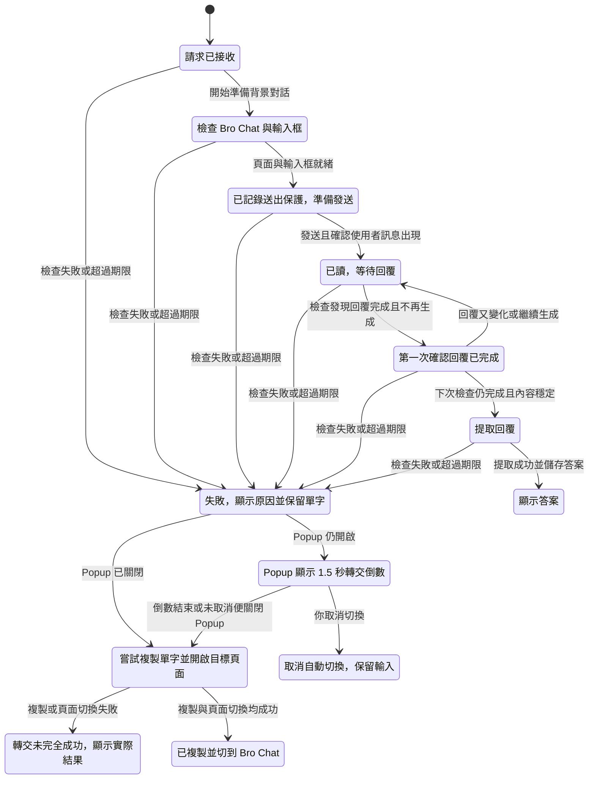

# 送出單字後的生命週期與失敗退路

- 日期：2026-11-02
- 產品：Talk To Bro（獨立儲存庫，知識存放於本專案）
- 相關實作：[Runner](../../src/sw/runner.ts)、[狀態機](../../src/shared/talk-machine.ts)、[輪詢判定](../../src/shared/tick.ts)、[Handoff](../../src/sw/handoff.ts)、[Popup](../../src/popup/popup.ts)、[畫面狀態](../../src/popup/view-state.ts)

## 對話核心摘要

- 接收單字後，先檢查 Bro Chat 與輸入框；執行發送之前，先持久化送出保護狀態。只有確認使用者訊息已出現，才進入等待並顯示「已讀」。
- 現行快速檢查約每 **2 秒**一次，另有約 **30 秒**的 watchdog。不是每秒輪詢，也不是精準的牆鐘排程保證。
- 回覆內容變化會刷新閒置計時；連續兩次判定回覆完成且穩定後，才提取、儲存並顯示答案。
- 等待回覆的主要期限為無內容變化 **30 秒**、送出後總計 **180 秒**，不是一律等待滿 180 秒才報錯。
- 失敗時保留單字並顯示原因。Popup 開啟時先顯示可取消的 **1.5 秒**轉交倒數；轉交只會「嘗試」複製與切頁，必須區分成功與部分失敗。

## 為什麼要區分這些階段

送出按鈕被點擊、Gemini 確認收到訊息、回覆停止生成，以及答案成功提取，是四個不同事件。混成單一「處理中」容易導致誤判成功或中斷後重複送出。

Service Worker 驅動流程並持久化狀態，Popup 依儲存變化渲染；Popup 自己的 HUD 計時器只是顯示用途，不控制背景回覆判定。

## 核心流程圖

以下保留本次對話產出的全部 13 個節點與 19 條轉移，不因整理文件刪除失敗分支。它是單次請求的簡化讀者模型，不是完整重啟恢復狀態圖。

### 檢查與計時

| 機制 | 現行行為 | 實作依據 |
|---|---|---|
| 快速 probe | 等待階段每次設定約 2 秒延遲，完成一次檢查後再排下一次；單次只容許一個 tick 執行 | [runner.ts](../../src/sw/runner.ts) |
| Watchdog | Chrome alarm 週期為 0.5 分鐘，作為背景喚醒與檢查途徑 | [runner.ts](../../src/sw/runner.ts) |
| 閒置期限 | 文字變長，或非空文字的簽章改變，都視為內容變化並刷新計時 | [tick.ts](../../src/shared/tick.ts) |
| 總期限 | Runner 在等待階段、呼叫 probe 前，先檢查送出後是否已達 180 秒 | [runner.ts](../../src/sw/runner.ts) |
| 完成確認 | 必須回報完成且不再生成；內容變化時完成連續次數重新從 1 計算 | [tick.ts](../../src/shared/tick.ts) |
| 畫面 HUD | 每秒更新顯示，不代表背景每秒 probe | [popup.ts](../../src/popup/popup.ts) |

`evaluateTick` 先處理登入、錯誤對話與額度問題，再判定內容變化與完成；第二次穩定完成可先於該函式的閒置期限分支返回。送出前與提取階段也各有獨立期限，不能把 30／180 秒當成所有階段共用的唯一期限。

### 失敗轉交不是成功保證

Popup 倒數結束後先嘗試透過剪貼簿 API 複製，再要求 SW 切頁；必要時 SW 使用 Offscreen Document 複製。若 Popup 在未取消時關閉，由 SW 接續轉交。

取消的轉交不應自動執行；成功或部分完成的轉交也有重複執行防護。未設定 Bro Chat 時無法切到該對話，改開設定頁。介面應以實際 `copied`／`focused` 結果呈現，不能把「已切頁」寫成「已成功複製」。

## 中斷恢復與模型邊界

[reconcile.ts](../../src/sw/reconcile.ts) 區分 Service Worker 重啟與整個瀏覽器重啟：

- 同一瀏覽器工作階段內，送出前可恢復準備；停在送出中時只查證訊息是否已送出，不盲目再點發送；等待與提取可恢復。
- 瀏覽器重啟時，未完成請求標記中斷，轉交延後至明確操作，不自動搶焦點。

這些恢復分支、空白／忙碌提交拒絕、細分錯誤碼，以及同一畫面狀態內的步驟，未納入上述圖。部分晚到成功與恢復失敗路徑會直接終結請求，並不全部經過一般的自動轉交處理；因此圖中的失敗分支不可解讀為每個錯誤都保證啟動倒數。

本次有限 TLA+ 模型檢查得到 19 個模型狀態、32 個步驟；顯示為 13 個節點、19 條箭頭，省略 7 個維持同一圖示狀態的步驟。型別、答案必須已確認送出及無死鎖規則成立。這只驗證所建模型，不代表完整擴充套件無缺陷，也未證明所有非確定性路徑最終完成。

## 維護與驗證 SOP

1. 修改送出或等待流程前，一起核對 [狀態機](../../src/shared/talk-machine.ts)、[Runner](../../src/sw/runner.ts) 與 [tick 判定](../../src/shared/tick.ts)，不要只看 Popup 文案。
2. 修改輪詢頻率時，區分快速計時器、watchdog 與 HUD 顯示頻率；同步更新本文件與[專案總覽](../../README.md)。
3. 修改失敗文案時，核對 [Handoff](../../src/sw/handoff.ts) 與 [failureViewOf](../../src/popup/view-state.ts) 的實際複製與切頁結果。
4. 重新建立模型時，保留真實狀態與規則；若出現反例，逐步回放至真實程式或測試，不因模型通過就宣稱程式已通過。
5. 本次為文件整理，未改動產品程式；模型檢查與圖表語法驗證不替代產品測試。

## 延伸閱讀

- [技術設計與開發計畫](../tech-spec/2026-10-28-talk-to-bro-personally-tech-design-and-plan.md)
- [M5 失敗偵測、恢復與 Handoff 計畫](../plans/2026-10-29-m5-failure-detection-matrix-watchdog-recovery-and-offscreen-handoff.md)
- [Popup 畫面狀態](../../src/popup/view-state.ts)
