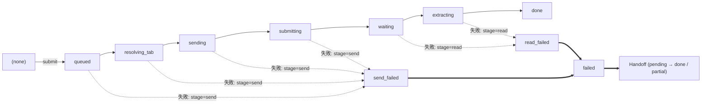

# Plan: Talk To Bro Personally 技術規格書 (Tech Spec) 格式化與工具鏈相容性修復

- **日期**：2026-10-28
- **所屬產品**：[talk-to-bro-personally](file:///Volumes/Extended/Documents/Developments/projects/agentic-development/products/talk-to-bro-personally/README.md)
- **目標檔案**：[`products/talk-to-bro-personally/docs/tech-spec/2026-10-28-talk-to-bro-personally-tech-design-and-plan.md`](file:///Volumes/Extended/Documents/Developments/projects/agentic-development/products/talk-to-bro-personally/docs/tech-spec/2026-10-28-talk-to-bro-personally-tech-design-and-plan.md)
- **關聯工具**：[`products/agentic-env/tools/notion-sync/`](file:///Volumes/Extended/Documents/Developments/projects/agentic-development/products/agentic-env/tools/notion-sync/README.md) (`nsync`)
- **狀態**：Drafted / Pending Review

---

## 1. 目標 (Objective)

修復從 Notion 直接下載之原始技術規格書檔案 [`2026-10-28-talk-to-bro-personally-tech-design-and-plan.md`](file:///Volumes/Extended/Documents/Developments/projects/agentic-development/products/talk-to-bro-personally/docs/tech-spec/2026-10-28-talk-to-bro-personally-tech-design-and-plan.md)，使其全面符合專案規範與工具鏈要求：
1. **套用 `nsync` 雙層可攜式標記**：透過 `notion_to_portable_markdown` 轉換所有 `<callout>`、`<mention-page>`，保留 `<!-- nsync:... -->` 註解，確保日後可透過 `nsync push` 無損推回 Notion。
2. **清理 Orca / CommonMark 不相容標記**：
   - 移除標題中的 `{toggle="true"}` Notion 私有屬性，使目錄（TOC）正常解析。
   - 清理所有行首不正常之 Tab（`\t`）縮排，轉為標準 2 空格或無縮排，徹底消除 CommonMark 將段落與 Mermaid 誤判為縮排程式碼塊的問題。
3. **遵循 [`AGENTS.md`](file:///Volumes/Extended/Documents/Developments/projects/agentic-development/AGENTS.md) 圖表規範**：
   - 將 §2.2 狀態機的純文字 ASCII 框線圖重構為標準 Mermaid 流程圖（`flowchart LR`），嚴格禁止純文字 ASCII。
   - 修復 §1.4 縮排失效之 Mermaid 時序圖。
4. **結構梳理與 Arena 歷史保留**：
   - 維護開頭 YAML Frontmatter 完整無誤。
   - 保留完整的技術設計內容（§0 至 §10）以及後續之 Arena Synthesis note 與候選模型對決記錄，但在語法與縮排層面完全標準化。

---

## 2. 修復規格與對照表

| 項目 | 原有非相容語法 (Notion Raw) | 修正後標準語法 (Portable Markdown) | 效益 |
| :--- | :--- | :--- | :--- |
| **Callout 區塊** | `<callout icon="💡" ...>\n\t內容\n</callout>` | `<!-- nsync:callout ... -->\n> 💡 內容\n<!-- /nsync:callout -->` | 消除未閉合 XML 節點衝突，維持雙向推回能力 |
| **頁面引用** | `<mention-page url="..."/>` | `[📄 Notion Page](url)<!-- nsync:mention-page -->` | 消除自閉合 HTML 標籤導致 DOM 被吞噬問題 |
| **相對連結** | `](/p/xxx)` | `](https://app.notion.com/p/xxx)<!-- nsync:rel-link -->` | 展開為可點擊全域連結並具備回寫能力 |
| **狀態機圖表** | ASCII 框線圖 (L295-L301) | Mermaid `flowchart LR` | 100% 符合 AGENTS.md 圖表規範 |
| **時序圖縮排** | `\t\t```mermaid` (L2181) | ```` ```mermaid ```` (無前綴 Tab) | 修復 CommonMark 誤判為縮排代碼塊，恢復圖表渲染 |
| **標題屬性** | `## 標題 {toggle="true"}` | `## 標題` | 移除私有語法，使 Orca 目錄能乾淨索引標題 |
| **段落與代碼縮排** | 內文帶 `\t` (Tab) | 改為標準空格縮排或頂格 | 避免 Markdown 產生破裂的 `<pre><code>` 區塊 |

---

## 3. 圖表重構細節 (§2.2 狀態機)

### 原始 ASCII 框線圖 (違反 AGENTS.md)：
```text
 (none) ─submit─▶ queued ─▶ resolving_tab ─▶ sending ─▶ submitting ─▶ waiting ─▶ extracting ─▶ done
                    └──────────────┴────────────┴────────────┘          └────────────┘
                         失敗：stage=send → send_failed            失敗：stage=read → read_failed
                                          ▼                                  ▼
                                        failed ──▶ Handoff（pending → done / partial）
```

### 重構後之標準 Mermaid 語法：


---

## 4. 執行步驟

1. **執行編解碼轉換腳本**：
   調用 `products/agentic-env/tools/notion-sync/nsync/format.py` 的 `notion_to_portable_markdown` 處理檔案內文，轉換所有 `<callout>`、`<mention-page>` 與相對連結。
2. **清洗 Notion 私有標籤與 Tab**：
   - 使用正規表達式移除所有 `{toggle="true"}`。
   - 移除段落、清單與 Mermaid 區塊前綴的非必要 `\t`。
3. **替換 ASCII 圖表**：
   將 §2.2 的 ASCII 框線圖替換為上述 Mermaid 圖表。
4. **驗證與比對**：
   - 驗證 `portable_to_notion_markdown` 可逆推還原性（Round-trip Lossless Check）。
   - 驗證 Mermaid 語法與無 XML 殘留。
5. **提交變更**。
