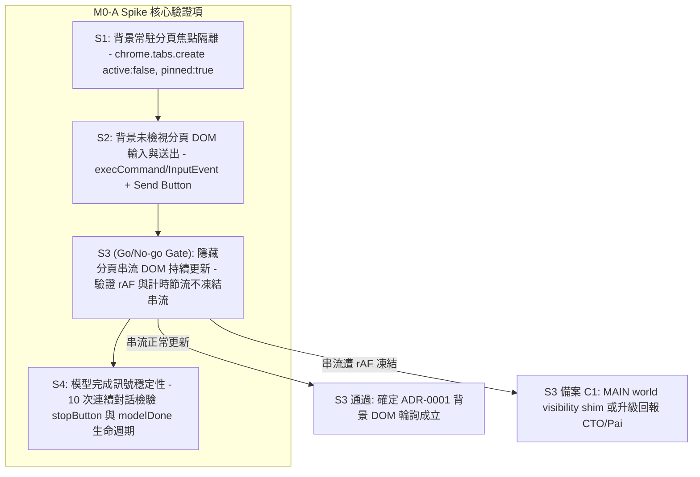
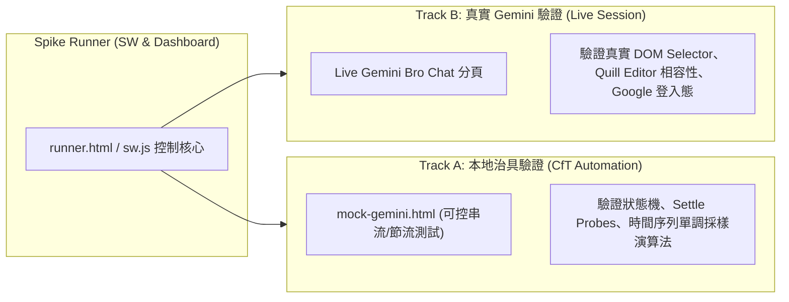

# Plan: M0-A Spike — 背景分頁行為與輸入送出協定原型驗證 (Ticket 01 / #25)

- **日期**：2026-10-28
- **所屬產品**：[talk-to-bro-personally](file:///Volumes/Extended/Documents/Developments/projects/agentic-development/products/talk-to-bro-personally/README.md)
- **工單依據**：[GitHub Issue #25: M0-A Spike](https://github.com/EasonPai/agentic-development/issues/25)（Parent: #24 Epic）
- **執行角色**：Engineer (Reports to CTO: `term_c7268128-7eab-4ebe-80cc-eb8a142462c1`)
- **狀態**：Completed (驗證全數通過，詳見 [Spike Report](2026-10-28-m0-a-spike-report.md))

---

## 1. 背景與核心目標 (Background & Objectives)

在正式投入 `talk-to-bro-personally` 的完整狀態機、UI 與音效/剪貼簿開發前，必須先透過最小原型（Disposable Prototype Extension）驗證最關鍵的瀏覽器行為與 ADR-0001 前提假設。

本 Spike 聚焦於驗收標準 S1 至 S4：



### 驗收標準 (Acceptance Criteria)

1. **S1 (焦點隔離)**：`chrome.tabs.create({ active: false, pinned: true })` 開啟背景釘選分頁時，絕不搶走當前視窗焦點或當前作用元素（`document.activeElement`）之輸入游標。
2. **S2 (背景輸入送出)**：在「從未顯示過之全新分頁」與「已隱藏超過 10 分鐘之分頁」中，透過程式化注入文字（`insertText` / DOM 事件）並點擊送出，均能成功建立合法的 `user-query` 節點。
3. **S3 (Go/No-go 關鍵閘門)**：分頁在背景隱藏超過 5 分鐘後發送 10 字以上 Talk，Probe 每秒採樣之 `textLength` 呈時間序列單調遞增，且最終字數與切回前景所見完全吻合（證明 Angular/Zone.js 變更偵測不因背景 rAF 暫停而凍結）。
4. **S4 (完成訊號可靠性)**：連續執行 10 次 Talk，完整觀察 `stopButton` 出現、消失與 `modelDone` 節點出現之生命週期，10 次皆正確判定完成，無任何提早截斷。

---

## 2. 原型架構與目錄結構 (Architecture & Layout)

Spike 原型以隔離的輕量 MV3 Extension 形式構建於 `products/talk-to-bro-personally/spikes/m0-a/`：

```
products/talk-to-bro-personally/spikes/m0-a/
├── manifest.json            # MV3 擴充套件設定 (tabs, scripting, storage)
├── sw.js                    # Background Service Worker (測試排程器與狀態探針)
├── adapter.js               # Gemini DOM 介接原型 (含 selectors 與 insertion 邏輯)
├── runner.html              # 測試儀表板 (視覺化觸發 S1-S4 測試並呈現採樣圖表)
├── runner.js                # 儀表板控制邏輯 (接收 SW 廣播與結果日誌)
└── fixtures/                # 本地可控測試治具 (供 CfT 自動化重現)
    ├── mock-gemini.html     # 模擬 Gemini DOM 階層與串流節奏之本地頁面
    └── mock-gemini.js       # 模擬 SSE 串流打字機渲染與 modelDone 行為
```

### 雙軌驗證架構 (Dual-Track Validation Strategy)



1. **Track A (本地可控治具)**：使用標準 HTTP/本地伺服器掛載 `fixtures/mock-gemini.html`，以確定性的延遲（如每 200ms 長出一個單字）模擬真實 Gemini 的串流行為，供自動化測試驗證連續 10 次的訊號判定與邊界情況。
2. **Track B (真實 Gemini Live 驗證)**：在 Chrome for Testing (CfT) 實例中載入真實 Bro Chat URL，實機驗證真實 Google Gemini DOM（包含 Quill editor、Angular 自定義標籤、zh-TW 介面語言）。

---

## 3. 詳細驗證協定 (Verification Protocols)

### S1: 背景開釘選分頁不搶焦點 (Focus Isolation)
- **測試步驟**：
  1. 在前景分頁中聚焦於文字輸入框（`<input>` 或 `<textarea>`），記錄 `document.activeElement` 與游標位置。
  2. 透過 SW 調用 `chrome.tabs.create({ url: targetUrl, active: false, pinned: true })`。
  3. 檢驗前景分頁的 `window.document.hasFocus()` 是否維持 `true`，`chrome.tabs.query({ active: true, currentWindow: true })` 是否未改變，游標是否仍留在輸入框內。
- **通過準則**：目前分頁與輸入焦點 100% 不受干擾。

### S2: 背景分頁文字插入與送出 (Input Insertion Protocol)
- **測試步驟**：
  1. 分別在兩個分頁執行：
     - Case 2.1：剛建立且**從未被切換檢視過**的全新背景分頁。
     - Case 2.2：已切換至其他分頁、隱藏在背景**超過 10 分鐘**的分頁。
  2. 注入 `adapter.js`，依照 Tech Spec §3.4 流程嘗試插入文字：
     - 路徑 A：`editor.focus()` → `document.execCommand('insertText', false, text)`。
     - 備用語法 B：若 A 失敗，更新 `innerHTML` 並 dispatch `new InputEvent('input', { bubbles: true })`。
     - 驗證 `normalize(editor.innerText) === normalize(text)`。
  3. 監控 Send Button 轉為啟用狀態（`!disabled && aria-disabled !== 'true'`），觸發 `sendButton.click()`。
  4. 驗證頁面出現新的 `user-query` 節點且文字完全相符。
- **通過準則**：兩者皆產生合法之 user turn，且不需將分頁聚焦或喚醒。

### S3 (Go/No-go): 隱藏分頁串流 DOM 持續更新 (Streaming DOM Updates)
- **測試步驟**：
  1. 將 Bro Chat 分頁置於背景隱藏至少 5 分鐘（`document.visibilityState === 'hidden'`）。
  2. 透過 SW 發送一則包含 10 個英文單字的多詞 Talk（例如 `"meticulous, persistent, elaborate, profound, ubiquitous, resilient, versatile, subtle, coherent, pragmatic"`）。
  3. SW 每 500ms 進行一次 probe，記錄 `textLength` 時間序列數組：`[{ timestamp, textLength, generating }]`。
  4. 驗證 `textLength` 數組呈現漸進階梯式或連續上升曲線，而非在背景停留於 0、直到切回前景才一次突增。
  5. 回覆完成後切回前景分頁，核對背景最終採樣之 `textLength` 與前景實際渲染字數是否一致。
- **通過準則**：背景隱藏期間 DOM 長度持續增長，確定無 rAF 凍結問題。
- **Go/No-go 決策邊界**：
  - 若通過：直接確認 ADR-0001 架構成立，進入後續 Milestone。
  - 若失敗（凍結）：啟動備案 C1（評估注入 MAIN world visibility shim），並發送跨終端事件通知 CTO 與使用者（Pai）決定。

### S4: 完成訊號可靠性 (Completion Signal Reliability)
- **測試步驟**：
  1. 執行 10 次連續對話（每筆間隔 2 秒）。
  2. 針對每一次 Talk，記錄以下生命週期時間點：
     - $T_0$：點擊送出。
     - $T_1$：`generating === true`（偵測到 `stopButton` 出現）。
     - $T_2$：`generating === false`（`stopButton` 消失）。
     - $T_3$：`modelDone`（操作按鈕列）渲染完成。
     - $T_4$：連續 2 次 Probe（Settle Check）`textLength` 保持穩定不變。
  3. 驗證每一次的 $T_2 \le T_3 \le T_4$，且無任何一次發生提前在 $T_1$ 期間截斷的現象。
- **通過準則**：10 次連續對話之完成判定 100% 成功，無偽陽性（False Positive）或死結。

---

## 4. 實作開發步驟與進度拆解

1. **Step 1: 建立 Spike 擴充套件骨架**
   - 建立 `products/talk-to-bro-personally/spikes/m0-a/manifest.json` 與基礎檔案。
   - 實作 `adapter.js` 中的 Gemini DOM 選擇器清單（`GEMINI` object）與安全比對工具。
2. **Step 2: 實作測試治具與自動化驗證頁面 (Track A)**
   - 建立 `fixtures/mock-gemini.html` 與 `fixtures/mock-gemini.js`。
   - 實作模擬打字串流與完成操作列。
3. **Step 3: 實作 SW 測試排程器與 Runner Dashboard**
   - 實作 `sw.js`：包含 `runS1()`, `runS2()`, `runS3()`, `runS4()`。
   - 實作 `runner.html`：顯示即時測試結果、時間序列採樣曲線與日誌。
4. **Step 4: 執行 CfT 實機自動化驗收與真實 Gemini 驗收**
   - 在 Chrome for Testing (`~/.chrome-cdp-profile`) 中載入 unpacked 擴充套件進行實機驗收。
5. **Step 5: 撰寫 Spike 總結報告與工單回報**
   - 產出 `products/talk-to-bro-personally/docs/plans/2026-10-28-m0-a-spike-report.md`。
   - 回報 CTO 與 PM。

---

## 5. 跨角色回報與風險控制

- **指派與回報鏈**：Engineer 承擔主動事件回報責任（Event-driven notifications），嚴禁輪詢主管。
- **CTO 諮詢路由**：`term_c7268128-7eab-4ebe-80cc-eb8a142462c1`。若 S3 遇到 rAF 節流或 DOM 選擇器需要重大決策，立即發送跨終端訊息。
- **完成交付成果**：產出完整的測試數據、DOM fixture 與驗收報告，通知 PM 更新 GitHub Issue #25。
