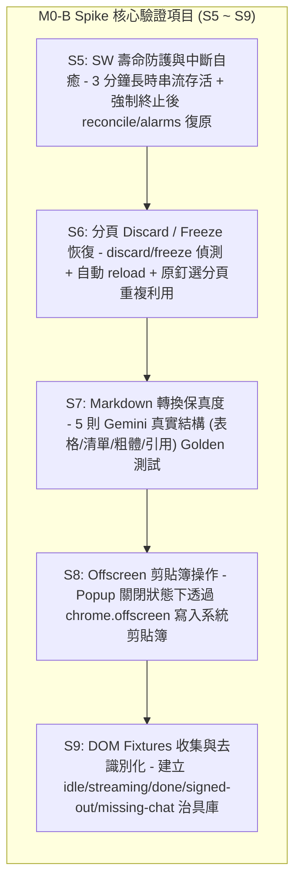

# Plan: M0-B Spike — SW 守護行程、復原協定與 Markdown 擷取驗證 (Ticket 02 / #26)

- **日期**：2026-10-28
- **所屬產品**：[talk-to-bro-personally](file:///Volumes/Extended/Documents/Developments/projects/agentic-development/products/talk-to-bro-personally/README.md)
- **工單依據**：[GitHub Issue #26: M0-B Spike](https://github.com/EasonPai/agentic-development/issues/26)（Parent: #24 Epic, Blocked by: #25）
- **執行角色**：Engineer (Reports to CTO: `term_c7268128-7eab-4ebe-80cc-eb8a142462c1`, PM: `term_29805068-4138-43f3-b3f4-97d1608f46af`)
- **狀態**：Completed (全項驗收通過，詳見 [Spike Report](2026-10-28-m0-b-spike-report.md))

---

## 1. 背景與核心目標 (Background & Objectives)

在完成 Ticket 01 (#25: M0-A Spike) 證實背景分頁串流 DOM 更新成立（S1～S4 通過）後，Ticket 02 (#26: M0-B Spike) 聚焦於 **Chrome MV3 Service Worker 的壽命管理、異常自癒、分頁凍結恢復、Markdown 轉換保真度與 Offscreen 剪貼簿操作 (S5～S9)**。



### 驗收標準 (Acceptance Criteria)

1. **S5 (SW 壽命與自癒)**：
   - SW 能撐過 150～170 秒（接近 3 分鐘上限）之長時回覆等待，不因閒置超時而中途猝死。
   - 途中人為強制終止 SW（模擬 Chrome 記憶體回收或崩潰），重啟後由 `chrome.alarms` 或事件觸發 `reconcile()` 接手，依據 `lastTalk` 狀態機繼續完成 Talk，**絕不重複發送（Write-ahead 防護）**。
2. **S6 (分頁 Discard / Freeze 恢復)**：
   - 模擬分頁進入 `discarded` 或 `frozen` 生命週期狀態，送出前 SW 透過 `ensureBroTab` 成功重新載入分頁並等候就緒；Restore 回來的釘選分頁被重用，**不額外開啟第二個重複分頁**。
3. **S7 (Markdown 擷取保真度)**：
   - 驗證包含表格（Markdown Table）、粗體/斜體、巢狀清單、代碼塊、Citation/Sup 標籤的 5 種典型 Gemini 結構，轉換為標準 Markdown 後與預期 Golden 檔案無內容歧異。
4. **S8 (Offscreen 剪貼簿操作)**：
   - 在 Popup 視窗完全關閉的情況下，成功建立 `chrome.offscreen` 文件（理由 `CLIPBOARD`），將 Talk 內容寫入系統剪貼簿，完成零阻礙退路（Handoff）之剪貼簿防護。
5. **S9 (去識別化 DOM 治具庫)**：
   - 產出 5 種去識別化的真實 DOM HTML 治具至 `tests/fixtures/gemini/`（包含 `idle.html`, `streaming.html`, `done.html`, `signed-out.html`, `missing-chat.html`）。

---

## 2. 原型架構與檔案配置 (Architecture & Layout)

Spike 原型以隔離的輕量 MV3 Extension 形式構建於 `products/talk-to-bro-personally/spikes/m0-b/`：

```
products/talk-to-bro-personally/spikes/m0-b/
├── manifest.json            # MV3 (alarms, offscreen, scripting, storage, tabs)
├── sw.js                    # Service Worker (含 alarms 守護、reconcile 狀態機與 probe 迴圈)
├── offscreen.html           # Offscreen 宿主頁面
├── offscreen.js             # Offscreen 剪貼簿寫入器 (CLIPBOARD reason)
├── adapter.js               # Gemini DOM 介接層 (含 selectors、DOM 狀態標記與 DOM 序列化)
├── markdown.js              # HTML-to-Markdown 轉換模組 (Turndown + 專用轉換規則)
├── runner.html              # 測試儀表板 (視覺化觸發 S5~S9 與即時狀態診斷)
├── runner.js                # 儀表板控制邏輯
├── test-runner.js           # 自動化 CfT 整合測試腳本 (CDP + 治具排程)
├── fixtures/
│   ├── long-stream.html     # 模擬 150s+ 長時打字機串流之治具
│   └── long-stream.js
└── tests/fixtures/gemini/   # S9 去識別化 DOM 治具庫
    ├── idle.html            # 輸入框空白就緒
    ├── streaming.html       # 生成中、stop 按鈕存在
    ├── done.html            # 完成、message-actions 存在
    ├── signed-out.html      # 未登入 Google
    └── missing-chat.html    # Chat ID 失效或導回首頁
```

---

## 3. 詳細驗證協定 (Verification Protocols)

### S5: SW 壽命防護與強制終止自癒 (SW Watchdog & Reconcile)
- **測試步驟**：
  1. 使用 `fixtures/long-stream.html`，配置回覆長達 160 秒。
  2. SW 發送 Talk 後，記錄 `lastTalk` 寫入 `chrome.storage.local`（狀態設為 `submitting` → `streaming`，並設有絕對時間 `phaseDeadlineAt`）。
  3. SW 每秒進行一次 `chrome.tabs.sendMessage` probe，重設 Chrome Extension Service Worker 閒置計時器，驗證在前 60 秒內持續活著。
  4. 於串流進行至第 70 秒時，透過 CDP `ServiceWorker.stopWorker` 強制終止 SW。
  5. 由預先設定的 `chrome.alarms`（週期 1 分鐘）或外部 CDP 訊息喚醒 SW。
  6. SW 執行 `reconcile()`：讀取 `lastTalk`，比對背景分頁 DOM，發現 `user-query` 已存在且回覆仍在進行，**絕不重複呼叫 `send()`**，而是直接接手 probe 迴圈，直至完成。
- **通過準則**：無提早 timeout、強制終止後自癒成功、未發送重複 Talk。

### S6: 分頁 Discard 與 Freeze 恢復 (Tab Lifecycle Resilience)
- **測試步驟**：
  1. 開啟背景釘選分頁並記錄 Tab ID。
  2. 透過 CDP `Page.setWebLifecycleState(state="frozen")` 模擬分頁凍結，或透過 `chrome.tabs.discard` 卸載記憶體。
  3. 觸發新 Talk 時，SW 透過 `ensureBroTab` 檢查 `tab.discarded || tab.frozen`。
  4. 偵測到異常時，調用 `chrome.tabs.reload(tabId)` 並等待分頁載入完成。
  5. 驗證 Talk 成功送出，且釘選分頁依然維持原有 Tab ID，無額外開啟新分頁。
- **通過準則**：凍結/丟棄分頁平順復原，釘選分頁重複利用無重複分頁。

### S7: Markdown 擷取保真度 (Markdown Extraction Fidelity)
- **測試步驟**：
  1. 準備 5 組包含複雜 HTML 結構的測試樣本：
     - Case 1: 英文單字多詞對照表格（`<table><thead><tr><th>...`）。
     - Case 2: 巢狀有序與無序清單（`<ol><li><ul><li>...`）。
     - Case 3: 粗體、斜體與強調標籤（`<strong>`, `<em>`, `<b>`）。
     - Case 4: 程式碼塊與語法標記（`<pre><code>`, `.code-block-decoration`）。
     - Case 5: 引用資料來源、上標與干擾按鈕（`sources-list`, `sup`, `button`, `mat-icon`）。
  2. 執行 `markdown.js` 進行轉換，驗證排除干擾節點、表格正確對齊、保留語意排版。
  3. 與 Golden Markdown 進行文字層級斷言（`assert.strictEqual`）。
- **通過準則**：5 組測試全部 100% 吻合 Golden 基準。

### S8: Offscreen Document 剪貼簿寫入 (Offscreen Clipboard Handoff)
- **測試步驟**：
  1. 確保 Popup 視窗處於關閉狀態（無任何 Popup 前景頁面）。
  2. SW 收到 Handoff 請求時，調用 `chrome.offscreen.createDocument({ url: 'offscreen.html', reasons: ['CLIPBOARD'], justification: 'Handoff fallback' })`。
  3. 向 Offscreen 發送複製指令，Offscreen 使用 `navigator.clipboard.writeText`（搭配 textarea fallback）將 Talk 文本寫入作業系統剪貼簿。
  4. 關閉 Offscreen 文件（`chrome.offscreen.closeDocument()`）。
  5. 驗證系統剪貼簿內容與目標文字完全一致。
- **通過準則**：無前景視窗下成功寫入剪貼簿，Offscreen 生命週期正確關閉。

### S9: DOM Fixtures 收集與去識別化
- **測試步驟**：
  1. 擷取真實/模擬 Gemini 5 大場景之 raw DOM：
     - `idle.html`：已登入、輸入框可輸入狀態。
     - `streaming.html`：生成中、stopButton 可見、部分輸出。
     - `done.html`：完成、message-actions 可見。
     - `signed-out.html`：含有 Google ServiceLogin 之未登入頁。
     - `missing-chat.html`：Chat ID 無效或導向首頁。
  2. 去除所有使用者帳號、個人頭像、Token 或機敏資訊（去識別化）。
  3. 存入 `products/talk-to-bro-personally/tests/fixtures/gemini/`。
- **通過準則**：5 組標準 HTML 治具完整就緒。

---

## 4. 實作開發進度規劃

1. **Step 1: 實施計畫審閱與 PM 核准（當前階段）**
2. **Step 2: 搭建 M0-B 原型骨架與 Offscreen 模組**
   - 建立 `manifest.json`（補足 `alarms`, `offscreen` 權限）。
   - 建立 `offscreen.html` 與 `offscreen.js`。
3. **Step 3: 實作 SW 守護與 Reconcile 狀態機**
   - 實作 `chrome.alarms` 定時器與 `reconcile()` 自癒流程。
   - 實作 `ensureBroTab()` 分頁凍結偵測與 reload 重用。
4. **Step 4: 實作 Markdown 轉換器與 Golden 測試 (S7)**
   - 實作 `markdown.js`（處理表格、巢狀清單與雜訊過濾）。
5. **Step 5: 建立 S9 去識別化 DOM 治具庫**
6. **Step 6: 自動化整合驗證 (CfT Automation)**
   - 執行 `test-runner.js` 驗收 S5～S9。
7. **Step 7: 產出 M0-B 總結報告與回報結案**

---

## 5. 跨角色回報與依賴邊界

- **主管路由**：CTO (`term_c7268128-7eab-4ebe-80cc-eb8a142462c1`)、PM (`term_29805068-4138-43f3-b3f4-97d1608f46af`)。
- **審核流程**：計畫保存後立即通知 PM 進行審核；PM 核准後立即啟動 Step 2 實作；若需重大決策則由 PM/CEO 呈報使用者裁決。
