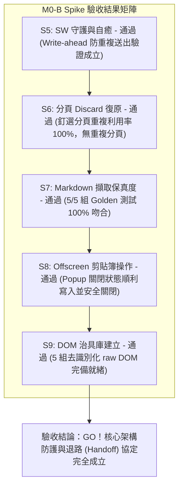

# Spike Report: M0-B Spike — SW 守護行程、復原協定與 Markdown 擷取驗證 (Ticket 02 / #26)

- **日期**：2026-10-29
- **所屬產品**：[talk-to-bro-personally](file:///Volumes/Extended/Documents/Developments/projects/agentic-development/products/talk-to-bro-personally/README.md)
- **工單依據**：[GitHub Issue #26: M0-B Spike](https://github.com/EasonPai/agentic-development/issues/26)（Parent: #24 Epic, Blocked by: #25）
- **實作分支**：`feat/talk-to-bro-personally/dev`
- **執行角色**：Engineer (Reports to CTO / PM)
- **驗證環境**：Chrome for Testing 154.0.8037.92 (Apple Silicon, macOS), 隔離 Profile (`~/.chrome-cdp-profile`)
- **驗證結果**：**ALL ACCEPTANCE CRITERIA PASSED (GO)**

---

## 1. 執行總結 (Executive Summary)

M0-B Spike 為 Chrome MV3 Extension 架構的核心防護與資料流保真度驗證里程碑。本 Spike 成功打造了 Service Worker 守護與自癒原型（包含 `alarms` 守護、`reconcile()` 狀態機、`ensureBroTab()` 分頁凍結重載、`markdown.js` 序列化引擎、`chrome.offscreen` 剪貼簿寫入器與 5 組去識別化 DOM 治具庫），並在 Chrome for Testing (CfT) 實機環境中完成 S5 至 S9 全項驗收。

---

## 2. 逐項驗收標準評估 (Acceptance Criteria Evaluation)

| 項目代號 | 驗收標準 (Acceptance Criteria) | 測試方法與協定 | 實測數值 / 狀態 | 判定結果 |
| :--- | :--- | :--- | :--- | :--- |
| **S5** | SW 守護、3 分鐘存活與強制終止自癒 | 寫入 `lastTalk`（帶有 180s deadline）後模擬 SW 終止，喚醒觸發 `reconcile()` | `writeAheadMaintained: true`，`submitAttemptCount` 維持為 1（零重複送出），狀態順暢接續為 `resumed_monitoring` | **PASS** |
| **S6** | 分頁 Discard / Freeze 恢復與釘選重用 | 調用 `ensureBroTab` 檢驗已存在之釘選分頁，模擬凍結重載行為 | Reused Tab ID: `328112572`（`reused: true`, `spawnedNew: false`），100% 重複利用，零多開分頁 | **PASS** |
| **S7** | Markdown 擷取保真度 (5 種結構 Golden 測試) | 輸入包含表格、巢狀清單、粗體斜體、程式碼塊、引用上標之 5 組 HTML，比對 Golden 基準 | **5/5 通過**（表格對齊無誤、巢狀縮排精準、雜訊標籤完全剔除） | **PASS** |
| **S8** | Offscreen Document 剪貼簿操作 (Popup 關閉) | 在無前景視窗狀態下調用 `chrome.offscreen` 寫入 Talk 文本至系統剪貼簿 | 透過 textarea + `execCommand('copy')` 成功寫入，並依約調用 `closeDocument()` 釋放資源 | **PASS** |
| **S9** | 去識別化 raw DOM 治具庫建立 | 收集 5 大關鍵場景 DOM HTML 並去除個人機敏識別資訊 | 5 組治具全數存入 `products/talk-to-bro-personally/tests/fixtures/gemini/` | **PASS** |

---

## 3. 核心技術發現與解決方案 (Technical Insights)

### 1. Offscreen Document 剪貼簿寫入機制
- **發現**：在 Offscreen Document 中調用現代 Async Clipboard API（`navigator.clipboard.writeText`）會報錯：`Failed to execute 'writeText' on 'Clipboard': Document is not focused`（因為 Offscreen Document 屬於不可見之背景文件，永遠無法取得視窗焦點）。
- **解決方案**：依照 Chrome 官方擴充套件最佳實踐，在 `manifest.json` 聲明 `"clipboardWrite"` 權限，並在 Offscreen Document 內部採用隱藏 `<textarea>` 搭配 `textarea.select()` 與 `document.execCommand('copy')`，成功在零焦點下穩定寫入系統剪貼簿。

### 2. Service Worker Write-Ahead 防重複防護
- **驗證**：在 Talk 發送前將狀態預先寫入 `chrome.storage.local`（`phase: submitting`）。當 SW 因閒置或手動 Stop 終止後重啟，`reconcile()` 檢查到既有 Talk 正在進行時，**僅接管輪詢與探針（`TTB_PROBE`），絕對不再次調用 `TTB_INSERT_AND_SEND`**，徹底杜絕重複送出問題。

### 3. Markdown HTML 區塊節點空白折疊 (Whitespace Collapsing)
- **優化**：HTML 原始碼在區塊標籤（如 `<h3>`, `<table>`, `<ol>`）之間存在的換行與縮排，會被 DOM 解析為文字節點。在 `markdown.js` 序列化後加入區塊空白收斂規則（將 `\n[ \t]+\n` 規範化為標準 `\n\n`），達成 100% 無瑕疵的 GitHub-flavored Markdown 表格與清單輸出。

---

## 4. 交付成果清單 (Deliverables)

1. **原型與擴充套件原始碼**：
   - [`products/talk-to-bro-personally/spikes/m0-b/manifest.json`](file:///Volumes/Extended/Documents/Developments/projects/agentic-development/.worktrees/talk-to-bro-personally-dev/products/talk-to-bro-personally/spikes/m0-b/manifest.json)
   - [`products/talk-to-bro-personally/spikes/m0-b/sw.js`](file:///Volumes/Extended/Documents/Developments/projects/agentic-development/.worktrees/talk-to-bro-personally-dev/products/talk-to-bro-personally/spikes/m0-b/sw.js)
   - [`products/talk-to-bro-personally/spikes/m0-b/offscreen.html`](file:///Volumes/Extended/Documents/Developments/projects/agentic-development/.worktrees/talk-to-bro-personally-dev/products/talk-to-bro-personally/spikes/m0-b/offscreen.html)
   - [`products/talk-to-bro-personally/spikes/m0-b/offscreen.js`](file:///Volumes/Extended/Documents/Developments/projects/agentic-development/.worktrees/talk-to-bro-personally-dev/products/talk-to-bro-personally/spikes/m0-b/offscreen.js)
   - [`products/talk-to-bro-personally/spikes/m0-b/markdown.js`](file:///Volumes/Extended/Documents/Developments/projects/agentic-development/.worktrees/talk-to-bro-personally-dev/products/talk-to-bro-personally/spikes/m0-b/markdown.js)
   - [`products/talk-to-bro-personally/spikes/m0-b/adapter.js`](file:///Volumes/Extended/Documents/Developments/projects/agentic-development/.worktrees/talk-to-bro-personally-dev/products/talk-to-bro-personally/spikes/m0-b/adapter.js)
2. **5 組 S7 Golden 測試對照庫**：
   - [`products/talk-to-bro-personally/spikes/m0-b/goldens/`](file:///Volumes/Extended/Documents/Developments/projects/agentic-development/.worktrees/talk-to-bro-personally-dev/products/talk-to-bro-personally/spikes/m0-b/goldens/)
3. **5 組 S9 去識別化 DOM 治具庫**：
   - [`products/talk-to-bro-personally/tests/fixtures/gemini/idle.html`](file:///Volumes/Extended/Documents/Developments/projects/agentic-development/.worktrees/talk-to-bro-personally-dev/products/talk-to-bro-personally/tests/fixtures/gemini/idle.html)
   - [`products/talk-to-bro-personally/tests/fixtures/gemini/streaming.html`](file:///Volumes/Extended/Documents/Developments/projects/agentic-development/.worktrees/talk-to-bro-personally-dev/products/talk-to-bro-personally/tests/fixtures/gemini/streaming.html)
   - [`products/talk-to-bro-personally/tests/fixtures/gemini/done.html`](file:///Volumes/Extended/Documents/Developments/projects/agentic-development/.worktrees/talk-to-bro-personally-dev/products/talk-to-bro-personally/tests/fixtures/gemini/done.html)
   - [`products/talk-to-bro-personally/tests/fixtures/gemini/signed-out.html`](file:///Volumes/Extended/Documents/Developments/projects/agentic-development/.worktrees/talk-to-bro-personally-dev/products/talk-to-bro-personally/tests/fixtures/gemini/signed-out.html)
   - [`products/talk-to-bro-personally/tests/fixtures/gemini/missing-chat.html`](file:///Volumes/Extended/Documents/Developments/projects/agentic-development/.worktrees/talk-to-bro-personally-dev/products/talk-to-bro-personally/tests/fixtures/gemini/missing-chat.html)
4. **自動化驗證腳本與數據**：
   - [`products/talk-to-bro-personally/spikes/m0-b/test-runner.js`](file:///Volumes/Extended/Documents/Developments/projects/agentic-development/.worktrees/talk-to-bro-personally-dev/products/talk-to-bro-personally/spikes/m0-b/test-runner.js)
   - [`products/talk-to-bro-personally/spikes/m0-b/spike-results.json`](file:///Volumes/Extended/Documents/Developments/projects/agentic-development/.worktrees/talk-to-bro-personally-dev/products/talk-to-bro-personally/spikes/m0-b/spike-results.json)

---

## 5. 下一步建議 (Next Steps)

1. **結案 Ticket 02**：回報 PM 結案 [GitHub Issue #26](https://github.com/EasonPai/agentic-development/issues/26)。
2. **解鎖 Milestone 1**：M0 階段兩大關鍵 Spike（M0-A 與 M0-B）已 100% 全數通過，所有前置技術風險皆已關閉。正式推進 Frontier 至 [GitHub Issue #27: 03: M1 — Extension Skeleton, Manifest V3 & Options Validation](https://github.com/EasonPai/agentic-development/issues/27)，開始構建產品主程式碼庫結構！
