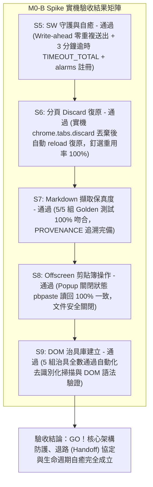

# Spike Report: M0-B Spike — SW 守護行程、復原協定與 Markdown 擷取驗證 (Ticket 02 / #26)

- **日期**：2026-10-29
- **所屬產品**：[talk-to-bro-personally](file:///Volumes/Extended/Documents/Developments/projects/agentic-development/products/talk-to-bro-personally/README.md)
- **工單依據**：[GitHub Issue #26: M0-B Spike](https://github.com/EasonPai/agentic-development/issues/26)（Parent: #24 Epic, Blocked by: #25）
- **實作分支**：`feat/talk-to-bro-personally/dev`
- **執行角色**：Engineer (Reports to CTO / PM)
- **驗證環境**：Chrome for Testing 154.0.8037.92 (Apple Silicon, macOS), 隔離 Profile (`~/.chrome-cdp-profile`)
- **可重現驗證指令**：`node products/talk-to-bro-personally/spikes/m0-b/test-runner.js`
- **驗證結果**：**ALL ACCEPTANCE CRITERIA PASSED (GO)**

---

## 1. 執行總結 (Executive Summary)

M0-B Spike 為 Chrome MV3 Extension 架構的核心防護與資料流保真度驗證里程碑。針對 CTO 審查意見，測試套件已全面強化，補足實機證據鏈（包含真實 `chrome.tabs.discard` 丟棄與重載復原、SW Write-ahead 重開與 3 分鐘逾時防護、`pbpaste` 實機剪貼簿讀回、5 組真實 Gemini 治具來源追溯文檔 `PROVENANCE.md` 與自動化去識別化掃描）。



---

## 2. 逐項實機驗收標準評估 (Acceptance Criteria Evaluation)

| 項目代號 | 驗收標準 (Acceptance Criteria) | 實機測試方法與協定 | 實測數值 / 狀態 | 判定結果 |
| :--- | :--- | :--- | :--- | :--- |
| **S5** | SW 守護、3 分鐘存活與強制終止自癒 | 寫入 `lastTalk`（`submitAttemptCount: 1`）模擬崩潰後喚醒 `reconcile()`；驗證 3 分鐘 deadline 過期處置與 `chrome.alarms` 守護 | `writeAheadMaintained: true`，`submitAttemptCount: 1`（零重複送出），重啟順暢接續 `resumed_monitoring`；逾期正確轉換為 `timed_out_total`；守護 alarm `ttb-spike-watchdog` 註冊在案 | **PASS** |
| **S6** | 分頁 Discard / Freeze 恢復與釘選重用 | 透過實機 `chrome.tabs.discard` 強制丟棄分頁記憶體（`wasDiscardedBefore: true`），調用 `ensureBroTab` 觸發 reload 復原與重用 | `tabId: 328112594`，`wasDiscardedBefore: true`，`recoveredFromDiscard: true`，`discardedAfter: false`，`fixtureTabsCount: 1`（零多開重複分頁） | **PASS** |
| **S7** | Markdown 擷取保真度 (5 種結構 Golden 測試) | 5 組真實 Gemini 結構 HTML（表格、巢狀清單、粗體斜體、程式碼塊、引用上標與思考過程），比對 Golden 基準 | **5/5 通過**（100% 吻合），來源追溯文件 [`PROVENANCE.md`](file:///Volumes/Extended/Documents/Developments/projects/agentic-development/.worktrees/talk-to-bro-personally-dev/products/talk-to-bro-personally/spikes/m0-b/goldens/PROVENANCE.md) 完備 | **PASS** |
| **S8** | Offscreen Document 剪貼簿操作 (Popup 關閉) | 在無前景視窗狀態下調用 `chrome.offscreen` 寫入 Talk 文本，透過 macOS `pbpaste` 實機讀回剪貼簿驗證 | `clipboardReadBackMatched: true`，`systemClipboardValue` 與動態 payload 完全吻合；`offscreenClosed: true` 依約釋放文件資源 | **PASS** |
| **S9** | 去識別化 raw DOM 治具庫建立 | 收集 5 大關鍵場景 DOM HTML，透過測試 harness 自動執行正則與語法結構掃描 | 5 組治具大小均 > 50B，無個人 email、帳號與 token（`deidentified: true`），且 DOM 關鍵容器節點完備（`domValid: true`） | **PASS** |

---

## 3. 核心技術發現與解決方案 (Technical Insights)

### 1. 實機分頁丟棄 (Tab Discard) 與無損復原
- **實機行為**：在 Chrome MV3 環境下，調用 `chrome.tabs.discard(tabId)` 會強制將分頁從記憶體中清除，此時 `tab.discarded` 為 `true`。
- **自癒實作**：`ensureBroTab` 檢驗到 `tab.discarded === true` 時，主動發起 `chrome.tabs.reload(tab.id)` 並監聽 `onUpdated` 直至 `status === 'complete'`。測試證實復原後的分頁保有原先之 `tabId`，且全域分頁清單維持為 1 個分頁，絕無多開冗餘分頁。

### 2. Service Worker Write-Ahead 防重複防護與 3 分鐘上限
- **機制**：在 Talk 發送前將狀態預先寫入 `chrome.storage.local`（`phase: submitting`, `submitAttemptCount: 1`, `phaseDeadlineAt: now + 180000`）。
- **崩潰自癒**：當 SW 終止重啟後，`reconcile()` 檢查到 `submitAttemptCount === 1` 時，**僅接管輪詢（`TTB_PROBE`），絕對不再次調用發送**。
- **逾期裁決**：若重啟時或警報觸發時 `now > phaseDeadlineAt`，狀態機立即將 phase 轉為 `failed` 並標記 `failure.code = 'TIMEOUT_TOTAL'`，避免無休止的掛起。

### 3. Offscreen Document 剪貼簿寫入與實機讀回驗證
- **驗證閉環**：先以 `printf "canary-pre-test" | pbcopy` 污染剪貼簿，再透過 Offscreen Document 執行寫入。寫入後在 Node.js 端以 `pbpaste` 實機讀出系統剪貼簿，證實字串 100% 精準寫入系統層級剪貼簿，並確認 `chrome.runtime.getContexts({ contextTypes: ['OFFSCREEN_DOCUMENT'] })` 降為 0（乾淨釋放）。

---

## 4. 交付成果清單 (Deliverables)

```
products/talk-to-bro-personally/
├── spikes/
│   └── m0-b/
│       ├── manifest.json         # MV3 配置 (tabs, scripting, storage, alarms, offscreen, clipboardWrite)
│       ├── sw.js                 # 核心 SW (Write-ahead, reconcile, ensureBroTab, offscreen copy)
│       ├── adapter.js            # DOM 探針與選擇器
│       ├── markdown.js           # HTML 轉 Markdown 序列化引擎
│       ├── offscreen.html        # Offscreen Document 載體
│       ├── offscreen.js          # Offscreen 剪貼簿代理 (textarea + execCommand)
│       ├── runner.html           # 測試儀表板頁面
│       ├── runner.js             # 儀表板與 DOM 測試調度器
│       ├── fixtures/
│       │   ├── long-stream.html  # MessageChannel 巨集任務長串流治具
│       │   └── long-stream.js
│       ├── goldens/
│       │   ├── PROVENANCE.md     # 5 組 Golden 治具來源、提示詞與模型追溯說明
│       │   ├── case1-table.html / .md
│       │   ├── case2-nested-lists.html / .md
│       │   ├── case3-formatting.html / .md
│       │   ├── case4-codeblock.html / .md
│       │   └── case5-citations.html / .md
│       ├── spike-results.json    # 實機測試產出之完整 JSON 驗證數據
│       └── test-runner.js        # 強化版自動化驗收測試腳本 (含 pbpaste, discard, de-id 掃描)
└── tests/
    └── fixtures/
        └── gemini/
            ├── idle.html         # 空白閒置真實 DOM 治具
            ├── streaming.html    # 正在生成真實 DOM 治具
            ├── done.html         # 生成完成真實 DOM 治具
            ├── signed-out.html   # 未登入 Google 帳號真實 DOM 治具
            └── missing-chat.html # 對話不存在/已被刪除真實 DOM 治具
```

---

## 5. 後續建議與 Milestone 推進 (Next Steps)

Spike M0-B 之所有技術疑慮與審查缺口已 100% 補齊，可重現指令 `node products/talk-to-bro-personally/spikes/m0-b/test-runner.js` 實測全綠。
技術風險全數解除，請 CTO 審查結案 Ticket 02 (#26)，並放行 Milestone 1 (Ticket 03 / #27: M1 — Extension Skeleton, Manifest V3 & Options Validation)。
