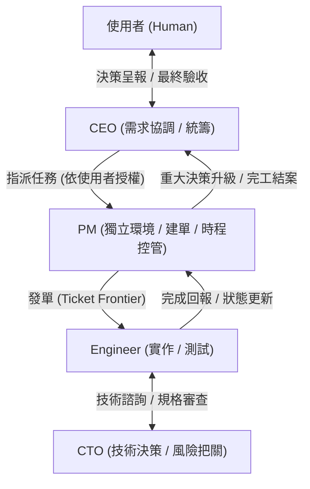

# Plan: Talk To Bro Personally PM 交辦、獨立環境建單與跨角色協同開發計畫

- **日期**：2026-10-28
- **所屬產品**：[talk-to-bro-personally](file:///Volumes/Extended/Documents/Developments/projects/agentic-development/products/talk-to-bro-personally/README.md)
- **發起角色**：CEO (`term_bbec7ea3-a470-4f1e-b25c-2649b925cdb3`)
- **受派角色**：PM (Project Manager)
- **協同角色**：CTO (`term_c7268128-7eab-4ebe-80cc-eb8a142462c1`), Engineer
- **依據文件**：
  - PRD v1.1：[`products/talk-to-bro-personally/docs/prd/2026-10-28-talk-to-bro-personally-prd.md`](file:///Volumes/Extended/Documents/Developments/projects/agentic-development/products/talk-to-bro-personally/docs/prd/2026-10-28-talk-to-bro-personally-prd.md)
  - Tech Spec v1.0：[`products/talk-to-bro-personally/docs/tech-spec/2026-10-28-talk-to-bro-personally-tech-design-and-plan.md`](file:///Volumes/Extended/Documents/Developments/projects/agentic-development/products/talk-to-bro-personally/docs/tech-spec/2026-10-28-talk-to-bro-personally-tech-design-and-plan.md)
- **狀態**：Pending Human Approval

---

## 1. 任務背景與目標 (Objective)

依據使用者（Human）指示，CEO 將新產品 `talk-to-bro-personally` 的開發執行交辦給 PM：
1. **建立獨立環境**：從 `dev` 切出獨立 worktree，避免環境干擾。
2. **初始化規格技能**：在該獨立環境中運行 `setup-matt-pocock-skills`，校驗或配置 issue tracker 與標籤。
3. **拆解垂直工單**：使用 `to-tickets` 將 PRD v1.1 與 Tech Spec v1.0 拆解為具備阻礙相依（blocking edges）的垂直切片工單（tracer-bullet tickets）。
4. **分發工單與角色協同**：
   - 工單發給 Engineer 開發。
   - Engineer 遇技術疑問與 CTO 自主討論。
   - 每個 ticket 完成後 Engineer 回報 PM 更新狀態。
   - 全部完成後 PM 回報 CEO。
   - 涉及使用者決策事項（如 Tech Spec §10 之 Q1-Q5），由 PM 回報 CEO，再由 CEO 呈報使用者裁決。

---

## 2. 決策架構與角色授權矩陣 (Role Matrix & Authority)

| 角色 | 執行終端 / 模型配置 | 核心職責 | 回報對象 |
| :--- | :--- | :--- | :--- |
| **CEO** | `term_bbec7ea3-a470-4f1e-b25c-2649b925cdb3` Gemini 3.8 Flash | 需求協調、優先級與資源決策、向使用者呈報與把關決策閘門 | Human |
| **PM** | 獨立 Worktree / 新終端 Gemini 3.8 Flash (High effort) | 獨立規劃、運行 `setup-matt-pocock-skills`、`to-tickets` 建單、追蹤工單狀態 | CEO / Human |
| **CTO** | `term_c7268128-7eab-4ebe-80cc-eb8a142462c1` GPT-6-Astra (Low effort) | 技術決策、架構規格把關、協助 Engineer 解除技術疑難 | CEO |
| **Engineer**| 專屬開發 Worktree / 終端 Gemini 3.8 Flash (Medium effort) | 依 ticket 進行垂直切片開發、測試、實施 M0 Spike，向 PM 回報 | CTO (技術) / PM (進度) |

---

## 3. 執行階段劃分 (Execution Phases)

### 階段一：獨立環境與 PM 身分綁定 (Isolation & Binding)
1. **建立獨立 Worktree**：
   - 分支：`feat/talk-to-bro-personally/pm-tickets`（基底：`dev`）
   - 目錄：`.worktrees/talk-to-bro-personally-planning`
2. **配置技能存取**：
   - 確保 `.worktrees/talk-to-bro-personally-planning/.agents/skills/` 內具備：
     - `setup-matt-pocock-skills`
     - `to-tickets`
3. **PM 角色綁定**：
   - 執行 `executive-identity.py rebind --role PM --assigned-by human --assigner-evidence "user-prompt-2026-10-28" --report-to term_bbec7ea3-a470-4f1e-b25c-2649b925cdb3`

### 階段二：運行 `setup-matt-pocock-skills` 與環境確認
1. 檢查本專案既有 tracker 配置（`docs/agents/issue-tracker.md` 為 GitHub Issues）。
2. 確認是否為 `talk-to-bro-personally` 開設 GitHub Issues，或採用本地 `.scratch/talk-to-bro-personally/issues/` 模式。
3. 確保 triage labels（`ready-for-agent` 等）就緒。

### 階段三：使用 `to-tickets` 拆解工單 (Vertical Tracer Bullets)
依據 Tech Spec §7 之里程碑（Milestones），產出具備 blocking edges 的工單：
- **Ticket 01 [M0-A]**：背景分頁與輸入送出 Spike（S1 背景 pinned 分頁、S2 隱藏分頁插入送出、S3 隱藏串流 DOM 更新 [Go/No-go]、S4 完成訊號）
- **Ticket 02 [M0-B]**：SW 生命週期與恢復 Spike（S5 3分鐘 watchdog、S6 discard/freeze reload、S7 Markdown 忠實度 golden、S8 offscreen 剪貼簿、S9 fixtures 蒐集）
- **Ticket 03 [M1]**：MV3 基礎骨架、Manifest、Options URL 驗證與 Popup 焦點快捷鍵（F1, F6）
- **Ticket 04 [M2]**：Talk 引擎狀態機、Watchdog 與 Fake Adapter（F5, F8 統計指標純函式）
- **Ticket 05 [M3]**：真 Bro Adapter、Gemini 選擇器隔離、分頁常駐與重用（F7, F2）
- **Ticket 06 [M4]**：HTML 轉 Markdown 擷取、Marked+DOMPurify 渲染、複製回覆（F3, F5）
- **Ticket 07 [M5]**：全失敗偵測對照表、三層 Watchdog、Offscreen 剪貼簿與 Handoff 退路（F4）
- **Ticket 08 [M6]**：Talk Log 成功率 UI、Pip 像素人設（五種狀態）、本機 README（F8）
- **Ticket 09 [M7]**：除錯選項收尾、去識別化、雙週試用驗收與指標檢核

### 階段四：派發 Engineer 開發與狀態循環
1. PM 依 blocking edges 啟動 Frontier Tickets，指派 Engineer 開始開發。
2. Engineer 在獨立開發分支實作並跑通測試。
3. 若 Engineer 遭遇技術不確定性：透過 Orca 終端與 CTO（`term_c7268128-7eab-4ebe-80cc-eb8a142462c1`）討論確認。
4. 每完成一個 Ticket，Engineer 主動向 PM 發送完成事件，PM 更新該 Ticket 狀態為已完成並釋放下游 Ticket。

### 階段五：關鍵決策升級與完工總結
1. 若遇到 Tech Spec §10 待決問題（如 S3 背景分頁串流是否更新之重大分歧、Gemini 畫面 Handoff 提示形式等）：PM 立即回報 CEO，CEO 暫停自動化並呈報使用者裁決。
2. 所有 Ticket 完成後，PM 產出全案驗收總結，回報 CEO，由 CEO 向使用者展示最終成果。

---

## 4. 驗收標準 (Acceptance Criteria)

- [ ] 獨立 worktree `.worktrees/talk-to-bro-personally-planning` 建立完成。
- [ ] PM 角色與環境成功初始化並確認回報路由直通 CEO。
- [ ] `setup-matt-pocock-skills` 與 `to-tickets` 順利產出完整相依工單鏈。
- [ ] Engineer、CTO、PM 溝通管道與事件回報鏈正常運作。
- [ ] 關鍵問題能正確經由 CEO 升級至使用者。
