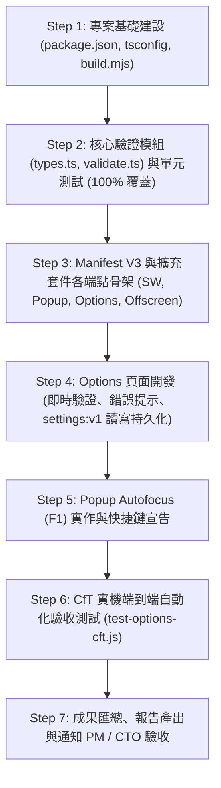

# Implementation Plan: M1 — Extension Skeleton, Manifest V3 & Options Validation (Ticket 03 / #27)

- **Date**: 2026-10-29
- **Product**: [talk-to-bro-personally](file:///Volumes/Extended/Documents/Developments/projects/agentic-development/products/talk-to-bro-personally/README.md)
- **Issue**: [GitHub Issue #27: M1 — Extension Skeleton, Manifest V3 & Options Validation](https://github.com/EasonPai/agentic-development/issues/27) (Parent: #24, Blocked by: #26 [Closed])
- **Branch**: `feat/talk-to-bro-personally/dev`
- **Role**: Engineer (Reports to CTO / PM)
- **Status**: Draft for PM & User Review

---

## 1. 任務目標與範疇 (Scope & Objectives)

本階段為 **Milestone 1 (M1)**，在 M0 Spike（#25, #26）技術假設全數確立通過後，正式進入生產級擴充套件骨架搭建。
核心目標為建立正式專案結構、TypeScript 編譯管線（esbuild）、Manifest V3 配置、Options 設定頁面（含 `validateBroChatUrl` 嚴格校驗與 `settings:v1` 持久化）、Popup 畫面與自動 focus 快捷鍵（`Alt+Shift+B`，F1），並達成 100% 邊界覆蓋的單元測試與自動化驗證。

### 依據 Acceptance Criteria (AC)
1. **MV3 `manifest.json` 配置**：
   - 宣告必要權限：`permissions: ["storage", "tabs", "scripting", "alarms", "offscreen", "clipboardWrite"]`
   - 宣告主機權限：`host_permissions: ["https://gemini.google.com/*"]`
   - 快捷鍵指令：`commands: { "_execute_action": { "suggested_key": { "default": "Alt+Shift+B" }, "description": "叫 Pip 出來" } }`
   - 安全規範：`content_security_policy: { "extension_pages": "script-src 'self'; object-src 'none'" }`
2. **Build Pipeline (`scripts/build.mjs`)**：
   - 使用 esbuild 零運行時依賴打包：
     - Background SW (`src/sw/index.ts` $\rightarrow$ `dist/sw.js`，ESM)
     - Adapter (`src/adapter/entry.ts` $\rightarrow$ `dist/adapter.js`，IIFE，含 build ID guard)
     - Popup (`src/popup/popup.ts` $\rightarrow$ `dist/popup.js`)
     - Options (`src/options/options.ts` $\rightarrow$ `dist/options.js`)
     - Offscreen (`src/offscreen/clipboard.ts` $\rightarrow$ `dist/offscreen.js`)
   - 複製靜態 HTML / CSS / 圖示至 `dist/`。
3. **Options 頁面與嚴格 URL 驗證 (`validateBroChatUrl`)**：
   - 協定限定：嚴格要求 `https:`
   - 主機名稱：完全等於 `gemini.google.com`（嚴格防禦 `gemini.google.com.evil.com`、子網域欺騙）
   - 憑證防護：不得包含 username / password（拒絕 `https://user@gemini.google.com/...`）
   - 路徑解析：必須為對話路徑，支援 `/app/<chatId>`、`/u/<N>/app/<chatId>`、`/gem/<gemId>/<chatId>`、`/u/<N>/gem/<gemId>/<chatId>`；拒絕首頁及未指定對話之 URL。
   - 儲存規範：儲存至 `chrome.storage.local` 的 `settings:v1`，重開 Chrome 設定依然保留。
4. **Popup Autofocus 驗證 (F1)**：
   - 按下 `Alt+Shift+B` 或開啟 Popup 時，輸入框 (`#talk-input`) 自動取得焦點並可立即打字。
5. **單元測試與邊界覆蓋**：
   - `validateBroChatUrl` 具備 100% 邊界測試覆蓋率（vitest / node:test），涵蓋惡意 URL、各類帳號前綴、空格清理等。
   - 自動化 CfT 端到端測試腳本驗證 Options 儲存與重載後狀態。

---

## 2. 系統架構與檔案結構 (Project Structure)

```
products/talk-to-bro-personally/
├── package.json               # 專案依賴與 scripts (build, test, verify)
├── tsconfig.json              # TypeScript 嚴格模式 (ES2022, DOM)
├── manifest.json              # MV3 原始宣告檔 (或 build 時產生至 dist/)
├── scripts/
│   ├── build.mjs              # esbuild 打包管線
│   └── test-options-cft.js    # CfT 自動化端到端驗收 Harness
├── src/
│   ├── shared/
│   │   ├── types.ts           # Storage schema, Talk, Settings, FailureCode
│   │   └── validate.ts        # validateBroChatUrl 核心邏輯
│   ├── sw/
│   │   └── index.ts           # Service Worker 骨架 (保留 M0 驗證成熟之 watchdog/reconcile)
│   ├── adapter/
│   │   └── entry.ts           # Adapter IIFE 入口骨架
│   ├── popup/
│   │   ├── popup.html         # Pip 角色風格像素介面骨架
│   │   ├── popup.css          # 暗色系精簡樣式
│   │   └── popup.ts           # F1 Autofocus 與輸入框互動邏輯
│   ├── options/
│   │   ├── options.html       # Options 設定頁
│   │   ├── options.css        # 設定頁樣式
│   │   └── options.ts         # validateBroChatUrl 即時校驗、儲存至 settings:v1、還原現有設定
│   └── offscreen/
│       ├── offscreen.html
│       └── clipboard.ts       # 延續 M0 成熟之剪貼簿代理
└── tests/
    └── unit/
        └── validate.test.ts   # 100% 邊界覆蓋單元測試
```

---

## 3. 實施階段與步驟 (Implementation Steps)



### Step 1: 專案基礎建設
- 在 `products/talk-to-bro-personally/` 初始化 `package.json`（包含 `esbuild`, `typescript`, `@types/chrome` 等開發依賴）。
- 配置 `tsconfig.json`（啟用 strict、target ES2022、moduleResolution bundler/node）。
- 編寫 `scripts/build.mjs`：
  - 支援 `node scripts/build.mjs` 一鍵打包至 `dist/`。
  - 編譯 SW (format: esm)、Adapter (format: iife)、Popup/Options/Offscreen (format: esm)。
  - 自動複製 HTML、CSS 與 `manifest.json` 至 `dist/`。

### Step 2: 核心驗證模組與單元測試
- 在 `src/shared/types.ts` 定義 `SettingsV1`、`ValidateBroChatUrlResult`。
- 在 `src/shared/validate.ts` 實作 `validateBroChatUrl(input: string)`：
  - 驗證 HTTPS。
  - 驗證 hostname 嚴格等於 `gemini.google.com`。
  - 驗證無 username/password。
  - 解析 Chat ID（支援 `/app/<id>`、`/u/<N>/app/<id>`、`/gem/<gemId>/<id>`）。
  - 回傳結構化結果 `{ valid, normalizedUrl, chatId, error, message }`。
- 編寫 `tests/unit/validate.test.ts`，測試 15 組以上正反邊界案例（空字串、偽造域名、http、帶帳密、首頁、各種正確路徑等），確保 100% 邊界覆蓋。

### Step 3 & 4: Options 頁面與 `settings:v1` 持久化
- `src/options/options.html` & `src/options/options.ts`：
  - 介面包含輸入框、儲存按鈕、即時驗證提示標籤（狀態 badge）、說明文字。
  - 開啟時從 `chrome.storage.local` 讀取 `settings:v1` 並回填。
  - 輸入或點擊儲存時執行 `validateBroChatUrl`：
    - 不合法：顯示明確中文錯誤訊息，拒絕儲存。
    - 合法：正規化為標準 URL，寫入 `chrome.storage.local.set({ 'settings:v1': { broChatUrl: normalizedUrl, updatedAt: Date.now() } })`，並顯示儲存成功反饋。

### Step 5: Popup Autofocus (F1)
- `src/popup/popup.html` & `src/popup/popup.ts`：
  - 介面提供 `#talk-input` 與 Pip 狀態頭像。
  - 頁面載入（`DOMContentLoaded`）立即呼叫 `#talk-input.focus()`。
  - `manifest.json` 宣告 `_execute_action` 預設快捷鍵 `Alt+Shift+B`。

### Step 6: CfT 實機端到端自動化驗證
- 編寫 `scripts/test-options-cft.js`：
  - 自動載入 `dist/` 擴充套件至現有隔離 CfT 實例。
  - 透過 CDP 開啟 `options.html`，自動輸入非法網址（斷言拒絕儲存與錯誤訊息）。
  - 輸入合法實機網址（`https://gemini.google.com/app/4d870f290f0c5975`），點擊儲存。
  - 重載擴充套件，再次開啟 `options.html`，斷言設定值完整保留。
  - 開啟 `popup.html`，透過 CDP 檢查 `document.activeElement.id === 'talk-input'` 驗證 Autofocus (F1)。

---

## 4. 驗收標準與確認清單 (Verification Checklist)

- [ ] `npm run build` 成功建置出乾淨的 `dist/` 擴充套件目錄。
- [ ] `npm test` 執行單元測試 100% 通過（`validateBroChatUrl` 邊界全覆蓋）。
- [ ] 執行 `scripts/test-options-cft.js` 端到端測試，全數斷言通過（exit code 0）：
  - [ ] 惡意/非法網址被拒絕且給出精確原因。
  - [ ] 合法網址正規化寫入 `settings:v1`。
  - [ ] 重啟/重載擴充套件後設定值依然完好（F6）。
  - [ ] Popup 打開後輸入框處於聚焦狀態（F1）。
- [ ] 不影響既有 M0 Spike 成果，Git 歷史與 Worktree 保持整潔。
