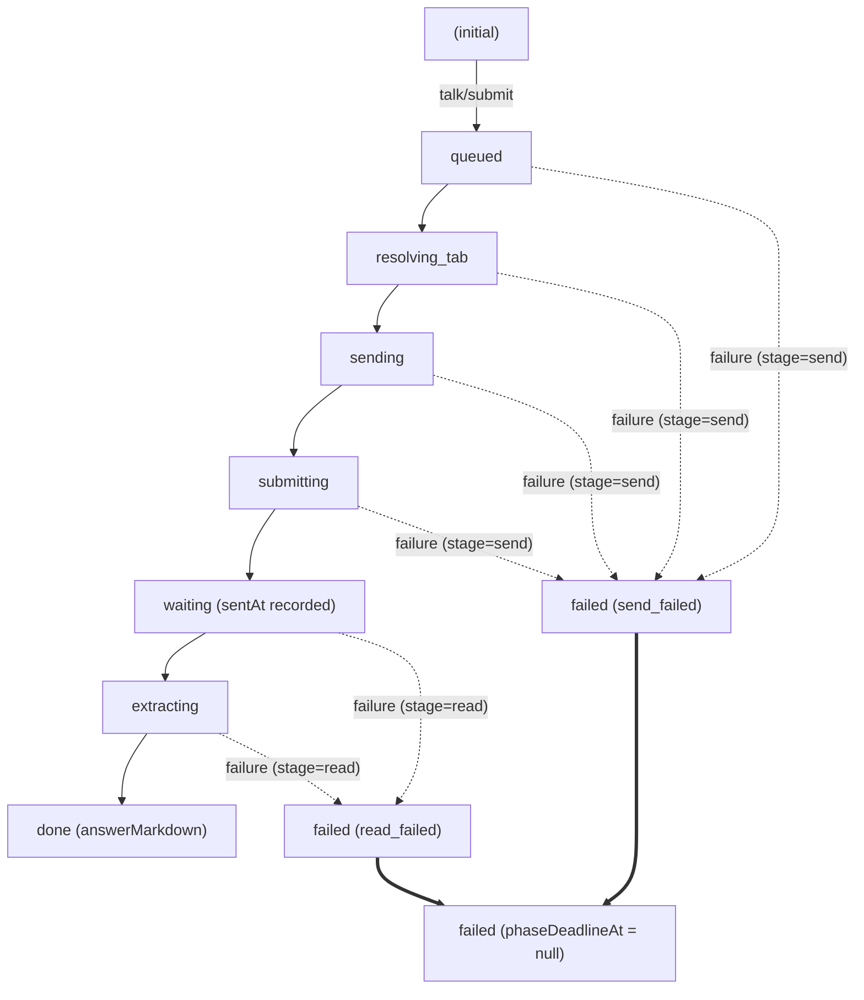

# Implementation Plan: M2 — Talk Runner Engine, Watchdog & Fake Adapter

**Task**: [GitHub Issue #28: [talk-to-bro-personally] 04: M2 — Talk Runner Engine, Watchdog & Fake Adapter](https://github.com/EasonPai/agentic-development/issues/28)  
**Parent Epic**: [GitHub Issue #24](https://github.com/EasonPai/agentic-development/issues/24)  
**Date**: 2026-10-29  
**Role**: Engineer  
**Supervisor**: CTO (`term_c7268128-7eab-4ebe-80cc-eb8a142462c1`), PM (`term_29805068-4138-43f3-b3f4-97d1608f46af`)  

---

## 1. Overview & Objectives

Milestone 2 establishes the core state machine, execution engine, and resilience protocols of the Talk To Bro Personally extension. It builds the heart of the extension in complete decoupling from external DOM, verified end-to-end using a deterministic, controllable `FakeAdapter`.

### Key Technical Scope
1. **Pure Talk State Machine (`src/shared/talk-machine.ts`)**:
   - `transition(talk: Talk, event: TalkEvent, now: number): Talk`
   - Immutable terminal states (`done`, `failed`), dropping late events.
   - Enforcing phase deadlines (`phaseDeadlineAt = null` upon entering terminal states).
   - Conservative stage assignment (`stage: 'send'` vs `stage: 'read'`).
2. **Stream Watchdog & Progress Evaluator (`src/shared/tick.ts`)**:
   - Pure `evaluateTick(talk: Talk, probe: ProbeResult, now: number): TickEvaluation`
   - 30s idle timeout (`TIMEOUT_IDLE` when no text growth seen for >= 30,000ms).
   - 180s total timeout (`TIMEOUT_TOTAL` from `sentAt` >= 180,000ms).
   - FNV-1a hash-based text signature tracking (`lastSig`) detecting same-length replacements.
3. **Storage & Write-Ahead Protocol (`src/shared/storage.ts`)**:
   - `runtime:v1`: Atomic single-write object containing `{ lastTalk: Talk | null, logByTalkId: Record<string, LogEntry> }`.
   - Write-ahead phase logging prior to external action dispatch.
   - Bounded Talk Log (max 2,000 entries, FIFO eviction).
   - Session identification (`session:v1: { bootId: string, broTab?: { tabId: number, windowId: number } }`).
4. **Boot, Reconciliation & Alarm Watchdog (`src/sw/boot.ts`, `src/sw/reconcile.ts`)**:
   - Single-entry `boot()` with `await ready` gate.
   - `reconcile()` matrix handling browser restart, SW death, and alarm watchdog (`ttb-watchdog`) without duplicate user-turn submissions.
5. **Pure Stats Aggregator (`src/shared/stats.ts`)**:
   - `computeStats(logByTalkId: Record<string, LogEntry>): TalkStats`
   - Sent-in rate = `(success + read_failed) / total`
   - Read-back rate = `success / (success + read_failed)`
   - Zero-division safe (`total === 0` -> `null` / "尚無樣本").
   - Active talk exclusion (only completed log entries counted).
6. **FakeAdapter & Runner Engine (`src/sw/runner.ts`, `tests/helpers/fake-adapter.ts`)**:
   - `FakeAdapter` simulating configurable delays, streaming chunks, errors, and unresponsive tabs.
   - Runner execution coordinating state transitions, write-ahead storage updates, and watchdog alarms.
   - Unit and integration tests achieving >= 90% coverage without browser dependencies.

---

## 2. Architecture & Pure Data Contracts

### 2.1 State Machine Diagram

### 2.2 Phase Deadlines & Timeout Budgets
| Phase | Normal Timeout | Failure Code on Expiry | Stage |
| :--- | :--- | :--- | :--- |
| `queued` | 5,000 ms | `INTERNAL` | `send` |
| `resolving_tab` | 15,000 ms | `TAB_UNRESPONSIVE` | `send` |
| `sending` | 10,000 ms | `EDITOR_BUSY` | `send` |
| `submitting` | 15,000 ms | `SUBMIT_UNCONFIRMED` (`maybeSent: true`) | `send` |
| `waiting` (idle) | 30,000 ms | `TIMEOUT_IDLE` | `read` |
| `waiting` (total) | 180,000 ms (from `sentAt`) | `TIMEOUT_TOTAL` | `read` |
| `extracting` | 10,000 ms | `EXTRACT_FAILED` | `read` |

---

## 3. Implementation Steps & File Breakdown

### Step 1: Types & Failure Codes (`src/shared/types.ts`)
- Update `src/shared/types.ts` with complete M2 types:
  - `TalkPhase`: `'queued' | 'resolving_tab' | 'sending' | 'submitting' | 'waiting' | 'extracting' | 'done' | 'failed'`
  - `FailureCode`: `'NO_BRO_CHAT' | 'BRO_CHAT_MISSING' | 'NOT_SIGNED_IN' | 'INPUT_NOT_FOUND' | 'EDITOR_BUSY' | 'SUBMIT_UNCONFIRMED' | 'TIMEOUT_IDLE' | 'TIMEOUT_TOTAL' | 'QUOTA_EXHAUSTED' | 'TAB_UNRESPONSIVE' | 'TAB_CLOSED' | 'EXTRACT_FAILED' | 'INTERRUPTED' | 'INTERNAL'`
  - `Talk`, `LogEntry`, `RuntimeV1Storage`, `SessionV1Storage`, `BroAdapter`, `ReadyResult`, `ProbeResult`.

### Step 2: Pure Talk State Machine (`src/shared/talk-machine.ts`)
- Implement `createTalk(text: string, now: number): Talk`
- Implement `transition(talk: Talk, event: TalkEvent, now: number): Talk`
  - Ensure immutability (returns new object, never mutates).
  - Terminal states `done` and `failed` cannot transition further (`phaseDeadlineAt: null`).
  - Strict validation of allowed transitions according to the state chart.
- Implement `stageOf(phase: TalkPhase): 'send' | 'read'`.

### Step 3: Stream Watchdog Evaluator (`src/shared/tick.ts`)
- Implement `evaluateTick(talk: Talk, probe: ProbeResult, now: number): TickEvaluation`
  - Checks total timeout: `now - talk.sentAt >= 180_000` -> `action: 'timeout_total'`.
  - Checks idle timeout: `now - (talk.lastGrowthAt ?? talk.sentAt) >= 30_000` -> `action: 'timeout_idle'`.
  - Detects text growth via signature & length:
    - If `probe.textSig !== talk.lastSig || probe.textLength > (talk.streamedChars ?? 0)`: update `lastGrowthAt`, update `streamedChars`.
  - Detects completion: `probe.turn === 'complete' && !probe.generating` -> `action: 'complete'`.
  - Detects quota exhaustion: `probe.quota` -> `action: 'quota_exhausted'`.

### Step 4: Storage & Write-Ahead Protocol (`src/shared/storage.ts`)
- Implement `getRuntimeStorage(storage: chrome.storage.StorageArea): Promise<RuntimeV1Storage>`
- Implement `saveRuntimeStorage(storage: chrome.storage.StorageArea, data: RuntimeV1Storage): Promise<void>`
- Implement write-ahead helper:
  - Atomic write updating both `lastTalk` and `logByTalkId` when entering a terminal state (`done` or `failed`).
  - FIFO log eviction when `logByTalkId` keys exceed 2,000.

### Step 5: Pure Stats Functions (`src/shared/stats.ts`)
- Implement `computeStats(logByTalkId: Record<string, LogEntry>): TalkStats`
  - `total`: number of log entries
  - `successCount`: number of `result === 'success'`
  - `sendFailedCount`: number of `result === 'send_failed'`
  - `readFailedCount`: number of `result === 'read_failed'`
  - `sentInRate`: `total === 0 ? null : (successCount + readFailedCount) / total`
  - `readBackRate`: `(successCount + readFailedCount) === 0 ? null : successCount / (successCount + readFailedCount)`
  - Formatter helper returning display ratios (e.g. `19/20 (95.0%)` or `"尚無樣本"`).

### Step 6: Boot & Reconciliation Engine (`src/sw/reconcile.ts`, `src/sw/boot.ts`)
- Implement `reconcile(runtime: RuntimeV1Storage, session: SessionV1Storage | null, now: number): ReconcileDecision`
  - Fresh session (`session === null` or mismatched `bootId`):
    - Active non-terminal talk immediately transitioned to `failed` (`code: 'INTERRUPTED'`, `handoff: 'deferred'`).
  - Same session, active talk:
    - If `phase === 'submitting'`: do NOT re-submit. Check probe; if user turn text matches talk text, move to `waiting`; else fail with `SUBMIT_UNCONFIRMED` (`maybeSent: true`).
    - If `phase in ['queued', 'resolving_tab', 'sending']`: restart from `resolving_tab`.
    - If `phase === 'waiting'`: continue polling with existing `sentAt` and `lastSig`.
    - If `phase === 'extracting'`: re-attempt extraction.
- Implement `boot()` with singleton ready promise.

### Step 7: FakeAdapter & Test Suite (`tests/helpers/fake-adapter.ts`, `tests/unit/*.test.ts`)
- Implement `FakeAdapter implements BroAdapter`:
  - Configurable responses for `checkReady`, `send`, `probe`, `extract`.
  - Scriptable streaming chunks and delays.
  - Fault injection switches (`forceFailure`, `simulateHang`, `simulateQuota`).
- Unit tests:
  - `tests/unit/talk-machine.test.ts`: 100% transition matrix, terminal immutability, late event discard.
  - `tests/unit/tick.test.ts`: boundary tests at 29,999ms / 30,000ms / 179,999ms / 180,000ms, signature hashing.
  - `tests/unit/stats.test.ts`: zero division, deduplication, active talk exclusion.
  - `tests/unit/reconcile.test.ts`: browser restart interruption, submitting unconfirmed safety, mid-stream continuation.
  - `tests/unit/runner.test.ts`: FakeAdapter end-to-end simulation of happy path, idle timeout, total timeout, editor busy, and crash recovery.

---

## 4. Acceptance Criteria Verification Matrix

| AC # | Acceptance Criteria | Target Module | Verification Method |
| :--- | :--- | :--- | :--- |
| **AC 1** | Pure state transition function `transition(talk, event, now)` with immutable terminal states & deadline enforcement | `src/shared/talk-machine.ts` | Unit tests in `tests/unit/talk-machine.test.ts` asserting immutability, terminal seal, and deadline assignment |
| **AC 2** | Write-ahead protocol: SW records phase before dispatching actions; single write to `runtime:v1` updates `lastTalk` and deduplicated `logByTalkId` | `src/shared/storage.ts`, `src/sw/runner.ts` | Storage unit tests verifying atomic write and talkId deduplication |
| **AC 3** | Single entry `boot()` and `reconcile()` handle browser restart (`session:v1`), terminal mid-execution, and alarm watchdog (`chrome.alarms`) without duplicate sends | `src/sw/boot.ts`, `src/sw/reconcile.ts` | Reconcile tests verifying `session:v1` empty detection and non-duplicate send during `submitting` |
| **AC 4** | Pure function `computeStats(log)` accurately calculates sent-in rate and read-back rate with zero-division handling and active talk exclusion | `src/shared/stats.ts` | Unit tests in `tests/unit/stats.test.ts` asserting exact rates, null handling for 0/0, and active talk exclusion |
| **AC 5** | Runner test suite passes with FakeAdapter simulating delays, streaming speeds, watchdog triggers, and failures with 90%+ unit test coverage | `src/sw/runner.ts`, `tests/unit/runner.test.ts` | Automated runner test suite covering all 14 failure codes, timeouts, and streaming flows |

---

## 5. Risk Assessment & Mitigations

1. **Risk**: Storage race conditions between Popup reads and Service Worker writes.  
   - **Mitigation**: Follow SSOT design: Service Worker is the sole writer to `runtime:v1`. Popup only reads and listens via `chrome.storage.onChanged`.
2. **Risk**: Watchdog timer drift in Chrome MV3.  
   - **Mitigation**: Pure `evaluateTick` calculates time deltas using absolute timestamps (`now - sentAt`), making timeout enforcement immune to timer jitter or SW sleep.
3. **Risk**: Accidental duplicate sends upon worker restart during `submitting`.  
   - **Mitigation**: `reconcile()` explicitly forbids re-dispatching send when phase is `submitting`; it probes first and conservatively fails with `SUBMIT_UNCONFIRMED` (`maybeSent: true`) if unverified.
