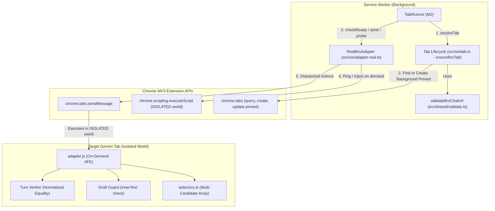

# M3 Implementation Plan: Real Bro Adapter, Selector Isolation & Tab Lifecycle

**Ticket**: [GitHub Issue #29: 05: M3 — Real Bro Adapter, Selector Isolation & Tab Lifecycle](https://github.com/EasonPai/agentic-development/issues/29)  
**Parent Epic**: [GitHub Issue #24](https://github.com/EasonPai/agentic-development/issues/24)  
**Date**: 2026-10-29  
**Author**: Engineer  
**Status**: Approved by CTO (Amended per CTO Technical Review)

---

## 1. Objectives & Boundaries

The purpose of M3 is to implement the real Gemini web client DOM interaction layer and Chrome MV3 background tab lifecycle manager, replacing the `FakeAdapter` from M2 with a robust, production-grade `BroAdapter` connected to an on-demand injected isolated content script.

### Pragmatic Engineering Boundaries (CTO Scope & Rules)
- **Included in M3**:
  1. Complete DOM selector isolation with multiple fallback selectors (`src/adapter/selectors.ts`).
  2. Tab finder, creator, pinner, and cacher (`src/sw/tab.ts` / `ensureBroTab`) using shared `validateBroChatUrl` matching `/app` & `/gem`, full account index `/u/N`, and `chatId` without stealing user focus (`active: false`).
  3. `checkReady` checking signed-in status, URL match, and draft protection (leaving non-matching existing drafts untouched and returning `EDITOR_BUSY`).
  4. Safe text insertion via `document.execCommand("insertText")` with NFC and newline normalization verification; returning `INPUT_NOT_FOUND` on mismatch without synthetic HTML/Enter fallbacks. Immediate draft re-check before any selection/replacement.
  5. Send dispatch (click at most once after write-ahead) and post-baseline user-turn confirmation via exact normalized equality (`userTurnVerified: true`).
  6. Real `RealBroAdapter` bridge in SW connecting `TalkRunner` with dynamic `tabId` and persisted `broChatUrl` (eliminating hardcoded `1001` and `mock-chat`).
  7. On-demand `adapter.js` injection in `ISOLATED` world via `chrome.scripting.executeScript` with ping-before-inject and build guard, preserving existing manifest architecture (no static `content_scripts` in `manifest.json`).
  8. Automated unit test suite and CfT live verification on port 9222.
- **Excluded / Deferred (Anti-Scope-Creep)**:
  - Markdown AST extraction, cleanup, and rich formatting (deferred to M4).
  - Popup full answer rendering & PiP streaming display (deferred to M4).
  - Automatic retries or duplicate sends (preserving M2 no-resend recovery semantics).

---

## 2. Proposed Architecture & Component Design



---

## 3. Detailed Component Specifications

### AC1: Selector Isolation (`src/adapter/selectors.ts`)
Isolate all CSS selectors into candidate arrays with robust fallbacks:
```typescript
export interface DomSelectors {
  editor: string[];
  sendButton: string[];
  stopButton: string[];
  userTurn: string[];
  userTurnText: string[];
  modelTurn: string[];
  modelBody: string[];
  modelDone: string[];
  signIn: string[];
}

export const SELECTORS: DomSelectors = {
  editor: [
    'rich-textarea .ql-editor[contenteditable="true"]',
    'div[contenteditable="true"][role="textbox"]',
    'textarea[aria-label*="prompt" i]',
    '#mock-editor'
  ],
  sendButton: [
    'button.send-button:not(.stop)',
    'button[aria-label*="Send" i]',
    'button[aria-label*="傳送" i]',
    'button[mattooltip*="Send" i]',
    '#mock-send-btn'
  ],
  stopButton: [
    'button.send-button.stop',
    'button[aria-label*="Stop" i]',
    'button[aria-label*="停止" i]',
    '#mock-stop-btn'
  ],
  userTurn: [
    'user-query',
    '.user-query',
    '[data-turn-type="user"]'
  ],
  userTurnText: [
    '.query-text',
    'user-query-content',
    '.query-content'
  ],
  modelTurn: [
    'model-response',
    '.model-response',
    '[data-turn-type="model"]'
  ],
  modelBody: [
    'message-content .markdown',
    '.model-response-text .markdown',
    '.model-body-content'
  ],
  modelDone: [
    'message-actions',
    '.response-footer',
    '.model-done-actions'
  ],
  signIn: [
    'a[href*="ServiceLogin"]',
    'a[href*="accounts.google.com"][href*="signin" i]'
  ]
};
```
Helper query functions (`queryOne(key)`, `queryAll(key)`) iterate candidates sequentially.

### AC2: Bro Tab Lifecycle Management (`src/sw/tab.ts`)
- **Shared Validation & Parsing**:
  - Uses `validateBroChatUrl(url)` from `src/shared/validate.ts` to obtain canonical URL, full account prefix (e.g. `/u/0`, `/u/1`), and full path (`/app/<chatId>` or `/gem/<gemId>/<chatId>`).
- **`ensureBroTab(targetUrl: string, storageSession?: StorageAreaLike)` algorithm**:
  1. Parse target URL using `validateBroChatUrl(targetUrl)`. If invalid, return `{ ok: false, code: 'NO_BRO_CHAT' }`.
  2. Inspect cached tab in `session:v1` (`storageSession.get('session:v1')`). If valid and `chrome.tabs.get(cachedTabId)` confirms URL and presence:
     - Ensure tab is pinned: `chrome.tabs.update(cachedTabId, { pinned: true })`.
     - Return `{ ok: true, tabId: cachedTabId }`.
  3. Query active tabs via `chrome.tabs.query({ url: "*://gemini.google.com/*" })`.
  4. Compare each tab's URL with `validateBroChatUrl(tab.url)`. If exact canonical match (same chat type, same chat ID, and matching account index):
     - Update `session:v1` cache.
     - Ensure tab is pinned (`pinned: true`).
     - Return `{ ok: true, tabId: tab.id! }`.
  5. If no matching tab exists:
     - Create a background pinned tab:
       `chrome.tabs.create({ url: targetUrl, active: false, pinned: true })`.
     - Await tab load completion (`status === 'complete'`) with a bounded timeout (15s).
     - Cache in `session:v1`.
     - Return `{ ok: true, tabId: newTab.id! }`.
  6. **Focus Protection**: All tab operations pass `active: false`. Active user window/tab focus is strictly preserved.

### AC3: `checkReady`, Sign-in Verification & Draft Protection (`src/adapter/entry.ts`)
- When `checkReady` is received:
  1. Inspect `signIn` selectors: if found, return `{ ok: false, code: 'NOT_SIGNED_IN' }`.
  2. Inspect `window.location.href`: validate with `validateBroChatUrl(location.href)` against target canonical URL. If mismatch, return `{ ok: false, code: 'BRO_CHAT_MISSING' }`.
  3. Inspect `editor` selector: if missing, return `{ ok: false, code: 'INPUT_NOT_FOUND' }`.
  4. Inspect `stopButton`: if visible and not `display: none`, return `{ ok: false, code: 'EDITOR_BUSY' }`.
  5. **Draft Protection (F5)**:
     - Read current `editor.innerText`.
     - Normalize text (`normalizeText(editor.innerText)`).
     - If text is non-empty and does NOT equal `normalizeText(incomingPrompt)`:
       - **Strict Draft Preservation**: Do NOT clear or select `editor`.
       - Return `{ ok: false, code: 'EDITOR_BUSY', reason: 'User draft present in editor' }`.
  6. Return `{ ok: true }`.

### AC4: Safe Text Insertion via `document.execCommand("insertText")`
- **Insertion Algorithm** in `insertAndSend(text: string)`:
  1. **Immediate Draft Re-check**: Right before modifying the DOM, re-check `editor.innerText`. If a non-matching draft was typed between `checkReady` and send, immediately abort with `{ ok: false, code: 'EDITOR_BUSY' }` to prevent erasing user text.
  2. Mark baselines: `markBaselines()` sets `data-ttb-seen="1"` on all existing user turns and model turns.
  3. Focus editor: `editor.focus()`.
  4. Select contents via Range/Selection API.
  5. Execute `document.execCommand('insertText', false, text)`.
  6. Verify insertion:
     Compare with NFC and newline normalization:
     `normalizeText(editor.innerText) === normalizeText(text)`.
  7. **Strict Contract (No Unsafe Fallbacks)**:
     If the normalized text does NOT match, do NOT attempt default `innerHTML` injection or synthetic `Enter` fallback. Immediately return `{ ok: false, code: 'INPUT_NOT_FOUND' }`.

### AC5: Submit Dispatch & User Turn Verification (F2, F7)
- Locate `sendButton`:
  - Poll for enabled send button (up to 3,000ms, 100ms intervals).
  - If disabled or missing: return `{ ok: false, code: 'EDITOR_BUSY' }`.
  - **Click Send At Most Once**: Call `sendButton.click()` once. Do NOT auto-retry on unconfirmed submission.
- **User Turn Confirmation**:
  - Poll for new `userTurn` element without `data-ttb-seen="1"` (up to 5,000ms).
  - Verify exact post-baseline text equality:
    `normalizeText(newTurnTextElement.textContent) === normalizeText(text)`.
    (Do NOT use `includes()`; do NOT match against historical turns or toolbar elements).
  - If verified, return `{ ok: true, userTurnVerified: true, sentAt: Date.now() }`.
  - If timeout reached, return `{ ok: false, code: 'SUBMIT_UNCONFIRMED' }`.

### AC6: RealBroAdapter & Runner Wiring (`src/sw/adapter-real.ts`)
- Replace `FakeAdapter` in real production Service Worker flow:
  1. On `submit()` / `reconcile()`:
     - Read target `broChatUrl` from `getSettingsStorage(storageLocal)`.
     - Resolve target `tabId` via `ensureBroTab(settings.broChatUrl, storageSession)`.
     - Store actual `tabId` in `talk.tabId` (replacing hardcoded `1001` and `mock-chat`).
  2. `RealBroAdapter` methods:
     - `checkReady({ chatId, text })`: Ensure tab, ping adapter, forward `TTB_CHECK_READY`.
     - `send({ talkId, text })`: Forward `TTB_INSERT_AND_SEND`.
     - `probe({ talkId, text })`: Forward `TTB_PROBE`.
     - `extract({ talkId, text })`: Forward `TTB_EXTRACT`.
  3. On-demand injection helper `ensureAdapterInjected(tabId)`:
     - Send `{ action: 'TTB_PING' }`.
     - If response is `{ ok: true }`, return.
     - If no response (connection error), invoke `chrome.scripting.executeScript({ target: { tabId }, files: ['adapter.js'], world: 'ISOLATED' })`.

---

## 4. Build Configuration & Manifest Updates

- **Manifest**: Preserve existing manifest architecture (`manifest.json` at root).
  - NO static `content_scripts` array in `manifest.json`.
  - Content script permissions: `"tabs"`, `"scripting"`, `"storage"`, `"alarms"`.
  - Host permissions: `"https://gemini.google.com/*"`.
- **esbuild**:
  - Bundle `src/adapter/entry.ts` into `dist/adapter.js` as an IIFE bundle (`format: 'iife'`).

---

## 5. Verification Plan

### Automated Unit Tests
- `tests/unit/selectors.test.ts`:
  - Verify selector lists contain expected fallback classes and attributes.
  - Test `queryOne` / `queryAll` matching priority.
- `tests/unit/tab.test.ts`:
  - Test `ensureBroTab` with fake Chrome Tabs API.
  - Test `/app` vs `/gem` URLs, multi-account `/u/N` matching, and tab reuse.
  - Verify background creation without focus stealing (`active: false, pinned: true`).
- `tests/unit/content-adapter.test.ts`:
  - Test `checkReady` with mock DOM: signed out, editor busy, draft present rejection (`EDITOR_BUSY`).
  - Test `insertAndSend` text insertion, NFC + newline normalization, and strict rejection on mismatch.
  - Test submit dispatch with single click and post-baseline exact equality verification.
- `tests/unit/adapter-real.test.ts`:
  - Test `RealBroAdapter` wrapping `chrome.tabs.sendMessage` and `chrome.scripting.executeScript`.

### Integration & CfT Verification
- Run `npm test` to verify all unit tests pass.
- Run `npm run build && npm run verify` to confirm M1 integration is intact.
- Verify live extension on Chrome for Testing instance (port 9222).
