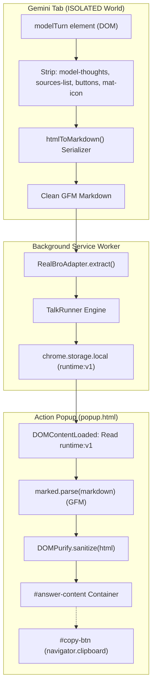

# Implementation Plan - Ticket 06 (#30: M4 — HTML to Markdown Extraction & Popup Answer Render)

- **Date**: 2026-10-29
- **Product**: `talk-to-bro-personally`
- **Ticket**: [GitHub Issue #30: [talk-to-bro-personally] 06: M4 — HTML to Markdown Extraction & Popup Answer Render](https://github.com/EasonPai/agentic-development/issues/30)
- **Assignee**: Engineer (`term_b7d9f995-f715-4d80-a6c1-9eb3991c39f7`)
- **Reviewers**: CTO (`term_c7268128-7eab-4ebe-80cc-eb8a142462c1`), PM (`term_29805068-4138-43f3-b3f4-97d1608f46af`)
- **Prerequisites**: Ticket 05 (#29: M3) accepted and closed at `4b5786c`.

---

## 1. Objective & Scope

Implement high-fidelity extraction of model answers into clean Markdown, strip thoughts and UI artifacts, safely render GitHub Flavored Markdown (GFM) in the extension popup using bundled `marked` and `DOMPurify` under strict CSP, provide one-click clipboard copy, and establish immediate Last Talk state restoration (F3, F5).

### In Scope
1. **`src/adapter/html-to-md.ts`**: Pure DOM-to-Markdown recursive serializer with element exclusions (`model-thoughts`, `sources-list`, `button`, `mat-icon`, `.code-block-decoration`, `sup`) and structure preservation (headings, nested lists, bold/italic, code blocks, tables, citation links).
2. **Golden Test Suite (`tests/unit/html-to-md.test.ts`)**: 6 Golden test cases asserting 100% exact match against verified Markdown targets with zero truncation.
3. **Popup GFM & Sanitized Rendering (`src/popup/popup.ts`, `src/popup/popup.html`, `src/popup/popup.css`)**:
   - Bundled `marked` + `DOMPurify` compiled via esbuild into `dist/popup.js`.
   - Strict MV3 Content Security Policy (`script-src 'self'`).
   - Clean typography, code syntax highlighting styling, and responsive layout.
4. **One-Click Copy**: Copies stored raw Markdown to clipboard via `navigator.clipboard.writeText` with interactive visual feedback ("已複製！" for 1.5s).
5. **Last Talk Restoration & Live State Sync (F5)**:
   - Reopening popup immediately restores previous prompt text and Markdown Answer from `runtime:v1.lastTalk`.
   - Active phases (`queued`, `sending`, `submitting`, `waiting`, `extracting`) display live progress in Pip status.
   - Listens for `chrome.storage.onChanged` to render newly finalized answers in real-time.
6. **Wiring into `RealBroAdapter.extract`**: Content script `extract()` uses `htmlToMarkdown` to generate the clean Markdown answer from `modelBody`.

### Explicitly Out of Scope
- Failure Detection Matrix, watchdog recovery dialogs, and offscreen clipboard handoff (deferred to Ticket 07 / M5).
- Talk Log UI, selector health check, and Pip pixel art sprite animation (deferred to Ticket 08 / M6).

---

## 2. Architecture & Data Flow



---

## 3. Detailed Acceptance Criteria & Verification Plan

### AC1: HTML-to-Markdown Serializer (`src/adapter/html-to-md.ts`)
- **Exclusion Filters**:
  - `model-thoughts`: Internal thinking nodes stripped completely.
  - `sources-list`: Source index and metadata stripped.
  - `button`, `mat-icon`: Interactive UI widgets stripped.
  - `.code-block-decoration`: Code language headers or copy buttons stripped.
  - `sup`: Citation footnote markers stripped.
- **Construct Preservation**:
  - Headings: `h1`~`h6` converted to `# ` through `###### `.
  - Lists: Ordered (`1. `) and unordered (`- `) with 2-space indentation per depth level, correctly preserving nested lists.
  - Text Styles: Bold (`**text**`), italic (`*text*`), inline code (`` `code` ``).
  - Preformatted Code: `<pre><code class="language-xxx">` converted to standard triple-backtick fenced code blocks with language tag.
  - Blockquotes: `> ` prefixed to each line.
  - Tables: Standard GFM markdown tables with header separator `| :--- | :--- |`.
  - Links: Anchor tags `[text](href)` preserved with valid external URLs.
- **Whitespace Hygiene**:
  - Replaces CRLF/CR with LF (`\n`).
  - Collapses blank lines with trailing whitespace.
  - Replaces `\n{3,}` with `\n\n`.
  - Trims outer boundaries.

### AC2: Golden Test Suite (`tests/unit/html-to-md.test.ts`)
- Utilizes the 6 Golden fixtures established in `spikes/m0-b/goldens/`:
  1. `case1-real-ledger.html` $\rightarrow$ `case1-real-ledger.md` (Live production turn, Turn ID `r_b53b451e2911b498`).
  2. `case1-table.html` $\rightarrow$ `case1-table.md` (Table conversion).
  3. `case2-nested-lists.html` $\rightarrow$ `case2-nested-lists.md` (Nested mixed lists).
  4. `case3-formatting.html` $\rightarrow$ `case3-formatting.md` (Bold, italic, inline code, blockquote).
  5. `case4-codeblock.html` $\rightarrow$ `case4-codeblock.md` (Fenced code blocks and decoration removal).
  6. `case5-citations.html` $\rightarrow$ `case5-citations.md` (Thoughts and citation exclusion).
- Asserts strict string equality with zero truncation.

### AC3: Popup Answer Rendering with GFM & DOMPurify (`src/popup/popup.ts`)
- Packages `marked` (configured with `gfm: true, breaks: true`) and `dompurify` directly into `dist/popup.js`.
- Respects strict MV3 CSP (`script-src 'self'`).
- Renders sanitized HTML into `#answer-content` with styled typography, scrollable container, and dark theme palette.

### AC4: One-Click Copy (`src/popup/popup.ts`)
- `#copy-btn` copies the raw Markdown string (`lastTalk.answer.markdown`) to system clipboard via `navigator.clipboard.writeText`.
- Visual confirmation: button text transitions to "已複製！" with green badge styling for 1500ms, then restores to "一鍵複製".

### AC5: Last Talk State Restoration (F5) (`src/popup/popup.ts`)
- When popup opens:
  - Fetches `runtime:v1` from `chrome.storage.local`.
  - Populates `#talk-input.value = lastTalk.text` and updates `#char-counter`.
  - If `lastTalk.phase === 'done'` and `lastTalk.answer`, renders Answer and reveals `#answer-container`.
  - If `lastTalk.phase` is active (`queued`, `sending`, `submitting`, `waiting`, `extracting`), updates `#pip-mood` to indicate active work in progress.
  - If `lastTalk.phase === 'failed'`, displays failure code and reason gracefully.
- Registers `chrome.storage.onChanged` listener to dynamically render Answer when background task finishes without requiring user to close/reopen popup.

---

## 4. File Modification List

| File Path | Nature | Purpose |
|---|---|---|
| `products/talk-to-bro-personally/package.json` | Modified | Adds `marked` and `dompurify` dependencies |
| `products/talk-to-bro-personally/src/adapter/html-to-md.ts` | New | Recursive DOM-to-Markdown serializer with exclusion rules |
| `products/talk-to-bro-personally/src/adapter/entry.ts` | Modified | Updates `extract()` to use `htmlToMarkdown` for clean Markdown generation |
| `products/talk-to-bro-personally/src/popup/popup.ts` | Modified | Implements Last Talk restoration, marked + DOMPurify rendering, copy handler, and storage sync |
| `products/talk-to-bro-personally/src/popup/popup.html` | Modified | Refines Answer container, copy button, and layout |
| `products/talk-to-bro-personally/src/popup/popup.css` | Modified | Adds Markdown styling (tables, code blocks, blockquotes, copy feedback) |
| `products/talk-to-bro-personally/tests/unit/html-to-md.test.ts` | New | Golden test suite verifying all 6 HTML-to-MD fixtures |
| `products/talk-to-bro-personally/scripts/test-m4-suite.js` | New | Automated end-to-end verification suite for M4 |

---

## 5. Verification Commands

1. **Unit & Golden Tests**:
   ```bash
   cd products/talk-to-bro-personally && npm test
   ```
2. **Build Verification**:
   ```bash
   cd products/talk-to-bro-personally && npm run build
   ```
3. **M1 Regression Suite**:
   ```bash
   cd products/talk-to-bro-personally && npm run verify
   ```
4. **M3 Regression Suite**:
   ```bash
   cd products/talk-to-bro-personally && npm run verify:m3
   ```
5. **M4 Verification Suite**:
   ```bash
   cd products/talk-to-bro-personally && node scripts/test-m4-suite.js
   ```
