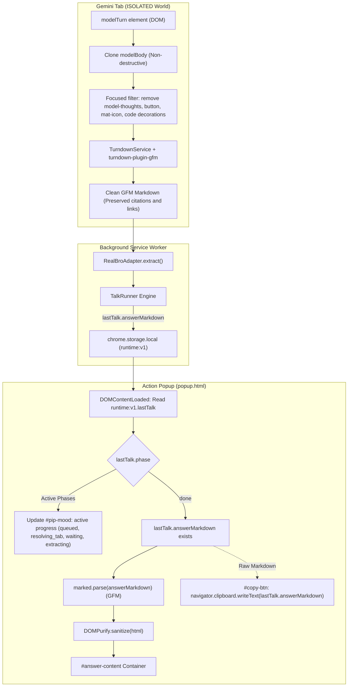

# Implementation Plan - Ticket 06 (#30: M4 — HTML to Markdown Extraction & Popup Answer Render)

- **Date**: 2026-10-29
- **Product**: `talk-to-bro-personally`
- **Ticket**: [GitHub Issue #30: [talk-to-bro-personally] 06: M4 — HTML to Markdown Extraction & Popup Answer Render](https://github.com/EasonPai/agentic-development/issues/30)
- **Assignee**: Engineer (`term_b7d9f995-f715-4d80-a6c1-9eb3991c39f7`)
- **Reviewers**: CTO (`term_c7268128-7eab-4ebe-80cc-eb8a142462c1`), PM (`term_29805068-4138-43f3-b3f4-97d1608f46af`)
- **Status**: Plan Approved by CTO with Technical Amendments; Proceeding to Implementation.

---

## 1. Objective & Scope

Extract the latest Talk-bound model turn into clean, complete Markdown while faithfully preserving visible citations, source links, tables, code blocks, and formatted text. Render the complete Answer in the Extension Action Popup using bundled `marked` (GFM) and `DOMPurify` under strict Content Security Policy (`script-src 'self'`). Provide one-click clipboard copy of raw stored Markdown, and establish immediate Last Talk state restoration across all active and terminal phases (F3, F5).

### In Scope & CTO Contract Alignment
1. **Turndown + GFM Bundled Pipeline (`src/adapter/html-to-md.ts`)**:
   - Bundles `turndown` and `turndown-plugin-gfm` directly into the extension build (`adapter.js`), strictly offline without remote CDN dependencies.
   - Clones the Talk-bound `modelBody` before DOM filtering so extraction does not mutate the live page.
   - Focused exclusion filters remove only confirmed internal thinking (`model-thoughts`) and UI noise (`button`, `mat-icon`, `.code-block-decoration`).
   - **Preserves visible citations and sources**: `sources-list` and `sup` are NOT blanket-stripped; visible citation text and anchor URLs survive as valid Markdown links (`[text](url)`).
   - Code block preservation: Custom Turndown rules faithfully convert `<pre><code class="language-xyz">` into triple-backtick fenced code blocks, strictly preserving inner indentation, newlines, and code text without destructive global line collapse.
2. **Golden Test Suite (`tests/unit/html-to-md.test.ts`)**:
   - Preserves historical Spike baseline fixtures in `spikes/m0-b/goldens/`.
   - Derives separate M4 citation test fixture (`case5-citations-m4.html` and `case5-citations-m4.md`) reflecting the product contract where visible citations and source links are preserved.
   - Tests all 6 Golden cases (Live production turn `case1-real-ledger`, tables `case1-table`, nested lists `case2-nested-lists`, formatting `case3-formatting`, code blocks `case4-codeblock`, and citations `case5-citations-m4`).
3. **Data Contract Compliance (`src/shared/types.ts`)**:
   - Strictly uses `lastTalk.answerMarkdown` (per `types.ts` line 56: `TalkRuntimeState.answerMarkdown`), never undefined `lastTalk.answer.markdown` or `lastTalk.answer`.
   - Reopening popup restores state across all active phases (`queued`, `resolving_tab`, `sending`, `submitting`, `waiting`, `extracting`) and terminal states (`done`, `failed`).
4. **Popup GFM & Sanitized Rendering (`src/popup/popup.ts`, `src/popup/popup.html`, `src/popup/popup.css`)**:
   - Bundled `marked` (GFM mode) + `DOMPurify` compiled into `dist/popup.js`.
   - Strict MV3 CSP (`script-src 'self'`).
   - Opens all links with `target="_blank"` and `rel="noopener noreferrer"`.
   - Clean dark-theme typography, responsive scrolling container, and code block styling.
5. **One-Click Copy (`src/popup/popup.ts`)**:
   - Copies exact raw stored Markdown (`lastTalk.answerMarkdown`) via `navigator.clipboard.writeText`, NOT the rendered DOM or sanitized HTML.
   - Visual confirmation: button text transitions to "已複製！" with green badge styling for 1500ms, then restores to "一鍵複製".
6. **Live End-to-End Verification (`scripts/test-m4-suite.js`)**:
   - Exercises the actual loaded build in Chrome for Testing:
     - Stores/receives a representative runtime `lastTalk`.
     - Opens/reopens the actual Action Popup.
     - Confirms done/active phase restoration (`resolving_tab`, `waiting`, `done`).
     - Verifies sanitized GFM rendering (including defense against representative unsafe HTML payloads like `<script>` or ``).
     - Verifies raw Markdown clipboard copy and read-back via `pbpaste` while safely restoring developer clipboard.

### Explicitly Out of Scope
- Failure Detection Matrix, watchdog recovery dialogs, and offscreen clipboard handoff (deferred to Ticket 07 / M5).
- Talk Log UI, selector health check, and Pip pixel art sprite animation (deferred to Ticket 08 / M6).

---

## 2. Architecture & Data Flow



---

## 3. Detailed Acceptance Criteria & Implementation Plan

### AC1: Turndown-Based HTML-to-Markdown Serializer (`src/adapter/html-to-md.ts`)
- **Initialization & Configuration**:
  ```ts
  import TurndownService from 'turndown';
  import { gfm } from 'turndown-plugin-gfm';

  const turndown = new TurndownService({
    headingStyle: 'atx',
    hr: '---',
    bulletListMarker: '-',
    codeBlockStyle: 'fenced'
  });
  turndown.use(gfm);
  ```
- **Cloning & Non-Destructive Filtering**:
  - `const clone = element.cloneNode(true) as HTMLElement;`
  - Remove only: `model-thoughts`, `button`, `mat-icon`, `.code-block-decoration`.
  - Visible citation blocks (`sources-list`, `.sources-list`, `sup a`) survive and are converted to standard Markdown links.
- **Custom Turndown Rules**:
  - `fencedCode`: Extracts language tag from `class="language-xyz"` and preserves raw code text with newlines without stripping internal spaces.
  - `citationLinks`: Formats source chips or citation anchors as `[Title / Index](url)`.
  - `paragraphSpacing`: Maintains paragraph boundaries without collapsing empty lines inside code blocks.

### AC2: Golden Test Suite (`tests/unit/html-to-md.test.ts`)
- Fixtures and Expectations:
  1. `case1-real-ledger.html` $\rightarrow$ `case1-real-ledger.md` (Live production turn, Turn ID `r_b53b451e2911b498`).
  2. `case1-table.html` $\rightarrow$ `case1-table.md` (GFM table with header separator).
  3. `case2-nested-lists.html` $\rightarrow$ `case2-nested-lists.md` (Nested mixed lists).
  4. `case3-formatting.html` $\rightarrow$ `case3-formatting.md` (Bold, italic, inline code, blockquote).
  5. `case4-codeblock.html` $\rightarrow$ `case4-codeblock.md` (Fenced code block with preserved language and indentation).
  6. `case5-citations-m4.html` $\rightarrow$ `case5-citations-m4.md` (Preserved visible source links and citations per product AC).
- Exact equality verification: `assert.equal(htmlToMarkdown(html), expectedMd)`.

### AC3: Popup GFM & Sanitized Rendering (`src/popup/popup.ts`)
- Uses bundled `marked.parse(markdown, { gfm: true, breaks: true })`.
- Sanitizes output via `DOMPurify.sanitize(dirtyHtml, { ADD_ATTR: ['target', 'rel'] })`.
- Adds `target="_blank"` and `rel="noopener noreferrer"` to external links.
- CSS typography styling in `popup.css`: table borders, code block dark backgrounds, blockquote borders, overflow scrolling.

### AC4: One-Click Copy (`src/popup/popup.ts`)
- Copies `currentLastTalk.answerMarkdown` directly to system clipboard via `navigator.clipboard.writeText(currentLastTalk.answerMarkdown)`.
- Updates `#copy-btn` text to "已複製！" and adds `.copied` class for 1500ms, then restores to "一鍵複製".

### AC5: Last Talk State Restoration Across All Phases (`src/popup/popup.ts`)
- Phase Matrix:
  - `queued` / `resolving_tab` / `sending` / `submitting`: `#pip-mood` shows "Pip 正在派發話語給老大..."
  - `waiting`: `#pip-mood` shows "老大正在思考中..."
  - `extracting`: `#pip-mood` shows "正在擷取老大的回覆..."
  - `done`: `#pip-mood` shows "老大回話了！", renders `#answer-content`, displays `#answer-container`.
  - `failed`: `#pip-mood` shows failure explanation.
- Dynamically updates UI via `chrome.storage.onChanged` listener if background runner finalizes while popup remains open.

---

## 4. File Modification List

| File Path | Nature | Purpose |
|---|---|---|
| `products/talk-to-bro-personally/package.json` | Modified | Adds `turndown`, `turndown-plugin-gfm`, `marked`, `dompurify` dependencies |
| `products/talk-to-bro-personally/src/adapter/html-to-md.ts` | New | Turndown-based DOM serializer with citation preservation and noise filtering |
| `products/talk-to-bro-personally/src/adapter/entry.ts` | Modified | Updates `extract()` to use `htmlToMarkdown` on cloned `modelBody` |
| `products/talk-to-bro-personally/src/popup/popup.ts` | Modified | Implements Last Talk restoration, marked + DOMPurify rendering, copy handler, and storage sync |
| `products/talk-to-bro-personally/src/popup/popup.html` | Modified | Refines Answer container, copy button, and layout |
| `products/talk-to-bro-personally/src/popup/popup.css` | Modified | Adds Markdown typography, table formatting, and copy button styles |
| `products/talk-to-bro-personally/tests/fixtures/goldens/case5-citations-m4.*` | New | M4 citation fixture with preserved links matching product AC |
| `products/talk-to-bro-personally/tests/unit/html-to-md.test.ts` | New | Golden test suite verifying all 6 HTML-to-MD fixtures |
| `products/talk-to-bro-personally/scripts/test-m4-suite.js` | New | Automated end-to-end verification suite for M4 |

---

## 5. Verification Commands

1. **Unit & Golden Tests**:
   ```bash
   cd products/talk-to-bro-personally && npm test
   ```
2. **Build Verification**:
   ```bash
   cd products/talk-to-bro-personally && npm run build
   ```
3. **M1 Regression Suite**:
   ```bash
   cd products/talk-to-bro-personally && npm run verify
   ```
4. **M3 Regression Suite**:
   ```bash
   cd products/talk-to-bro-personally && npm run verify:m3
   ```
5. **M4 End-to-End Suite**:
   ```bash
   cd products/talk-to-bro-personally && node scripts/test-m4-suite.js
   ```
