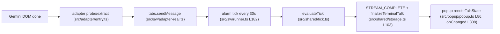

# Plan: Fix Popup Zoom and Gemini Answer-Return Bugs

- **Date**: 2026-10-29
- **Author**: CTO (assignmentId `team-talk-bugs-investigation-20261029`)
- **Product**: `talk-to-bro-personally` (Ticket #31 M5 acceptance gap — user-reported)
- **Inputs**: Engineer handover `.scratch/talk-bugs/engineer-findings-20261029.md`; current source in `.worktrees/talk-to-bro-personally-dev` (WIP `61d17bf` + uncommitted M5 test changes)
- **Status**: DRAFT — awaiting explicit human approval. After approval: CTO → PM → Engineer. No code changes yet.

## Bug 2 — Answer never returns after Gemini finishes (priority 1)

### Path traced (source evidence, paths relative to `products/talk-to-bro-personally`)

### Root-cause hypothesis (NOT yet proven; live SW-suspension repro is a mandatory gate)

1. `consecutiveDone` is an **in-memory** field of `TalkRunner` (`src/sw/runner.ts:70`, reset L183, used L375–376). Completion requires **two consecutive** stable done probes (`src/shared/tick.ts:75–80`).
2. Ticks come from `chrome.alarms` with `periodInMinutes: 0.5` = **30 s** (`runner.ts:182/564/592/627`). `IDLE_TIMEOUT_MS = 30_000` (`tick.ts:4`). Idle timeout check runs **after** the complete check in the same tick (`tick.ts:103`).
3. MV3 service workers are suspended after ~30 s with no events. With the popup closed (normal use), each 30 s alarm tick usually wakes a **fresh SW instance**, so `consecutiveDone` restarts at 0 every tick:
   - Tick N (answer just finished, growth) → count = 1, no complete.
   - Tick N+1 (new SW, count 0 → 1, no growth) → not complete; `now - lastGrowthAt ≥ 30 s` → **`timeout_idle`**. The answer is never persisted as done.
4. Why it didn't reproduce: Engineer's live run kept the SW alive (CDP sampler polling storage/DOM every 4 s, sends from popup context), so the in-memory counter survived and the run finished at +63 s. M5 synthetic suite seeds state, which also bypasses this.

### Secondary items (lower confidence, verify during fix; do not expand scope unless they cause the failure)

- H-b: real-DOM done selector (`message-actions` / `.response-footer` / `.model-done-actions`) mismatch observed by Engineer's sampler — log and confirm, fix only if probes never report `complete`.
- H-c: `adapter-real.ts` maps `sendMessage` errors to fake probes (`loading`/`not_found`), hiding transport failures — add a debug log only.
- `checkReady` in `entry.ts` treats `validateBroChatUrl` object result as nullable — note for a separate ticket (not this fix).

### Proposed fix (only after the repro gate passes)

1. Persist the completion streak with the talk: add `doneStreak` to persisted talk state; read/write it in `runner.tick()` instead of the class field. Reset on growth/non-done as today.
2. **Preserve the M5 watchdog contract**: `IDLE_TIMEOUT_MS = 30_000` and `TOTAL_TIMEOUT_MS = 180_000` stay unchanged for genuinely unfinished generation.
3. Bounded confirmation window: when exactly one stable `complete` probe is recorded (`doneStreak == 1`), schedule a single one-shot confirmation alarm (`delayInMinutes: 0.5`) and allow at most **one** confirmation tick past the idle deadline. If that confirmation probe is not stable complete (no growth, same `textSig`, stop button hidden), reset the streak and apply `timeout_idle` normally. `TOTAL_TIMEOUT_MS` is never exempted. This cannot hide a hung or false-complete probe for more than one extra tick.
4. **No automatic fallback** to a 60 s idle timeout. Any change to timeout values is a separate behavioral change requiring separate human approval; if option 3 proves insufficient, Engineer reports blocked to CTO.
5. No change to M6/M7 features, selectors, or popup rendering unless the repro proves a hop is broken.

### Regression cases

- Unit (`tests/unit/runner.test.ts`): simulate SW restart between ticks (new `TalkRunner` instance sharing storage) → talk reaches `done` with answer persisted; never `timeout_idle` when last two probes are stable done.
- Unit (`tests/unit/tick.test.ts`): doneStreak == 1, no growth ≥ 30 s → one confirmation allowed; second consecutive stable done → `complete`.
- Unit: doneStreak == 1 but confirmation probe not complete / changed sig → `timeout_idle` (no hidden hang).
- Unit: false-complete probe repeated past total deadline → `timeout_total` at 180 s (never exempted).
- Unit: unfinished generation with no growth for 30 s and doneStreak 0 → `timeout_idle` (M5 contract unchanged).
- Live (CfT, isolated profile, CDP_HOST=127.0.0.1): submit a real prompt, **close popup and stop all CDP polling of the SW**; wait ≥ 2 min; reopen popup → answer rendered. Run 3 times, include one long answer (> 30 s generation).

## Bug 1 — Popup text does not follow browser zoom (priority 2)

### Surface and root cause

- Surface is the toolbar popup only (`manifest.json:23` `default_popup` → `src/popup/popup.html`); no side panel. Injected Gemini toast already follows page zoom.
- `src/popup/popup.css` uses fixed sizes (`body { width: 360px }` L16; fonts 10–22 px L41–168; `.answer-content max-height: 240px` ~L171). Chrome extension popups render in their own context and **do not inherit the active tab's zoom**, so there is nothing for the popup to follow by CSS alone.
- Uncertainty: whether Chrome applies per-extension-origin zoom to popups (Ctrl+/- inside popup). Engineer must check live in CfT before coding.

### Proposed fix (minimal)

1. On popup open, read `chrome.tabs.getZoom(activeTabId)` and set a CSS variable `--ttb-zoom` on `:root`; listen to `chrome.tabs.onZoomChange` while open.
2. Convert popup sizes to `calc(<px> * var(--ttb-zoom, 1))` (or `rem` with `html { font-size: calc(16px * var(--ttb-zoom)) }`). Clamp width to Chrome popup max (800 px).
3. No change to options page or injected toast.

### Regression cases

- Unit: zoom helper maps 0.75 / 1 / 1.5 / 2 → expected root font-size and clamped width.
- Live (CfT): set Gemini tab zoom to 150 % via `chrome.tabs.setZoom`, open popup → computed `font-size` of answer text = 1.5× baseline; reset to 100 % → baseline.

## Execution order and gates

1. **Repro gate (Engineer via PM)**: live-confirm Bug 2 in CfT with the popup closed and no CDP keepalive/polling of the SW (observe only via one read after ≥ 2 min). Expect `timeout_idle`. If NOT reproduced, report blocked to CTO with evidence; no coding.
2. Implement Bug 2 fix + tests; then Bug 1 fix + tests (Bug 1 also gated by a live check of popup zoom behavior).
3. `tsc --noEmit`, unit suite, `npm run verify:m5`, plus the live regression cases above.
4. CTO review → CEO → human. No commits/merge/push without human approval. M5 stays open until live regression passes.

### Environment state constraints (not part of the bug fix)

- `spikes/m0-b/` is dirty from the investigation; its pristine backup is `/tmp/m0b-backup`. **Preserve both.** No blanket `git checkout`/`git clean`/restore. Ownership of the dirty state must be inspected first; any destructive cleanup requires a separate, specific human approval and is not bundled with these fixes. Fix work must avoid writing to `spikes/m0-b/` (use a separate build output dir).
- The running CfT instance (port 9222, `~/.chrome-cdp-profile`) may be shared. Do not stop it unless ownership and dependants are established; reuse it for the repro.

## Out of scope

Selector rewrites, M6/M7 features, options page zoom, `checkReady` latent bug (separate ticket).
