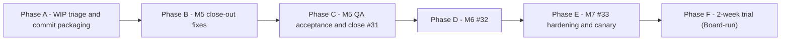

# Talk To Bro Personally — Project Continuation Plan (M5 close-out → M6 #32 → M7 #33)

- **Date**: 2026-10-30
- **Author**: CTO (assignmentId `assign-cto-1`, dispatch event `ceo-talk-recovery-20261030-0821`)
- **Status**: Phases A–C APPROVED by the Board (2026-10-30, CEO event `ceo-approved-m5-ac-20261030-0830`). Phases D–F NOT approved.

## 0. Approval record (2026-10-30)

- Approved: Phase A (local scoped commits), Phase B (Node 22 declaration/check, isolated harness incl. CfT reload, M5 popup-close continuation, truthful live tests), Phase C (QA evidence, then PM closes #31).
- Popup design NOT accepted: its changes stay uncommitted (see A1).
- Not authorized: push, merge, deletions (incl. `spikes/m0-b/popup.*`), M6/M7 implementation.
- Test counts: no fixed count; all existing and new tests must pass.
- QA captures screenshots for every passing and failing case and attaches them to the ticket.
- No CTO acceptance gate: Engineer → QA → PM. CTO is contacted only for plan gaps or technical blockers.
- **Worktree / branch**: `.worktrees/talk-to-bro-personally-dev` / `feat/talk-to-bro-personally/dev`, HEAD `88e0786`, ahead of origin by 1 (behind 0).
- **Epic**: #24. Tickets: #31 (M5, open, in progress), #32 (M6, open, blocked by #31), #33 (M7, open, blocked by #32).

## 1. Verified current state (evidence)

### 1.1 Git history relevant to M5

| Commit | Content | Acceptance status |
| :--- | :--- | :--- |
| `810c6fe` | M5 initial implementation (failures, tick, handoff, offscreen, popup, m5 suite) | CTO review: changes requested (4 items + typecheck) |
| `61d17bf` | "checkpoint unmerged work before quota reset (WIP, not acceptance)" — handoff.ts, index.ts, runner.ts, popup.ts, tab.ts, types.ts, handoff/runner tests | Not reviewed; not acceptance |
| `88e0786` | Bug1 popup zoom fix (popup.ts, zoom.ts, popup-zoom.test.ts) | Board-approved local commit; CTO-accepted; not pushed |

### 1.2 Uncommitted working tree (not acceptance)

| Path | Nature | Owner / origin |
| :--- | :--- | :--- |
| `scripts/test-m5-suite.js` | Reload via SW `chrome.runtime.reload()`; `CDP_HOST` env override | M5 harness fix |
| `src/popup/popup.css`, `popup.html`, `popup.ts` (part) | Popup redesign | `2026-10-29-popup-design-implementation.md` (status COMPLETED, uncommitted) |
| `src/popup/zoom.ts`, `tests/unit/popup-zoom.test.ts` | Base width constant follow-up | Popup design |
| `tests/unit/runner.test.ts` | New test: forceFailure drives all 14 codes to failed Talk | M5 AC6 (unit level) |
| `tests/unit/{adapter-real,extract-target,tab,talk-machine}.test.ts` | Type annotations / `frozen:false` fixture fields so `tsc --noEmit` passes | M5 typecheck item |
| Untracked `tests/popup-ui.test.mjs` | Live CfT popup screenshot test (requires CfT on 9222 + Node ≥ 22) | Popup design |
| Untracked `PRODUCT.md`, `.impeccable/`, plans `impeccable-init`, `popup-design-*`, `talk-bugs-zoom-and-completion-return` | Docs / design context | Design + bug work |
| Untracked `spikes/m0-b/popup.{css,html,js}` | Residue of live harness copying `dist/` into `spikes/m0-b` | **Do not delete** (Board instruction) |

Backup of the pre-restore spike state: `.scratch/talk-to-bro-personally/m0-b-before-restore-20261030T082008.tar.gz`.

### 1.3 Executed checks (CTO, 2026-10-30, this worktree, no file changes)

| Check | Result |
| :--- | :--- |
| `./node_modules/.bin/tsc --noEmit` | exit 0, 0 errors (working tree) |
| `npm test` with default Node v20.19.5 | **fails**: `Could not find 'tests/unit/**/*.test.*'` (glob unsupported in Node 20 test runner) |
| `npm test` with Node v22.23.4 | 105 tests, 105 pass, 0 fail |
| `node --test tests/popup-ui.test.mjs` (Node 20, no CfT check) | 6/6 fail at precondition (`WebSocket` missing) — environment, not product |
| `npm run verify:m5` (live CfT) | **Not executed** in this investigation |

### 1.4 Status of the four CTO review items on `810c6fe`

| # | Item | Static review of current code | Evidence gap |
| :--- | :--- | :--- | :--- |
| 1 | Explicit user action must execute a deferred handoff | `authorizeDeferred` path in `handoff.ts`; SW passes it from popup message; unit test "Explicit user action authorizes deferred handoff execution" | No live real `boot()` → deferred → click test |
| 2 | Copy truthfulness | Popup sends actual `copiedOk`; `done` only when `copied && focused`; partial UI text differentiates | No test for rejected `navigator.clipboard` → offscreen fallback/partial |
| 3 | Single SW ownership, dedup, persistent cancel, close continuation | done/partial guard, per-talk in-flight dedup, pre-action cancelled re-check, cancel now written by SW (`handoff/cancel`) | **Popup-close-during-countdown continuation not implemented** (no port/close signal in `src/sw/index.ts` or popup) |
| 4 | AC6 live evidence | Unit test drives 14 codes through real `debug:v1.forceFailure` (uncommitted) | **Live suite still writes failed runtime objects directly** while labelled "via debug:v1.forceFailure"; deferred live test pre-writes state; no closed-popup offscreen/tab-focus/Shadow-notice live check |

Other facts:
- `test-m5-suite.js` copies `dist/` into `spikes/m0-b/` and restores from a backup; an aborted run leaves spike residue. This conflicts with the bug plan rule "fix work must avoid writing to `spikes/m0-b/`".
- One live flake recorded on #31 (`NOT_SIGNED_IN` popup visibility, passed on rerun; root cause unconfirmed).
- Bug2 (missing answer) closed by the Board as not reproducible; does not close M5.

## 2. Phased plan

Each phase ends at a gate. Tickets are dispatched one at a time by PM with `ticket=<id> plan=<this file>`. Engineer hands finished work to QA. QA verifies only the listed AC and test cases.

### Phase A — WIP triage and commit packaging (no behavior change)

**Goal**: turn the uncommitted tree into reviewable, single-purpose local commits so later tickets start from a clean base.

Ticket A1 — Package existing work into scoped commits.
- Dependencies: Board approval of the grouping below.
- Approved groups to commit locally: (a) M5 typecheck fixture fixes + runner forceFailure unit test; (b) M5 harness reload fix. Not committed (preserved as-is): popup design changes (css/html/popup.ts design hunks, related zoom/test follow-up, `tests/popup-ui.test.mjs`), design/docs files (`PRODUCT.md`, `.impeccable/`, design plans, `talk-bugs` plan, this plan unless PM decides otherwise), and `spikes/m0-b/popup.*`. If an M5 hunk cannot be separated from a design hunk in the same file, report blocked to CTO (cc PM) rather than committing the design.
- Acceptance criteria:
  - AC-A1.1 Each commit touches only its group's files; `spikes/m0-b/` unchanged.
  - AC-A1.2 After each commit, `tsc --noEmit` exits 0 and `npm test` (Node 22) passes all existing and new tests (no fixed count).
  - AC-A1.3 No push or merge.
- Test cases:
  - TC-A1.1 `git show --stat` per commit matches group list.
  - TC-A1.2 `git status --short` afterwards shows only the preserved unaccepted popup design changes, design/docs files and `spikes/m0-b/popup.*`; no M5 file remains modified.
  - TC-A1.3 Run `tsc --noEmit` and Node 22 `npm test` at final HEAD.
- Risk: popup design and M5 popup.ts edits overlap in one file; hunks must be split carefully (low risk, reversible).
- Board decision (made): popup design not accepted; stays uncommitted.

### Phase B — M5 close-out fixes (within the six existing #31 AC)

Ticket B1 — Pin test runtime to Node ≥ 22.
- AC-B1.1 Running `npm test` under an unsupported Node fails with a clear version message, not a glob error; `package.json` `engines.node` and a product `.nvmrc` declare `>=22`.
- TC-B1.1 Node 22: `npm test` → all tests pass. TC-B1.2 Node 20: clear version error.

Ticket B2 — Isolate live harness from `spikes/m0-b`.
- AC-B2.1 `verify:m5` (and the M3/M4 suites if they share the pattern) loads the built extension from a dedicated scratch directory (`.scratch/talk-to-bro-personally/cft-ext/`), never writes to `spikes/`.
- AC-B2.2 Aborting the suite mid-run leaves `git status` for `spikes/` unchanged.
- TC-B2.1 Run `verify:m5`; compare `git status -- spikes/` before/after. TC-B2.2 Kill the run after the copy step; same comparison.
- Risk: extension ID changes with load path; CfT profile must load the new path (manual Board/Engineer step in CfT per `docs/testing/chrome-for-testing-setup.md`).

Ticket B3 — Popup-close continuation during countdown (review item 3 remainder).
- AC-B3.1 If the popup closes while a pending countdown runs and the user has not cancelled, the SW completes the handoff exactly once via the closed-popup path (offscreen copy, tab switch, focus, notice).
- AC-B3.2 Cancel before close → no handoff; status stays `cancelled`.
- AC-B3.3 A completion for an older Talk ID never overwrites a newer Talk.
- TC-B3.1 Unit: simulate popup disconnect during pending → one `performHandoff` call, final status `done` or `partial` with observed booleans.
- TC-B3.2 Unit: cancel then disconnect → zero external calls.
- TC-B3.3 Unit: two concurrent switch requests → one execution.
- TC-B3.4 Unit: stale talkId completion → newer Talk unchanged.
- Scope limit: no new scheduling system (per CTO review).

Ticket B4 — Truthful live AC6 evidence (review item 4).
- AC-B4.1 The live 14-code loop creates failures only via `debug:v1.forceFailure` + real submit, not by writing failed runtime objects.
- AC-B4.2 Live closed-popup case verifies clipboard content (offscreen), active Bro Chat tab, badge `!`, and the Shadow DOM notice root.
- AC-B4.3 Live deferred case runs the real boot path (cleared session → SW restart), asserts no tab/focus change at boot, then clicks "去找老大 ⏎" and asserts clipboard + tab switch.
- AC-B4.4 Live rejected-clipboard case shows partial UI wording, not "copied".
- AC-B4.5 Suite restores the user's clipboard and settings, and prints CfT version, extension path and build commit.
- TC-B4.1 `npm run verify:m5` passes twice consecutively. TC-B4.2 grep the suite: no direct `phase: 'failed'` runtime writes in the 14-code loop.
- Risk: live flake (`NOT_SIGNED_IN` visibility). Fix only with deterministic waits on observed state, not longer sleeps.

### Phase C — M5 acceptance and closure

- Dependencies: B1–B4 done.
- AC-C.1 QA executes TC-A1, TC-B1…B4 and the six #31 AC; report records Node version, CfT version and commit, with screenshots of every passing and failing case attached to the ticket.
- AC-C.2 PM closes #31 only after QA pass; #32 unblocked.
- Not authorized now (separate Board decision later): push of `feat/talk-to-bro-personally/dev` (currently 1 ahead + Phase A/B commits) and whether to merge into `dev`.

### Phase D — M6 #32 (Talk Log UI, selector health, Pip pixel art, README)

One ticket per #32 AC, dispatched in this order:

| Ticket | AC (from #32) | Test cases |
| :--- | :--- | :--- |
| D1 Stats dashboard | Options shows Sent In / Read Back rates with exact numerator/denominator; "No samples yet" empty state (F8) | Unit: `computeStats` on 0, mixed, all-failed logs; DOM: rendered text equals `n/d (pct)`; empty log → empty-state text |
| D2 Selector health check | `selfCheck()` renders a traffic light per selector in `selectors.ts` | Unit: every exported selector has one row; fixture page → green; missing node → red; live CfT on signed-in Gemini → no red |
| D3 Pip 5 states | door, waiting, boss_speaks, scared, ignored derived purely from Talk state; status bar | Unit: table test phase/failure → state for every phase and both moods; no other state source |
| D4 Pixel typography | Subsetted pixel font on chrome/buttons only; answer body uses system font | DOM: computed font-family of buttons vs `.answer`; font file size within agreed budget |
| D5 README | Install/unpack, Bro Chat setup, selector maintenance, troubleshooting | Reviewer follows README on clean CfT profile and reaches a successful Talk |

- Dependencies: Phase C. D3 must reuse `failures.ts` mood mapping (no duplication).
- Risks: sprite assets need a design source (Designer role); font license must permit subsetting/bundling; scope creep into M7 hardening — reject under YAGNI.
- Board decisions: approve pixel font and sprite source/licensing; confirm Designer involvement.

### Phase E — M7 #33 hardening and canary

| Ticket | AC (from #33) | Test cases |
| :--- | :--- | :--- |
| E1 Release build | Debug defaults removed (incl. `debug:v1.forceFailure` reachable only in dev build); strict TS zero warnings; unpacked v0.1.0 package | Build release; grep bundle for debug hooks; `tsc --noEmit` exit 0; manifest version 0.1.0 |
| E2 Manual sanity | F1–F8, IME composition Enter, background tab hidden > 5 min, consecutive queries, long chat history | Checklist executed by QA in CfT with timestamps and evidence per row |
| E3 Canary procedure | Daily "Pip Knocks on Door" + selector health with no red | Procedure doc; one recorded run with D2 output |

- Risks: debug hook removal can break the live M5 suite — keep a dev build target for tests. Hidden-tab > 5 min is a real-time wait (allowed at this stage).

### Phase F — 2-week trial (Board-run, calendar-bound)

- AC-F.1 Steps reduced 6 → 2; ≥ 20 queries/week; zero manual tab switching.
- Measurement from local Talk log stats (D1) plus Board self-report. Agents do not fabricate trial data.
- Board decision: trial start date and weekly review owner.

## 3. Risks summary

| Risk | Impact | Mitigation |
| :--- | :--- | :--- |
| Live CfT flakiness | False red/green on M5 acceptance | Deterministic waits; two consecutive passes (TC-B4.1) |
| Harness writes into `spikes/m0-b` | Dirty tree, accidental spike loss | Ticket B2 |
| Node 20 default shell | `npm test` false failure | Ticket B1 |
| Mixed popup-design + M5 changes in one tree | Unreviewable commits | Ticket A1 |
| Gemini DOM drift | Selector failures in M6/M7 | D2 health check + E3 canary |

## 4. Board approvals required

1. ~~Phases A–C~~ approved 2026-10-30; popup design not accepted.
2. Phases D–F.
3. ~~Harness load path change (B2) including CfT reload~~ approved.
4. Push/merge of `feat/talk-to-bro-personally/dev` after Phase C.
5. M6 font/sprite sourcing and licensing.
6. Trial start date (Phase F).

Out of scope for this plan: any deletion of `spikes/m0-b/popup.*`, timeout value changes (require separate approval per the bug plan), and new features beyond #31–#33 AC.
