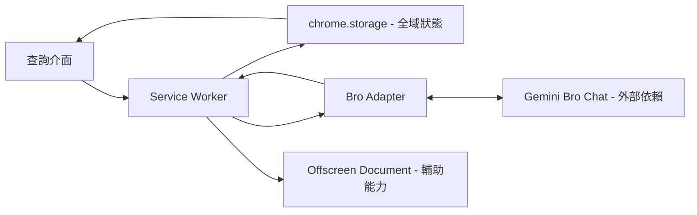

# Talk To Bro — 系統總覽

日期：2026-11-02 · 狀態：初始摘要

## 摘要與目的

減少閱讀英文時切換分頁、手動貼上問題及來回取得答案的操作。透過 Chrome MV3 擴充套件協調查詢介面與既有 Gemini Bro Chat。

本文件根據 [專案 README](../../README.md) 整理元件責任；詳細規格由 [SDD Index](README.md) 路由至既有文件。不代表本次已查核程式碼、測試或所有規格的一致性。

## 系統邊界與元件

| 元件 | 設計責任 |
|---|---|
| 查詢介面（Popup 等） | 接收輸入、顯示狀態與答案；擴展閱讀設計見主題規格 |
| Service Worker | 協調執行、推進狀態、發出 probe 與處理恢復 |
| Bro Adapter | 隔離 Gemini 頁面 DOM 互動與選擇器 |
| chrome.storage | 保存全域狀態；詳細欄位與更新規則見 Tech Spec |
| Offscreen Document | 剪貼簿等輔助能力 |
| Gemini Bro Chat | 外部頁面依賴；頁面變更、登入狀態等不是擴充套件可完全控制的條件 |

圖僅描述責任與互動方向，不定義詳細訊息協定或完整狀態轉移。

## 核心設計原則

- SW 協調時間推進，不依賴背景 Gemini 頁面的計時器維持進度。
- 全域狀態以 storage 保存，SW 為唯一寫入者，介面響應狀態。
- 送出前先記錄狀態，避免中斷後盲目重送。
- 自動化失敗時提供 Handoff 退路；觸發條件與限制以詳細規格為準。

不在此重述精確 probe 間隔、timeout 數值或訊息欄位，避免形成第二份易過期規格。

## 局部更新範例

若討論「Handoff 剪貼簿失敗」：先讀索引的技術設計列，搜尋 Tech Spec 的 Handoff／剪貼簿相關標題，分段讀取該章節與相關狀態約束，再整理寫回原章節。若涉及產品行為改變，共讀相關 PRD；若權威或決策不明則先確認，不只修改本摘要。

## 狀態與後續

- 本次新增的是文件導航框架，不是功能發布或架構改版。
- 實作進度應查核程式碼、測試與工作紀錄，不以計畫存在推論完成。
- 來源優先序與待確認事項見 [SDD Index](README.md#待確認事項)。
