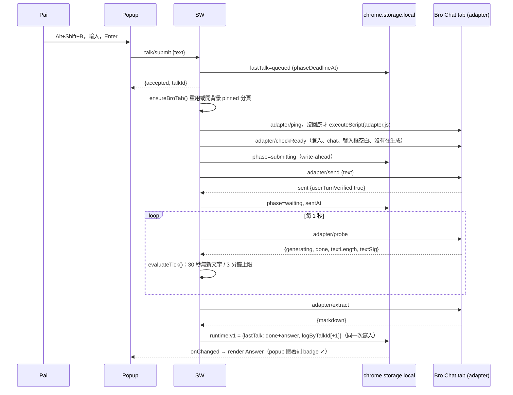
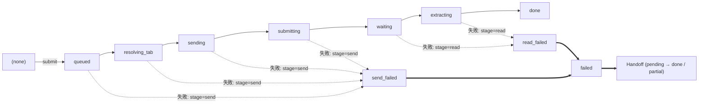
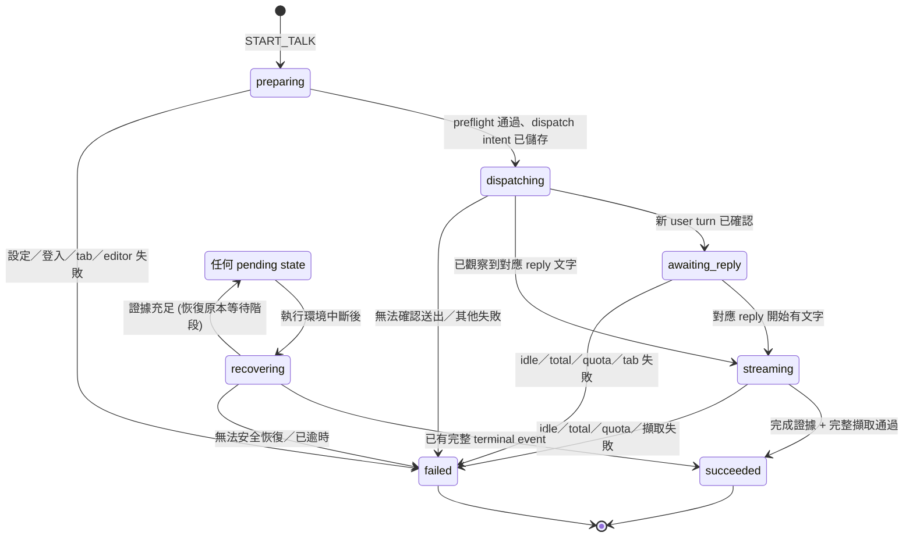
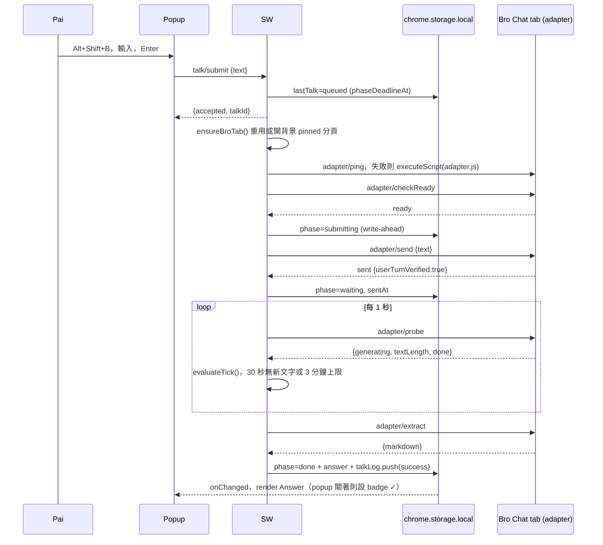
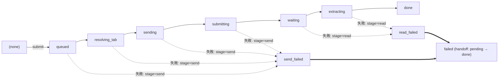

<!-- nsync:callout icon="💡" color="gray_bg" -->
> 💡 ***Refs***<!-- nsync:br -->
> [📄 Notion Page](https://app.notion.com/p/3c20e8c693da42eeb1e9436942b79aef)<!-- nsync:mention-page -->
<!-- /nsync:callout -->
<!-- nsync:callout icon="💡" color="gray_bg" -->
> 💡 ***Source***
> Arena（[📄 Notion Page](https://app.notion.com/p/6d6b7d9752994cc6829ffc26471c36a5)<!-- nsync:mention-page -->）：Opus 5.5 ＋ GPT-6.1 Sol 兩個 runner，Opus 5.5 cross-judge，reasoning effort high。
<!-- /nsync:callout -->
<!-- nsync:callout icon="💡" color="gray_bg" -->
> 💡 ***Summary***<!-- nsync:br -->
> Talk To Bro Personally 的 MV3 技術設計與開發計畫。SW 每秒 probe 背景 Bro Chat 分頁、chrome.storage 為唯一真實狀態、write-ahead 不重送；selector 集中與 selfCheck 應付 Gemini 改版；任何失敗都 Handoff（popup 關著時用 offscreen 複製）。開發從 M0 spike（背景分頁串流是否更新）開始，約 11–13 個晚上＋2 週試用。
<!-- /nsync:callout -->
<!-- nsync:callout icon="⚔️" color="gray_bg" -->
> ⚔️ Arena 產出（2 runners + 1 judge）。底稿：Opus 5.5 的設計（Candidate 2），再嫁接 GPT-6.1 Sol（Candidate 1）的 PRD 合規與正確性保護。依據 PRD v1.1、Glossary、ADR-0001：[📄 Notion Page](https://app.notion.com/p/3c20e8c693da42eeb1e9436942b79aef)<!-- nsync:mention-page -->。比稿過程見最下方 Synthesis note。
<!-- /nsync:callout -->
# Talk To Bro Personally：技術設計與開發計畫 v1.0
讀者：Pai（solo developer）。目標：Chrome ≥ 132、unpacked MV3 extension。所有產品決策照 PRD v1.1，不改；這份只回答「怎麼做」與「怎麼驗」。
## 0. 設計原則
1. **Service worker 管時間，adapter 只回報。** 計時、逾時判斷、狀態推進都在 service worker（SW）。Bro Chat 分頁裡的 adapter 不存狀態、不跑 timer，SW 每秒 probe 一次。理由：背景分頁的 chained timer 會被節流到約每分鐘一次，30 秒規則放在頁面裡會失準；而 SW 每次呼叫 extension API 都會重設 30 秒閒置計時（Chrome 110+），每秒一次 `tabs.sendMessage` 本身就讓 SW 在 Talk 進行中活著。
2. **`chrome.storage`**** 是唯一真實狀態，SW 是唯一寫入者。** Popup 只讀 storage 與 `storage.onChanged`。Popup、Options、adapter 都只能「請 SW 改」，自己不寫。
3. **每個未結束的 Talk 都有絕對時間 ****`phaseDeadlineAt`****。** 三層 watchdog（SW 輪詢、`chrome.alarms`、popup）都看它；過期一定被推到 `failed`，不會無限 loading。
4. **先寫入、再送出（write-ahead），絕不自動重送。** 按 Gemini 送出鍵前先把狀態寫成 `submitting`。SW 中途被終止，恢復時只找「送出證據」，找不到就 Handoff，不重送。
5. **原樣送出，不碰 Pai 的東西。** Talk 原文照送（trim 只用來判斷空白）；輸入框已有草稿、Bro 正在回別的問題時，不清空、不按 Stop，直接 Handoff。
6. **Gemini 的 DOM 知識全部集中在 ****`adapter/selectors.ts`****。** Gemini 改版時，通常只改這一個檔案，再補 fixture。
## 1. 架構
### 1.1 元件與職責
<table header-row="true">
<tr>
<td>元件</td>
<td>職責</td>
<td>不做的事</td>
</tr>
<tr>
<td>**Popup** `popup.html`</td>
<td>F1 focus 輸入框；F2 驗證輸入；顯示 Last Talk、Pip 狀態；Markdown render Answer；一鍵複製；popup 開著時的 Handoff 剪貼簿寫入</td>
<td>不跑 Talk、不計時、不寫 storage、不碰 Bro Chat 分頁的 DOM</td>
</tr>
<tr>
<td>**Background SW** `sw.js`（ESM）</td>
<td>Talk runner（狀態機）；找到或開啟 Bro Chat 分頁（F7）；注入 adapter；每秒 probe；逾時判斷；寫入 Last Talk 與 Talk Log（F8）；啟動時 reconcile；alarm watchdog；action badge；Handoff 協調</td>
<td>不直接操作 Gemini DOM</td>
</tr>
<tr>
<td>**Bro adapter** `adapter.js`（IIFE，`chrome.scripting.executeScript` 按需注入 ISOLATED world）</td>
<td>`checkReady`、`send`、`probe`、`extract`（HTML→Markdown）、`selfCheck`、`showHandoffNotice`</td>
<td>不計時、不存 Talk 狀態、不寫 storage</td>
</tr>
<tr>
<td>**Options** `options.html`</td>
<td>F6 設定並驗證 Bro Chat URL；F8 成功率；「Pip 去敲門」連線測試（只跑 `checkReady`，不送出）；Selector 健康檢查紅綠燈</td>
<td>不提供 timeout 等額外設定</td>
</tr>
<tr>
<td>**Offscreen document** `offscreen.html`</td>
<td>**只做一件事**：popup 已關閉時，替 Handoff 把 Talk 寫進剪貼簿（reason `CLIPBOARD`）</td>
<td>不當 keepalive、不跑 adapter、不計時</td>
</tr>
</table>
**為什麼需要 offscreen：** PRD 規定任何失敗都要 Handoff（複製 Talk＋切到 Bro Chat），不論 popup 是否開著。SW 沒有 DOM clipboard，popup 關著時唯一正規解法就是 `CLIPBOARD` 的 offscreen document。它只在這條路徑被建立，用完即關。
**為什麼 adapter 按需注入、不在 manifest 宣告 ****`content_scripts`****：** extension reload 後，已開著的 Gemini 分頁會留下失效的舊 script。做法是「先 ping，沒回應才注入」，並用**帶 build ID 的 guard**（`window.__ttb_<BUILD_ID>`）防止同一版本重複安裝；新版本的 build ID 不同，一定會裝上新的實例，不會被舊實例擋住。
### 1.2 專案結構與工具
```javascript
talk-to-bro/
  manifest.json
  scripts/build.mjs           # esbuild：sw(esm) / adapter(iife) / popup / options / offscreen
  src/
    shared/   types.ts messages.ts storage.ts talk-machine.ts tick.ts
              failures.ts validate.ts stats.ts pip.ts
    sw/       index.ts boot.ts runner.ts bro-tab.ts reconcile.ts handoff.ts badge.ts
    adapter/  selectors.ts   ← Gemini 改版時通常只改這個檔案
              dom.ts gemini.ts html-to-md.ts notice.ts entry.ts
    popup/    popup.html popup.ts render-md.ts popup.css
    options/  options.html options.ts
    offscreen/offscreen.html clipboard.ts
  test/unit/  test/fixtures/gemini/<yyyy-mm-dd>/*.html  test/golden/*.md
```
依賴：`marked`、`dompurify`、`turndown`、`turndown-plugin-gfm`，全部打包進 extension，不從 CDN 載入。開發：`typescript`（strict）、`esbuild`、`vitest`、`jsdom`、`@types/chrome`。UI 不用框架，vanilla TS 加一個 `render(view)` 就夠。
### 1.3 Manifest
```json
{
  "manifest_version": 3,
  "name": "Talk To Bro Personally",
  "version": "0.1.0",
  "minimum_chrome_version": "132",
  "permissions": ["storage", "tabs", "scripting", "alarms", "offscreen", "clipboardWrite"],
  "host_permissions": ["https://gemini.google.com/*"],
  "background": { "service_worker": "sw.js", "type": "module" },
  "action": { "default_popup": "popup.html", "default_title": "Talk To Bro" },
  "options_ui": { "page": "options.html", "open_in_tab": true },
  "commands": {
    "_execute_action": {
      "suggested_key": { "default": "Alt+Shift+B" },
      "description": "叫 Pip 出來"
    }
  },
  "content_security_policy": { "extension_pages": "script-src 'self'; object-src 'none'" }
}
```
- `tabs`：Bro 分頁被導到 `accounts.google.com`（未登入）時仍讀得到 `tab.url`。不讀、不存其他頁面內容。
- `_execute_action`：Chrome 內建的「開 popup」指令，快捷鍵可在 `chrome://extensions/shortcuts` 改，直接滿足 F1。
- 不設 `externally_connectable`。SW 收到任何 message 都檢查 `sender.id === chrome.runtime.id`；來自分頁的 message 另外檢查 `sender.tab.id` 等於目前綁定的 Bro 分頁、且 `sender.url` 是 Bro Chat。
### 1.4 一次 Talk 的流程

<table header-row="true">
<tr>
<td>#</td>
<td>步驟</td>
<td>預算</td>
<td>失敗歸類</td>
</tr>
<tr>
<td>1</td>
<td>popup 驗證輸入，送 `talk/submit`</td>
<td>—</td>
<td>不送出（UI 提示，不記 Log）</td>
</tr>
<tr>
<td>2</td>
<td>SW 檢查：已設定 Bro Chat、沒有其他 Talk 在跑</td>
<td>—</td>
<td>`NO_BRO_CHAT`（send）</td>
</tr>
<tr>
<td>3</td>
<td>`resolving_tab`：找到或開分頁、必要時 reload、注入、`checkReady`</td>
<td>25 s</td>
<td>send</td>
</tr>
<tr>
<td>4</td>
<td>`sending`：插入文字、驗證、等送出鍵可按</td>
<td>10 s</td>
<td>send</td>
</tr>
<tr>
<td>5</td>
<td>`submitting`（write-ahead 後才 click）：確認新 user turn 文字等於 Talk</td>
<td>10 s</td>
<td>send</td>
</tr>
<tr>
<td>6</td>
<td>`waiting`：每秒 probe；30 s 無新文字或 `sentAt` 起 180 s 即失敗</td>
<td>≤ 180 s</td>
<td>read</td>
</tr>
<tr>
<td>7</td>
<td>`extracting`：連續兩次 probe 都完成且文字不變，才轉 Markdown</td>
<td>5 s</td>
<td>read</td>
</tr>
<tr>
<td>8</td>
<td>`done`：Answer 與 Talk Log 同一次 `storage.set`</td>
<td>—</td>
<td>—</td>
</tr>
</table>
## 2. 資料模型與狀態機
### 2.1 Storage keys
<table header-row="true">
<tr>
<td>區域</td>
<td>Key</td>
<td>內容</td>
<td>說明</td>
</tr>
<tr>
<td>`local`</td>
<td>`settings:v1`</td>
<td>`{ broChatUrl: string | null }`</td>
<td>F6；重開 Chrome 仍在</td>
</tr>
<tr>
<td>`local`</td>
<td>`runtime:v1`</td>
<td>`{ lastTalk: Talk | null, logByTalkId: Record<id, LogEntry> }`</td>
<td>F5＋F8 放同一個 key：終態與 Log 一次寫入，不會「成功但沒記 Log」；以 talkId 去重，同一 Talk 最多一筆</td>
</tr>
<tr>
<td>`local`</td>
<td>`debug:v1`</td>
<td>`{ forceFailure?: FailureCode, verbose?: boolean }`</td>
<td>故障注入</td>
</tr>
<tr>
<td>`session`</td>
<td>`session:v1`</td>
<td>`{ bootId, broTab?: { tabId, windowId } }`</td>
<td>瀏覽器重開就清空；用來判斷「這是新的瀏覽器 session」</td>
</tr>
</table>
Timeout 是程式常數（`idleMs: 30_000`、`totalMs: 180_000`），不做成設定，維持 PRD 範圍。
```typescript
// shared/types.ts
export type TalkPhase =
  | 'queued' | 'resolving_tab' | 'sending' | 'submitting'
  | 'waiting' | 'extracting' | 'done' | 'failed';

export type FailureCode =
  | 'NO_BRO_CHAT' | 'BRO_CHAT_MISSING' | 'NOT_SIGNED_IN' | 'INPUT_NOT_FOUND'
  | 'EDITOR_BUSY' | 'SUBMIT_UNCONFIRMED' | 'TIMEOUT_IDLE' | 'TIMEOUT_TOTAL'
  | 'QUOTA_EXHAUSTED' | 'TAB_UNRESPONSIVE' | 'TAB_CLOSED' | 'EXTRACT_FAILED'
  | 'INTERRUPTED' | 'INTERNAL';

export interface Talk {
  id: string;                     // crypto.randomUUID()
  text: string;                   // Talk 原文，不 trim
  phase: TalkPhase;
  createdAt: number; updatedAt: number;
  phaseDeadlineAt: number | null; // 非終態一定有值
  sentAt?: number;                // user turn 確認時間；3 分鐘從這裡算
  lastGrowthAt?: number;          // 最近一次看到文字變化
  lastSig?: string;               // 最近一次 probe 的文字簽章（長度＋hash）
  streamedChars?: number;         // 只給 Pip 進度條用
  tabId?: number;
  answerMarkdown?: string;
  failure?: { code: FailureCode; stage: 'send' | 'read'; at: number; maybeSent?: boolean };
  handoff?: { status: 'pending' | 'deferred' | 'done' | 'partial'; copied: boolean; focused: boolean };
}

// F8：只有結果與時間，不含 Talk、Answer、URL 或失敗原因
export interface LogEntry { result: 'success' | 'send_failed' | 'read_failed'; at: number }
```
失敗原因（`failure.code`）只留在 `lastTalk` 給畫面與除錯用，下一筆 Talk 開始就被覆蓋，不進 Talk Log。`logByTalkId` 超過 2000 筆時刪最舊的。
### 2.2 狀態機

- 轉換寫成純函式 `transition(talk, event, now): Talk`，vitest 測。
- 終態 `done` / `failed` 一律 `phaseDeadlineAt = null`，不可逆；晚到的事件丟掉。
- 同一時間只有一個 Talk。`lastTalk` 未結束時 `talk/submit` 回 `{ accepted:false, reason:'BUSY' }`，popup 顯示「Pip 還在等老大」。
- Talk 進行中，Options 不允許改 Bro Chat URL（提示等這筆結束）。
### 2.3 中斷情境
<table header-row="true">
<tr>
<td>情境</td>
<td>行為</td>
</tr>
<tr>
<td>**Popup 在途中關閉**</td>
<td>不影響。runner 在 SW 繼續，結果寫進 `lastTalk`。完成時 badge `✓`、失敗 `!`；下次開 popup 清 badge 並顯示結果（F5）。</td>
</tr>
<tr>
<td>**SW 被終止**</td>
<td>正常不會發生：每秒 API 呼叫會重設閒置計時，每個步驟也都遠短於 5 分鐘單次上限。仍要能自救：Talk 開始時建 `chrome.alarms.create('ttb-watchdog', { periodInMinutes: 0.5 })`（30 秒是 Chrome 120+ 的最小週期），結束時清掉；SW 每次啟動跑 `boot()`。</td>
</tr>
<tr>
<td>**瀏覽器在途中重開**</td>
<td>`boot()` 發現 `session:v1` 是空的＝新瀏覽器 session：未結束的 Talk 一律 `failed / INTERRUPTED`（有 `sentAt` 算 read_failed，否則 send_failed），Handoff 標為 `deferred`，**等 Pai 下次開 popup 才執行**，避免開機時突然搶焦點、覆寫剪貼簿。不自動恢復：3 分鐘通常早已過了。</td>
</tr>
<tr>
<td>**Pai 關掉 Bro Chat 分頁**</td>
<td>`tabs.onRemoved` 對到 `talk.tabId` → `TAB_CLOSED`。</td>
</tr>
</table>
**單一入口 ****`boot()`**（SW top-level 呼叫一次，回傳 promise，所有 listener 先 `await ready`）。不依賴 `runtime.onStartup` 與 top-level 誰先跑。
`reconcile()` 依找到的 phase：
<table header-row="true">
<tr>
<td>Phase</td>
<td>動作</td>
</tr>
<tr>
<td>`queued` / `resolving_tab` / `sending`</td>
<td>從 `resolving_tab` 重跑（還沒按送出，安全）。若輸入框內容剛好等於這筆 Talk 原文，視為自己先前插入的，直接沿用；其他非空內容一律 `EDITOR_BUSY`。</td>
</tr>
<tr>
<td>`submitting`</td>
<td>結果不確定，**絕不重送**。probe：最新 user turn 文字等於 Talk → 視為已送出，進 `waiting`；否則 `SUBMIT_UNCONFIRMED`，`maybeSent: true`，Handoff 訊息提示「可能已送出，先看一下有沒有重複再貼」。</td>
</tr>
<tr>
<td>`waiting`</td>
<td>用存好的 `sentAt`、`lastSig` 繼續輪詢；已超過 `sentAt + 180s` → `TIMEOUT_TOTAL`。</td>
</tr>
<tr>
<td>`extracting`</td>
<td>重新 extract。</td>
</tr>
<tr>
<td>終態</td>
<td>不處理（只檢查 `handoff.status === 'pending'` 是否要補做）。</td>
</tr>
</table>
### 2.4 Popup 端的保險（只顯示，不寫入）
Popup 開啟時讀到未結束的 Talk，且 `now > phaseDeadlineAt + 10s`：
1. 送 `talk/reconcile` 給 SW（這個 message 本身就會喚醒 SW）。
2. 5 秒內 `lastTalk` 沒變，popup **只在畫面上**顯示「Pip 迷路了」與「去找老大」按鈕（popup 自己複製 Talk、用 `chrome.tabs.update` 切過去），不寫 storage。下次 SW 醒來由 reconcile 正式結案。
`chrome.storage` 沒有 compare-and-set，所以不讓 popup 和 SW 搶著寫同一個 key。
## 3. Bro adapter
### 3.1 找到、開啟、重用 Bro Chat 分頁（F7）
```typescript
// sw/bro-tab.ts
export function parseChatRef(url: string): BroChatRef | null;
// 接受 https://gemini.google.com[/u/N]/app/<chatId> 或 [/u/N]/gem/<gemId>/<chatId>
// 比對時「帳號前綴 /u/N ＋ chatId」都要相同；忽略 query 與 hash

export async function ensureBroTab(ref: BroChatRef): Promise<chrome.tabs.Tab> {
  return tabMutex.run(async () => {                      // 記憶體鎖：同一時間只有一個建立流程
    let tab = await getCachedTab();                      // session:v1.broTab
    if (tab && isOnAccounts(tab.url)) return tab;        // 被導去登入頁：沿用，交給 checkReady 回報 NOT_SIGNED_IN
    if (tab && !matchesChat(tab.url ?? tab.pendingUrl, ref)) tab = null;  // Pai 拿去做別的事了：放手，不把它導回來
    if (!tab) tab = pickBest((await chrome.tabs.query({ url: 'https://gemini.google.com/*' }))
                    .filter(t => matchesChat(t.url ?? t.pendingUrl, ref)));   // 先綁定過的 > pinned > lastAccessed
    if (!tab) {
      const win = await chrome.windows.getLastFocused({ windowTypes: ['normal'] });
      tab = await chrome.tabs.create({ url: ref.url, windowId: win.id, pinned: true, active: false, index: 0 });
    }
    if (tab.discarded || tab.frozen) await chrome.tabs.reload(tab.id!);  // 只在送出前做；reload 不會切換分頁
    await chrome.tabs.update(tab.id!, { autoDiscardable: false });
    await setCachedTab(tab);
    return tab;
  });
}
```
- **不重複開分頁**：mutex；先認快取 tabId（處理被導到登入頁、URL 對不上的情況）；同時比對 `url` 與 `pendingUrl`（避免分頁還在載入就再開一個）；用帳號前綴＋chatId 比對。Pai 自己開的多個 Bro 分頁不關，只挑一個用。
- **不搶焦點**：`create({ active:false })`、`reload`、`executeScript`、`sendMessage` 都不會切換目前分頁；`active:false` 也不影響視窗 focus。只有 Handoff 會 `active:true` 加 `windows.update({ focused:true })`。
- **防 discard**：`autoDiscardable:false` 只是降低機率，不保證。`discarded` / `frozen`（Chrome 132+；frozen 分頁不能執行任何 task）在**送出前**遇到就 reload；**送出後**遇到不 reload（會毀掉串流），直接 `TAB_UNRESPONSIVE`。
### 3.2 Adapter 介面
```typescript
// shared/messages.ts —— SW 只認得這組介面
export interface BroAdapter {
  checkReady(a: { chatId: string; text: string }): Promise<ReadyResult>;
  send(a: { talkId: string; text: string }): Promise<SendResult>;
  probe(a: { talkId: string; text: string }): Promise<ProbeResult>;
  extract(a: { talkId: string; text: string }): Promise<{ markdown: string } | { error: 'EXTRACT_FAILED'; reason: string }>;
  selfCheck(): Promise<Record<keyof typeof GEMINI, boolean>>;
  showHandoffNotice(a: { message: string }): Promise<void>;
}

export type ReadyResult =
  | { ok: true; editorHasOwnText: boolean }
  | { ok: false; code: 'NOT_SIGNED_IN' | 'BRO_CHAT_MISSING' | 'INPUT_NOT_FOUND' | 'EDITOR_BUSY' | 'QUOTA_EXHAUSTED' };

export interface ProbeResult {
  page: 'ready' | 'signed_out' | 'wrong_chat' | 'loading';
  turn: 'not_found' | 'pending' | 'streaming' | 'complete';
  generating: boolean;    // stop 按鈕存在
  textLength: number;     // 新 model turn 的文字長度（含 thinking，見 A3）
  textSig: string;        // 長度＋FNV-1a hash；同長度替換也算變化
  quota: boolean;
}
```
### 3.3 Selector 隔離
`adapter/selectors.ts` 是唯一知道 Gemini DOM 長相的檔案。每項是一組依序嘗試的候選；優先用結構性 custom element（如 `model-response`），不依賴介面語言的 aria-label 文字。以下是觀察到的寫法，**一律要在 M0 用真實頁面確認**：
```typescript
export const GEMINI = {
  verifiedOn: '2026-11-xx',
  editor:        ['rich-textarea .ql-editor[contenteditable="true"]', 'div[contenteditable="true"][role="textbox"]'],
  sendButton:    ['button.send-button:not(.stop)', 'button[aria-label*="Send" i]', 'button[aria-label*="傳送"]'],
  stopButton:    ['button.send-button.stop', 'button[aria-label*="Stop" i]', 'button[aria-label*="停止"]'],
  userTurn:      ['user-query'],
  userTurnText:  ['.query-text', 'user-query-content'],
  modelTurn:     ['model-response'],
  modelBody:     ['message-content .markdown', '.model-response-text .markdown'],
  modelDone:     ['message-actions', '.response-footer'],   // 回覆完成後才出現的操作列
  thoughts:      ['model-thoughts'],                         // 只算進 idle 判斷，不進 Answer
  uiNoise:       ['button', 'mat-icon', '.code-block-decoration'],   // 只刪純 UI；citation 與來源連結保留
  signIn:        ['a[href*="ServiceLogin"]', 'a[href*="accounts.google.com"][href*="signin" i]'],
  quotaContainer:['.error-message', 'snack-bar-container', 'model-response .error'],
  quotaText:     [/limit.*(reached|resets)/i, /已達.*上限/, /額度/],
} as const;
```
`dom.ts` 提供 `q(key)` / `qa(key)`。`selfCheck()` 回報每一項找不找得到，Options 顯示紅綠燈：Gemini 改版時一分鐘內就知道是哪一項壞了。多個候選 editor、必要訊號缺失，都回明確失敗，不「找第一個像輸入框的就填」。
### 3.4 插入文字與送出
1. **Preflight（****`checkReady`****）**：頁面是目標 chat（pathname 含 chatId；chat 被刪時 Gemini 會導回首頁）、已登入、輸入框唯一且可編輯。
  - 輸入框**非空**：內容等於這筆 Talk → 自己先前插入的（reconcile 情境），沿用；否則 `EDITOR_BUSY`，不清空。
  - **正在生成**（Pai 手動問的還在跑）：最多等 10 秒，仍在跑就 `EDITOR_BUSY`。不按 Stop。
2. **Baseline**：替現有所有 `user-query`、`model-response` 加 `data-ttb-seen="1"`，並記下最後一個 user turn 的文字與位置（標記遺失時的備援）。
3. **插入**：`editor.focus()`（只是 DOM focus，不會切分頁）→ `document.execCommand('insertText', false, text)`，產生 `beforeinput`/`input`，Quill 與 Angular 都會處理。驗證 `normalize(editor.innerText) === normalize(text)`（NFC＋換行正規化），不符就 `INPUT_NOT_FOUND`、不送。
  - M0 spike 若 `insertText` 不行，才評估其他插入法；直接改 `innerHTML`、合成 Enter keydown 都**不是預設路徑**（合成事件不是 trusted input，按鈕狀態不一定更新）。
4. 等 `sendButton` 可按（`!disabled && aria-disabled!=='true'`），最多 3 秒。
5. **送出**：SW 先寫 `submitting`，再叫 adapter `sendButton.click()` 一次。
6. **確認**：出現沒有 `data-ttb-seen` 的新 `user-query`，且文字等於 Talk → `{ userTurnVerified:true }`。這同時是 F2「原樣送進 Bro Chat」的自動驗收，每次 Talk 都驗。
### 3.5 判斷回覆結束與擷取 Answer
**哪一則是這次的 Answer**：已確認 user turn 之後、第一個沒有 `data-ttb-seen` 的 `model-response`。標記被重新 render 弄掉時，改用「最後一個文字等於 Talk 的 `user-query` 之後那個 `model-response`」。等待期間若出現另一個新 user turn（Pai 手動插話）或 chat 被切換，綁定不再唯一 → `EXTRACT_FAILED`，交給 Handoff，不猜。
**SW 每秒的判斷**（`shared/tick.ts`，純函式）：
```typescript
export const TIMEOUTS = { idleMs: 30_000, totalMs: 180_000, settleProbes: 2, maxProbeMisses: 5 };
export function evaluateTick(t: Talk, p: ProbeResult | { miss: true }, s: TickMemory, now: number):
  | { kind: 'continue'; patch?: Partial<Talk> } | { kind: 'extract' } | { kind: 'fail'; code: FailureCode };
```
1. probe 2 秒沒回應：`misses++`，查 `chrome.tabs.get`：不存在 → `TAB_CLOSED`；`discarded || frozen` → `TAB_UNRESPONSIVE`；`misses ≥ 5` → `TAB_UNRESPONSIVE`。
2. `signed_out` → `NOT_SIGNED_IN`；`wrong_chat` → `BRO_CHAT_MISSING`。
3. `quota` → `QUOTA_EXHAUSTED`。
4. `textSig !== lastSig`：`lastGrowthAt = now`（最多每 2 秒寫一次 storage，讓 Pip 進度條會動）。spinner、toolbar 的變化不在 modelBody 文字裡，不算。
5. `turn === 'complete'`（沒有 stop 按鈕且有 `modelDone`）連續 2 次、`textSig` 不變 → `extract`。**完成一定要有完成訊號；「30 秒沒新文字」只代表失敗，不代表完成。**
6. `now - (lastGrowthAt ?? sentAt) > 30s` → `TIMEOUT_IDLE`（包含送出後 30 秒完全沒開口）。
7. `now - sentAt > 180s` → `TIMEOUT_TOTAL`。
8. Bro 還在輸出就繼續等，直到 3 分鐘。
**轉 Markdown**（`html-to-md.ts`，在 adapter 內）：
- 複製 `modelBody`，只移除 `thoughts` 與 `uiNoise`（按鈕、圖示、code block 裝飾）。citation 與來源連結屬於 Answer 可見內容，轉成 Markdown 連結保留。
- `turndown`＋`gfm`：標題、段落、粗體、清單（含巢狀）、表格、inline code、fenced code（保留語言）。
- **不改寫、不截斷**（F3）。遇到不支援的結構或結果為空 → `EXTRACT_FAILED`，不悄悄丟內容。
- 「完整」的定義：與 Bro Chat 顯示的文字、順序、連結與 Markdown 結構相同；不承諾還原 Gemini 原始 Markdown 的逐字 bytes（例如清單符號用 `*` 還是 `-`）。
- 開發模式額外比對「Markdown 去語法後的純文字」與 `modelBody.innerText` 的相似度，\< 0.98 在 console 警告。
不採用「點 Gemini 的複製按鈕」：需要頁面 focus，且每次成功查詢都會覆蓋 Pai 的剪貼簿。
### 3.6 背景分頁的頭號風險（M0 第一個驗）
瀏覽器會暫停背景分頁的 `requestAnimationFrame`、節流 timer。如果 Gemini 用 rAF 批次更新串流文字，背景分頁的 DOM 可能完全不動，會被誤判成 `TIMEOUT_IDLE`。
- **假設**：Gemini 由網路事件與 zone.js 觸發 Angular change detection，不依賴 rAF。
- **驗證**：spike S3。若失敗，**停下來找 Pai 決定**（Q1）。可能的最後手段（MAIN world 注入 shim，偽造 `visibilityState` 並模擬 rAF）會改變 Gemini 頁面行為、接近反偵測，不在沒有 Pai 同意的情況下採用。
## 4. 失敗偵測與 Handoff（F4）
### 4.1 失敗對照表
<table header-row="true">
<tr>
<td>Code</td>
<td>PRD F4</td>
<td>偵測</td>
<td>Stage</td>
<td>Pip</td>
<td>訊息（例）</td>
</tr>
<tr>
<td>`NO_BRO_CHAT`</td>
<td>未設定 Bro Chat</td>
<td>`settings.broChatUrl` 為空或無效</td>
<td>send</td>
<td>嚇到</td>
<td>還沒告訴 Pip 老大在哪，先去設定 Bro Chat。</td>
</tr>
<tr>
<td>`BRO_CHAT_MISSING`</td>
<td>（延伸：chat 被刪）</td>
<td>pathname 不含 chatId；**送出前必查**，避免 Talk 進到沒有 skill 的新 chat</td>
<td>send</td>
<td>嚇到</td>
<td>老大搬家了，Bro Chat 網址好像失效。</td>
</tr>
<tr>
<td>`NOT_SIGNED_IN`</td>
<td>Google 未登入</td>
<td>分頁 host 是 `accounts.google.com`，或有 `signIn` 而沒有 `editor`</td>
<td>send（等待中出現算 read）</td>
<td>嚇到</td>
<td>你還沒登入 Google，Pip 進不去。</td>
</tr>
<tr>
<td>`INPUT_NOT_FOUND`</td>
<td>找不到輸入框</td>
<td>已載入、已登入，但 20 秒內找不到唯一 editor；或插入後驗證不符</td>
<td>send</td>
<td>嚇到</td>
<td>找不到老大的耳朵（Gemini 可能改版了）。</td>
</tr>
<tr>
<td>`EDITOR_BUSY`</td>
<td>（延伸）</td>
<td>輸入框有 Pai 的草稿，或 Bro 正在回別的問題超過 10 秒</td>
<td>send</td>
<td>嚇到</td>
<td>老大那邊正忙，Pip 不敢打斷。</td>
</tr>
<tr>
<td>`SUBMIT_UNCONFIRMED`</td>
<td>（送出失敗）</td>
<td>click 後 10 秒沒看到相符的 user turn；或 reconcile 找不到送出證據</td>
<td>send</td>
<td>嚇到</td>
<td>話好像沒遞到——也可能已經送出，先看一下有沒有重複再貼。</td>
</tr>
<tr>
<td>`TIMEOUT_IDLE`</td>
<td>逾時</td>
<td>30 秒沒有新文字</td>
<td>read</td>
<td>**老大不理人**</td>
<td>老大 30 秒沒出聲。</td>
</tr>
<tr>
<td>`TIMEOUT_TOTAL`</td>
<td>逾時</td>
<td>`sentAt` 起超過 180 秒</td>
<td>read</td>
<td>老大不理人</td>
<td>等了 3 分鐘，老大還沒講完。</td>
</tr>
<tr>
<td>`QUOTA_EXHAUSTED`</td>
<td>額度用完</td>
<td>**只在** `quotaContainer` 裡比對（Answer 本文本來就可能出現 limit 這個字）</td>
<td>送出前 send、之後 read</td>
<td>嚇到</td>
<td>老大今天見客見太多（額度用完）。</td>
</tr>
<tr>
<td>`TAB_UNRESPONSIVE`</td>
<td>（背景節流／discard）</td>
<td>probe 連 5 次沒回應，或送出後 `discarded` / `frozen`</td>
<td>依 stage</td>
<td>嚇到</td>
<td>老大的門被 Chrome 關起來了。</td>
</tr>
<tr>
<td>`TAB_CLOSED`</td>
<td>（延伸）</td>
<td>`tabs.onRemoved`</td>
<td>依 stage</td>
<td>嚇到</td>
<td>Bro Chat 分頁被關掉了。</td>
</tr>
<tr>
<td>`EXTRACT_FAILED`</td>
<td>（讀回失敗）</td>
<td>完成但 Markdown 為空、有不支援的結構、或綁定不唯一</td>
<td>read</td>
<td>嚇到</td>
<td>老大講完了，但 Pip 抄不下來。</td>
</tr>
<tr>
<td>`INTERRUPTED`</td>
<td>（瀏覽器重開）</td>
<td>`boot()` 發現新 session 且有未結束 Talk</td>
<td>有 `sentAt` 算 read</td>
<td>嚇到</td>
<td>Chrome 重開，Pip 半路被叫回來。</td>
</tr>
<tr>
<td>`INTERNAL`</td>
<td>任何例外</td>
<td>runner 最外層 try/catch</td>
<td>依 stage</td>
<td>嚇到</td>
<td>Pip 迷路了。</td>
</tr>
</table>
- `failures.ts` 用 `switch`＋`never` 檢查，每個 code 都必須有訊息與 Pip 狀態，漏一個就編譯不過。
- 登入、額度訊號優先於「找不到輸入框」，避免叫 Pai 修 selector，其實只是沒登入。
- Timeout 本身不等於被節流；沒有 `discarded`/`frozen` 證據時，不顯示「被 Chrome 關起來」。
### 4.2 保證不會出現空白 popup
- `popup.html` 的靜態 HTML 就有輸入框與 Pip 閒置畫面，JS 沒載入也看得到。
- `popup.ts` 最外層 error boundary：storage 讀不到仍顯示輸入框和一行錯誤；Answer render 失敗顯示「Answer 顯示失敗」＋複製 Markdown 原文與 Handoff 按鈕。
- 所有未結束 Talk 都有 `phaseDeadlineAt`，三層 watchdog 看守（§0、§2.4）。
### 4.3 Handoff 流程
順序固定：**先寫失敗＋Talk Log → 複製 Talk → 切到 Bro Chat 分頁 → focus 視窗**。一定先複製，因為切分頁會讓 popup 關掉。
```typescript
// sw/handoff.ts
async function performHandoff(talk: Talk, popupOpen: boolean) {
  if (talk.failure!.code === 'NO_BRO_CHAT') {             // 沒有可切的分頁：複製後開 Options
    const copied = await copyViaOffscreen(talk.text);
    await chrome.runtime.openOptionsPage();
    return patchHandoff(talk.id, { status: copied ? 'done' : 'partial', copied, focused: false });
  }
  const copied = popupOpen ? true /* popup 已自己用 navigator.clipboard 寫好 */ : await copyViaOffscreen(talk.text);
  const tab = (await findBroTab()) ?? await chrome.tabs.create({ url: settings.broChatUrl!, pinned: true, active: true });
  const focused = await chrome.tabs.update(tab.id!, { active: true })
    .then(() => chrome.windows.update(tab.windowId, { focused: true })).then(() => true, () => false);
  adapterCall(tab.id!, 'showHandoffNotice', { message: messageOf(talk) + (copied ? '（Talk 已複製，Ctrl+V 貼上）' : '') }).catch(() => {});
  await patchHandoff(talk.id, { status: copied && focused ? 'done' : 'partial', copied, focused });
}

async function copyViaOffscreen(text: string): Promise<boolean> {
  const exists = (await chrome.runtime.getContexts({ contextTypes: ['OFFSCREEN_DOCUMENT'] })).length > 0;
  if (!exists) await chrome.offscreen.createDocument({
    url: 'offscreen.html', reasons: ['CLIPBOARD'], justification: 'Handoff：把 Talk 複製到剪貼簿' });
  const ok = await chrome.runtime.sendMessage({ target: 'offscreen', type: 'copy', text }).catch(() => false);
  await chrome.offscreen.closeDocument().catch(() => {});
  return ok === true;   // offscreen 端用 textarea.select() + execCommand('copy')，並回報結果
}
```
- **Popup 開著時失敗**：popup 顯示原因與 1.5 秒倒數「Pip 帶你去找老大…」，先用 `navigator.clipboard.writeText` 複製，再請 SW 切分頁。可按「留在這裡」取消。
- **Popup 關著時失敗**：照 PRD 自動執行 Handoff（offscreen 複製＋切分頁），badge 顯示 `!`。切過去後，Bro Chat 頁面上會出現一個可關閉的小提示（shadow DOM）說明原因，Pai 不會不知道為什麼被切過來。
- **瀏覽器重開造成的 ****`INTERRUPTED`**：Handoff 標 `deferred`，Pai 下次開 popup 時顯示原因與已 focus 的「去找老大 ⏎」按鈕。
- 複製失敗不顯示「已複製」；popup 下次打開會顯示可選取的 Talk 原文與重試按鈕。切分頁失敗則提供「再試一次」。不做無限自動重試。
- Handoff 之後 Pai 手動完成，不會把那筆 Log 改成成功。
## 5. F1–F8 對照
<table header-row="true">
<tr>
<td>F</td>
<td>實作</td>
<td>驗收</td>
</tr>
<tr>
<td>**F1** 快捷鍵 popup</td>
<td>`_execute_action`（Alt+Shift+B）；`<input autofocus>`，`DOMContentLoaded` 再 `focus()` 一次；Options 顯示目前快捷鍵（`chrome.commands.getAll`）與修改入口</td>
<td>手動：任意網頁按快捷鍵直接打字，字出現在輸入框；PDF viewer、Google Docs 各測一次</td>
</tr>
<tr>
<td>**F2** 送出 Talk</td>
<td>`validateTalk(raw)`：`raw.trim()===''` 不送；`[...raw].length > 300` 計數器變紅並擋下（不用 `maxlength`，避免貼上時被悄悄截斷）；`keydown` Enter 且 `!e.isComposing`（注音、倉頡選字的 Enter 不送）；連按 Enter 只送一次；送出的是 raw 原文</td>
<td>單元測試：空白、300、301、emoji、全形逗號、首尾空白保留；自動驗收：每次都確認 user turn 文字等於 Talk，否則不算 success</td>
</tr>
<tr>
<td>**F3** 顯示 Answer</td>
<td>§3.5 擷取；popup 用 `marked`（GFM）＋`DOMPurify` render；連結 `target=_blank rel=noopener`；Answer 區 `overflow:auto`；複製按鈕複製儲存的 Markdown；只在 `done` 顯示，串流中不顯示半份</td>
<td>golden 測試：fixture HTML → `.md` 比對；手動：先留一則明顯不同的舊 Answer，新 Talk 只顯示新的；10 則（含表格、多字）與 Bro Chat 並排比對</td>
</tr>
<tr>
<td>**F4** 錯誤處理</td>
<td>§4；`debug:v1.forceFailure` 可強制觸發任一 code</td>
<td>每個 code 故障注入：有訊息、剪貼簿有 Talk、Bro 分頁被切到前面，popup 開著與關著各一次；真實測：登出、關分頁、URL 改成不存在的 chat、送出時斷網</td>
</tr>
<tr>
<td>**F5** Last Talk</td>
<td>`runtime:v1.lastTalk`；popup 先讀再訂閱 `onChanged`；runner 不依賴 popup</td>
<td>送出後 1 秒內關 popup，等完成再開：Talk、完整 Answer、badge ✓ 都在；途中重開看到等待狀態與進度條；手動 Stop SW 後不重送、不空白</td>
</tr>
<tr>
<td>**F6** Options</td>
<td>`validateBroChatUrl`：必須 https、hostname **完全等於** `gemini.google.com`、不含帳密、路徑符合 chat 格式；存 `settings:v1`；「Pip 去敲門」只跑 `checkReady`</td>
<td>單元測試：拒絕 `evil.com`、`gemini.google.com.evil.com`、`http://`、`https://user@gemini.google.com/...`、首頁 URL；手動：儲存後重開 Chrome 仍在</td>
</tr>
<tr>
<td>**F7** 分頁常駐</td>
<td>`ensureBroTab`（§3.1）</td>
<td>手動：(a) 沒分頁時 Talk，左側多一個 pinned 分頁，目前分頁與視窗 focus 不變；(b) 連續 5 次 Talk 不新增分頁；(c) Bro 分頁被導到登入頁後再 Talk，也不多開</td>
</tr>
<tr>
<td>**F8** Talk Log</td>
<td>終態時以 talkId 寫入 `{ result, at }`；`computeStats(log)`：**送得進**＝(success＋read_failed)／total；**讀得回**＝success／(success＋read_failed)；顯示分子／分母，分母 0 顯示「尚無樣本」；進行中的那筆另外標示，不算失敗；送出結果不明的保守算 send_failed</td>
<td>單元測試：`computeStats`、去重（同一 Talk 重複結案只記一筆）、entry 只有 `result` 與 `at` 兩個欄位；手動：三種結果各造一筆，Options 數字可手算核對</td>
</tr>
</table>
## 6. Look & Feel（只寫影響架構的部分）
```typescript
export type PipState = 'door' | 'waiting' | 'boss_speaks' | 'scared' | 'ignored';
export function pipStateOf(t: Talk | null): PipState {
  if (!t) return 'door';
  if (t.phase === 'done') return 'boss_speaks';
  if (t.phase === 'failed') return t.failure!.code.startsWith('TIMEOUT') ? 'ignored' : 'scared';
  return 'waiting';     // queued…extracting；台詞可依 phase 細分：敲門中、遞話中、老大開口了
}
```
- Pip 狀態由 Talk 推導，不另外存。`streamedChars` 只畫 Roguelike 狀態條，不顯示內容。
- 像素字型只用在 `.pixel`（標題、按鈕），用 OFL 授權的繁中像素字型（如 Cubic 11），以 `pyftsubset` 只保留介面固定字串用到的字。`.answer` 用 `system-ui, "PingFang TC", "Noto Sans TC", "Microsoft JhengHei", sans-serif`。
- Answer 放在獨立 `<article class="answer">`，人設只在外框；render 程式沒有任何改寫 Answer 的步驟。
- popup 寬約 420 px、最高 600 px（Chrome popup 上限 800×600）。動畫用 CSS `steps()`，遵守 `prefers-reduced-motion`；狀態變化用 `aria-live` 提示。
## 7. 開發計畫
每個 milestone 都要達到可驗證狀態才進下一個。估時單位：晚上（約 2–3 小時）。
### M0：Spike，先驗最危險的假設（2–3 個晚上）
拋棄式最小 extension：SW＋adapter 原型，Bro Chat URL 寫死，沒有 UI，從 SW console 呼叫 `talk('meticulous')`。
<table header-row="true">
<tr>
<td>#</td>
<td>假設</td>
<td>方法</td>
<td>通過標準</td>
<td>不通過</td>
</tr>
<tr>
<td>S1</td>
<td>背景開 pinned 分頁不搶焦點</td>
<td>在其他分頁打字時觸發</td>
<td>目前分頁與游標不受影響</td>
<td>—</td>
</tr>
<tr>
<td>S2</td>
<td>背景分頁能插入並送出</td>
<td>**從未顯示過的新分頁**、已隱藏超過 10 分鐘的分頁各測</td>
<td>兩者都出現正確的 user turn</td>
<td>評估其他插入法</td>
</tr>
<tr>
<td>S3</td>
<td>**隱藏分頁裡串流文字的 DOM 會持續更新**</td>
<td>分頁隱藏超過 5 分鐘後送長 Talk（10 個字），記錄 probe 的 `textLength` 時間序列</td>
<td>長度持續增加，最後與前景所見一致</td>
<td>停下來找 Pai（Q1）</td>
</tr>
<tr>
<td>S4</td>
<td>完成訊號可靠</td>
<td>觀察 stop 按鈕與 `modelDone` 出現／消失時間點，10 次</td>
<td>10 次都正確，沒有提早</td>
<td>加長 settle 或找其他訊號</td>
</tr>
<tr>
<td>S5</td>
<td>SW 能撐過 3 分鐘等待，被終止能恢復</td>
<td>用 fixture 頁讓回覆持續長出 150–170 秒；途中到 `chrome://serviceworker-internals` 按 Stop；不開 SW DevTools（會改變壽命）</td>
<td>alarm 或 reconcile 接手，完成或明確失敗，不重複送出</td>
<td>調整 reconcile</td>
</tr>
<tr>
<td>S6</td>
<td>discard／freeze 行為</td>
<td>`chrome://discards` 手動 discard、freeze 後 Talk；重開 Chrome 後 Talk</td>
<td>reload 後正常送出；restore 回來的 pinned 分頁被重用</td>
<td>修 `ensureBroTab`</td>
</tr>
<tr>
<td>S7</td>
<td>Markdown 忠實</td>
<td>5 則真實 Answer（含表格、粗體、清單、citation），轉換後 render 與原頁並排</td>
<td>看不出內容差異</td>
<td>補 turndown rule</td>
</tr>
<tr>
<td>S8</td>
<td>Offscreen 剪貼簿</td>
<td>popup 關著時觸發 Handoff</td>
<td>剪貼簿是 Talk，Bro 分頁被切到前面</td>
<td>改成「popup 下次開啟時補做」並找 Pai 確認</td>
</tr>
<tr>
<td>S9</td>
<td>收集 fixture</td>
<td>存 idle、streaming、done、signed-out、chat 不存在（盡量也收 quota）的 `outerHTML`，去識別</td>
<td>存進 `test/fixtures`</td>
<td>—</td>
</tr>
</table>
**Go / No-go**：S2、S3、S4 全過才進 M1；否則依 Q1 回報 Pai，不偷偷改成 API、私有 endpoint 或前景操作。
### M1：骨架、設定、F1、F6（1 個晚上）
manifest、esbuild、`validate.ts`＋單元測試、Options 的 URL 驗證與儲存、popup 靜態畫面與 focus、快捷鍵。**驗收**：F1、F6 全過（重開 Chrome 設定仍在）。
### M2：Talk 引擎，先接 fake adapter（2 個晚上）
`talk-machine.ts`、`tick.ts`、`stats.ts`、`failures.ts`、`reconcile.ts`、`boot.ts` 寫成純函式＋vitest（fake clock）；runner 接 `FakeAdapter`（可設延遲、串流速度、各種失敗）；storage 寫入、Talk Log、alarm watchdog、badge。**驗收**：success、兩種逾時、途中關 popup、手動 Stop SW、模擬瀏覽器重開，結果都正確、只記一筆 Log、不重送。
### M3：真正的 adapter、F7、F2（2 個晚上）
`selectors.ts`、`gemini.ts`、`bro-tab.ts`＋fixture 的 jsdom 測試；message sender 驗證。**驗收**：真實 Talk 送進 Bro Chat、user turn 驗證通過；草稿與正在生成時回 `EDITOR_BUSY` 且草稿原封不動；F7 三個情境通過。
### M4：Answer、F3、F5（1 個晚上）
`html-to-md.ts`＋golden 測試；`marked`＋`DOMPurify` render；複製按鈕；Last Talk 顯示。**驗收**：F3 的 10 則並排比對、F5 手動情境通過。
### M5：失敗處理與 Handoff、F4（2 個晚上）
§4 對照表、offscreen 剪貼簿、Handoff（popup 倒數、Bro 頁面提示、partial／deferred）、故障注入、popup 保險。**驗收**：每個 FailureCode 故障注入（popup 開著／關著各一次）＋4 個真實情境，全部有訊息與 Handoff，沒有空白或卡住的 popup。
### M6：Talk Log 介面與 Pip、F8（1–2 個晚上）
Options 成功率（分子／分母、尚無樣本、進行中）、selector 健康檢查；Pip sprite 與五種狀態、像素字型 subset；本機 README（載入、設定、重現故障、selector 維護步驟）。**驗收**：F8 通過；五種 Pip 狀態都能用故障注入觸發。
### M7：強化與 2 週試用
移除 debug 預設值，tag `v0.1.0`。每週 ≥ 20 次 Talk，每週日看 Talk Log。第一週先修高頻的 adapter／恢復問題，不加 Later。**驗收**：PRD Success metrics：操作降到 2 步、送得進／讀得回每次都成功，或每次失敗都已有 fixture 與修正。仍頻繁 Handoff 就先修可靠性，不進 History 或 Notion 整合。
合計約 11–13 個晚上，加 2 週試用。
## 8. 測試與驗證
1. **純邏輯單元測試**（vitest，不需要瀏覽器）：`validateTalk`、`validateBroChatUrl`／`parseChatRef`（含 `/u/N`）、`transition`（終態不可逆、晚到事件）、`evaluateTick`（29,999／30,000 ms、180 s 上限、同長度替換、settle、probe miss）、`reconcile` 決策表（click 前／後／確認前後的中斷）、`computeStats`（去重、分母 0）、`pipStateOf`、FailureCode 完整性。目標：`shared/` 覆蓋率 ≥ 90%。
2. **Adapter fixture 測試**（jsdom）：`test/fixtures/gemini/<date>/*.html` 測 `checkReady`（草稿、正在生成、登入、chat 不存在）、`probe`、`extract`（對 golden `.md`）、`selfCheck`。Gemini 改版修正流程：抓新 fixture → 測試變紅 → 只改 `selectors.ts` → 變綠。
3. **SW 整合測試**：runner 接 `FakeAdapter`，用簡化的 `chrome.*` mock 跑完整生命週期與中斷。
4. **手動檢查清單**（改 adapter 或發版前，約 10 分鐘）：F1–F8 手動驗收；背景分頁隱藏 5 分鐘以上再 Talk；注音選字 Enter；同一個字連續 Talk 兩次（要讀到第二次的回覆）；在已累積長歷史的 Bro Chat 中抓到最新回覆。
5. **日常 canary**：每天第一次用時，Options 按「Pip 去敲門」與 selector 健康檢查，有紅燈先修。
6. **試用期**：任何一次失敗都要追（目標是每次都成功）。失敗原因看當下 `lastTalk` 的 code 與 console；需要時手動存一份去識別的 DOM fixture，補回歸測試。
7. **不做**：不用 Playwright 對真實 Gemini 跑 E2E（Google 登入在自動化瀏覽器很不穩，也會讓 Bro Chat 累積雜訊）；不送 telemetry；debug log 只印 talkId、phase、code，不印 Talk、Answer 或整段 DOM。
## 9. 主要風險與對策
<table header-row="true">
<tr>
<td>風險</td>
<td>可能性／影響</td>
<td>對策</td>
</tr>
<tr>
<td>Gemini 改版讓 selector 失效</td>
<td>高／高</td>
<td>集中 `selectors.ts`、多候選；`selfCheck` 紅綠燈；fixture 回歸；fail closed＋Handoff（ADR-0001 已接受）</td>
</tr>
<tr>
<td>隱藏分頁串流不更新（rAF 被暫停）</td>
<td>中／致命</td>
<td>M0 S3 第一個驗；不行就找 Pai 決定</td>
</tr>
<tr>
<td>DOM 自動化／服務條款</td>
<td>低–中／高</td>
<td>ADR-0001 已接受；一次 Talk 一則訊息、人類頻率；不並行、不重送、不做反偵測或 CAPTCHA 繞過</td>
</tr>
<tr>
<td>SW 在等待途中被終止</td>
<td>低／中</td>
<td>每秒 API 呼叫延長壽命；alarm watchdog；write-ahead＋reconcile，絕不重送</td>
</tr>
<tr>
<td>分頁被 discard／freeze</td>
<td>中／中</td>
<td>`autoDiscardable:false`；送出前檢查並 reload；送出後遇到判 `TAB_UNRESPONSIVE`</td>
</tr>
<tr>
<td>讀到錯的回覆（歷史累積、重新 render、Pai 手動插話）</td>
<td>中／高</td>
<td>`data-ttb-seen` baseline＋user turn 文字比對＋文字備援；綁定不唯一就失敗，不猜</td>
</tr>
<tr>
<td>覆寫 Pai 的草稿或打斷進行中的回覆</td>
<td>中／中</td>
<td>非空輸入框與正在生成一律 `EDITOR_BUSY`，不清空、不按 Stop</td>
</tr>
<tr>
<td>Chat 被刪，Talk 送進沒有 skill 的新 chat</td>
<td>低／高</td>
<td>送出前與每次 probe 檢查 pathname 的 chatId</td>
</tr>
<tr>
<td>額度訊息誤判</td>
<td>中／中</td>
<td>只在錯誤容器裡比對；漏判時至少把額度訊息當 Answer 顯示，不是空白</td>
</tr>
<tr>
<td>thinking 模型 30 秒以上沒有可見文字</td>
<td>中／中</td>
<td>idle 判斷把 thinking 面板文字也算進去（A3）；S4 一併觀察</td>
</tr>
<tr>
<td>Markdown 漏內容（表格、citation、code）</td>
<td>中／高</td>
<td>golden fixture；不支援就 `EXTRACT_FAILED`；dev 相似度警告</td>
</tr>
<tr>
<td>Answer 含不安全 markup</td>
<td>低／中</td>
<td>本機 renderer＋DOMPurify＋嚴格 CSP，不執行 Answer 內的 HTML</td>
</tr>
<tr>
<td>Handoff 覆蓋剪貼簿</td>
<td>確定／低</td>
<td>PRD 規定的行為；只在 Handoff 當下寫入，成功查詢絕不碰剪貼簿</td>
</tr>
</table>
## 10. 假設與待決問題
**Assumptions**
- **A1** Popup 關著時失敗，照 PRD 自動 Handoff；唯一例外是瀏覽器重開造成的 `INTERRUPTED`，延到下次開 popup。
- **A2** 3 分鐘上限從 user turn 確認（`sentAt`）起算；送出前各步驟另有預算，合計 ≤ 45 秒。
- **A3** 「30 秒沒有新文字」把 thinking 面板的文字變化也算進去；Answer 不含 thinking 內容。
- **A4** 300 字元以 Unicode code point 計算；送出原文不 trim。
- **A5** 同一時間只有一個 Talk；新 Talk 要等上一筆結束。
- **A6** 「Answer 不改寫」＝文字、順序、連結與 Markdown 結構相同，不是原始 Markdown 逐字相同。
- **A7** URL 驗證除了 hostname，還要求路徑是 chat 格式，否則每次都會開新 chat、失去 skill。
- **A8** 額度用完：送出前算 send_failed，送出後算 read_failed；送出結果不明算 send_failed。
- **A9** 新增 action badge（✓／!）與 Bro Chat 頁面上的 Handoff 小提示，屬於小幅介面補充。
**Open questions（請 Pai 決定）**
- **Q1** 如果 S3 失敗（Gemini 在背景分頁不更新畫面），ADR-0001 的前提就不成立。要接受「前景操作」、試 MAIN world shim，還是重新評估 ADR？這份設計不替 Pai 決定。
- **Q2** 可以在 Gemini 頁面上顯示 Handoff 小提示嗎？如果希望完全不動 Gemini 的畫面，就拿掉，只靠 badge 與 popup。
- **Q3** 3 分鐘要從「Pai 按 Enter」還是「確認送進 Bro Chat」起算？目前採後者（A2）。
- **Q4** `NO_BRO_CHAT` 屬於設定問題，要不要從「送得進」的分母排除？目前算進去。
- **Q5** 等待期間 Pai 若在 Bro Chat 手動問了別的問題，目前判為讀回失敗（不猜）。PRD 的「最新一則回覆」是否接受改抓那則？
### 參考
- [Extension service worker lifecycle](https://developer.chrome.com/docs/extensions/develop/concepts/service-workers/lifecycle)：30 秒閒置、API 呼叫重設計時（Chrome 110+）、5 分鐘單次上限、alarm 最小 30 秒（Chrome 120+）
- [chrome.tabs](https://developer.chrome.com/docs/extensions/reference/api/tabs)：`active` 不影響視窗 focus、`autoDiscardable`、`discarded`、`frozen`（Chrome 132+）
- [chrome.offscreen](https://developer.chrome.com/docs/extensions/reference/api/offscreen)：`CLIPBOARD` reason、只能用 runtime API
- [Offscreen clipboard sample](https://github.com/GoogleChrome/chrome-extensions-samples/blob/main/functional-samples/cookbook.offscreen-clipboard-write/offscreen.js)
- [Timer throttling in Chrome 88](https://developer.chrome.com/blog/timer-throttling-in-chrome-88)
- [chrome.commands](https://developer.chrome.com/docs/extensions/reference/api/commands)：`_execute_action`
---
## Synthesis note
### 底稿與原因
底稿採 **Candidate 2（Opus 5.5）**。理由：SW 每秒 probe、adapter 不存狀態，時間判斷只在一處，solo 最好除錯，也直接避開背景分頁 timer 節流；Gemini 改版韌性最好（`selectors.ts` 多候選、`selfCheck` 紅綠燈、fixture 修復流程）；把「背景分頁 rAF 暫停」列為 spike 第一項，風險排序正確。Candidate 1 在正確性與 PRD 合規上更嚴謹，但移動部件多（ACK 重送、documentId permit、事件序號、`recovering` 狀態）。在簡單骨架上補保護，比把複雜設計削薄容易。
### Rubric 評分
<table header-row="true">
<tr>
<td>準則</td>
<td>C1 · GPT-6.1 Sol（我）</td>
<td>C2 · Opus 5.5（我）</td>
<td>C1（judge）</td>
<td>C2（judge）</td>
</tr>
<tr>
<td>1. 送得進／讀得回</td>
<td>5</td>
<td>4</td>
<td>5</td>
<td>4</td>
</tr>
<tr>
<td>2. MV3 生命週期（F5）</td>
<td>5</td>
<td>4</td>
<td>5</td>
<td>4</td>
</tr>
<tr>
<td>3. Gemini 改版 → 偵測 → Handoff</td>
<td>3</td>
<td>5</td>
<td>3</td>
<td>5</td>
</tr>
<tr>
<td>4. F1–F8 對應實作＋驗證</td>
<td>5</td>
<td>4</td>
<td>4</td>
<td>4</td>
</tr>
<tr>
<td>5. Solo 簡潔與可維護</td>
<td>2</td>
<td>4</td>
<td>2</td>
<td>4</td>
</tr>
<tr>
<td>**總分**</td>
<td>**20**</td>
<td>**21**</td>
<td>**19**</td>
<td>**21**</td>
</tr>
</table>
另外把 PRD 原有的 Tech Plan 當 Candidate 0 參考：方向與兩份一致（content script＋MutationObserver＋selector 集中），但沒有生命週期、失敗偵測與驗證細節；它把 timeout 做成設定，兩份 candidate 都改成常數以守住 PRD 範圍。沒有可嫁接的新內容。
### Judge 結論
Judge 也建議以 C2 為底稿（C1 19、C2 21），與我的判斷一致。主要論點：C2 的計時模型與修復流程更適合 solo；C1 的瀏覽器重啟恢復大多用不到（3 分鐘通常已過）。Judge 指出 C2 偏離 PRD 的三處（trim 原文、popup 關著時延後 Handoff、Talk Log 多存 code），以及幾個技術錯誤／風險：popup 自救的 compare-and-set 不是原子操作；`__ttbAdapter` guard 在 extension reload 後可能擋住新實例；MAIN world shim 接近反偵測；`innerHTML` 插入與合成 Enter 未驗證；`onStartup` 與 top-level reconcile 執行順序不確定；C1 誤稱 `storage.local` 限制在 trusted contexts。Judge 也指出 rubric 的模糊處：「本次 Answer」與 PRD「最新一則回覆」不同、「完整不改寫」的嚴格度、3 分鐘起算點、PRD 偏離是否扣分。
### 嫁接（皆來自 C1，部分由 judge 指出）
1. **Popup 關著時也自動 Handoff**（C1）：照 PRD F4，用 offscreen `CLIPBOARD` 寫剪貼簿再切分頁；瀏覽器重開的 `INTERRUPTED` 才延到下次開 popup。取代 C2 的「只在 popup 開著時 Handoff」。
2. **原樣送出、不覆寫草稿、不按 Stop**（C1）：trim 只判斷空白；輸入框非空或正在生成 → `EDITOR_BUSY`。取代 C2 的「先清空輸入框」。
3. **Talk Log 只存 ****`{result, at}`****，與 Last Talk 同一個 key 一次寫入、以 talkId 去重**（C1）：失敗原因只留在 `lastTalk`。指標顯示分子／分母、「尚無樣本」。
4. **送出結果不明保守處理**（C1）：算 send_failed，Handoff 訊息提示「可能已送出」。
5. **文字變化用簽章（長度＋hash）判斷**（C1）：同長度替換也算新文字。
6. **擷取不靜默刪內容**（C1）：citation 與來源連結保留；不支援的結構 → `EXTRACT_FAILED`。
7. **chat 比對含 ****`/u/N`****、cached tab 被 Pai 拿去用時不導回**（C1）；送出後遇 discard／freeze 不 reload（C1）。
8. **Message sender 驗證、URL 偽造測試案例、Talk 進行中不准改 URL**（C1）。
依 judge 修正底稿：popup 保險改成「只顯示、不寫入」；adapter guard 改用 build ID；`boot()` 單一入口並用 `storage.session` 判斷新瀏覽器 session；MAIN world shim 降為需 Pai 同意的選項（Q1）；`innerHTML`／合成 Enter 降為非預設。
### 沒採用的部分
- C1 的事件推送＋durable ACK＋documentId permit＋事件序號協定：正確但部件太多；改用 C2 的 SW 輪詢＋write-ahead＋reconcile，達到同樣「不重送、不遺失」的保證。
- C1 的瀏覽器重啟 read-only 恢復：多半已超過 3 分鐘，收益低。
- C1 的 Playwright extension 整合測試、Vite：對 solo 成本高；保留 vitest＋jsdom fixture＋手動清單。
- C2 的 Talk Log JSON 匯出與「Dump Bro DOM」按鈕：縮減範圍，改為需要時手動存 fixture。
- C2 的 MAIN world shim 作為自動備案：改成需 Pai 決定。
### 收斂、掉隊、模型
- 兩份在核心形狀上高度收斂：SW 單一寫入者、chrome.storage 為真實狀態、one pending Talk、write-ahead 不重送、user turn 比對確認送達、DOM→Markdown（不按 Gemini 複製）、`_execute_action`、Chrome ≥ 132、`autoDiscardable:false`、M0 spike 先行。主要分歧在計時放哪裡（SW 輪詢 vs 頁面事件推送）與 Handoff／offscreen。
- 無掉隊、無模型替換。
- Runner 1：Opus 5.5（high）；Runner 2：GPT-6.1 Sol（high）；Judge：Opus 5.5（high）。父模型家族未知，依 skill 規則用 Opus 5.5 當 judge，**未執行家族檢查**；judge 與底稿同家族，可能有偏好，但我的獨立評分得到相同結論。
### 驗證
- 對照 Chrome 官方文件確認：SW 30 秒閒置、收到事件或呼叫 extension API 會重設計時（Chrome 110+）、單次 5 分鐘上限、alarm 最小週期 30 秒（Chrome 120+）；`tabs.create({active:false})` 不影響視窗 focus；`autoDiscardable`、`discarded`（54+）、`frozen`（132+，frozen 分頁不能執行任何 task）；offscreen `CLIPBOARD` reason。
- Rubric 逐項：(1) §3.4–3.5 user turn 比對、baseline、完成訊號、簽章；(2) §2.3–2.4 write-ahead、alarm、`boot()`、三層 watchdog；(3) §3.3 selectors＋selfCheck、§4.1 失敗表、§8 fixture 流程；(4) §5 F1–F8 每項有實作與驗收；(5) 6 個元件、11–13 個晚上、無框架。
- 未驗證：所有 Gemini selector 與完成訊號都只是觀察值，必須在 M0 spike 用真實頁面確認。程式碼片段是設計示意，沒有在電腦上執行。
## Candidates
### Candidate 1 · GPT-6.1 Sol（high）
# 1. Artifact
# Talk To Bro Personally — 技術設計與開發計畫
**適用範圍：PRD v1.1、個人自用、Chrome MV3、unpacked extension。**
本設計保留所有產品決策：透過固定 Bro Chat 的 DOM 送出 Talk、沿用該 chat 已啟用的 skill、不呼叫 Gemini API、不設定 skill、不另建 server；Answer 完整呈現，失敗時執行 Handoff。Later 功能不納入 MVP。 ([來源](https://app.notion.com/p/3c20e8c693da42eeb1e9436942b79aef))
## 1. 設計總覽
核心選擇：
1. **popup 是可隨時關閉的 view，不是工作的執行者。**
2. **service worker 是狀態與儲存的唯一寫入者，但不假設它能活滿三分鐘。**
3. **content script 負責 Bro Chat 內的 DOM 操作與串流觀察；結果經 service worker 持久化後才算交付。**
4. **一個時間只允許一筆進行中的 Talk。** 不做自動重送；送出狀態不明時寧可 Handoff，避免在 Bro Chat 重複送出。
5. **offscreen document 僅負責背景 Handoff 的 clipboard write。** 不拿它當常駐 worker 或計時器。
6. **完整且可確認屬於這筆 Talk 的 Answer 才能成功。** 部分答案、舊答案、無法確認結束的答案，一律不能偽裝成成功。
MV3 service worker 通常會在閒置 30 秒後終止，全域變數也會消失；官方要求以持久化資料設計恢復，而不是依賴常駐背景程式。 ([來源](https://developer.chrome.com/docs/extensions/develop/concepts/service-workers/lifecycle))
---
## 2. 架構與元件責任
### 2.1 元件
<table header-row="true">
<tr>
<td>元件</td>
<td>責任</td>
<td>明確不做</td>
</tr>
<tr>
<td>`popup`</td>
<td>輸入驗證、送出意圖、顯示 Last Talk、Markdown render、Copy Answer、顯示失敗與 Handoff 狀態</td>
<td>不直接操作 Gemini DOM；不持有唯一一份 pending Talk</td>
</tr>
<tr>
<td>`background service worker`</td>
<td>接受 Talk、單筆排程、tab 管理、狀態機、deadline 仲裁、儲存、Talk Log、恢復、Handoff 協調</td>
<td>不等待一個長達三分鐘的 message response；不依賴全域 timer</td>
</tr>
<tr>
<td>`content script`</td>
<td>在指定 Bro Chat 做 preflight、插入原文、送出一次、辨識 user turn／reply、觀察串流、擷取 Answer、回報事件</td>
<td>不自行建立 Talk Log；不決定跨 Talk 的全域狀態；不觸發 skill</td>
</tr>
<tr>
<td>`options page`</td>
<td>儲存 Bro Chat URL、顯示 Talk Log 指標與樣本數</td>
<td>不存 API key、不提供 timeout 等額外設定</td>
</tr>
<tr>
<td>`offscreen document`</td>
<td>popup 已關閉時，替 Handoff 寫入 clipboard</td>
<td>不載入 Gemini iframe、不執行 DOM adapter、不維持三分鐘工作</td>
</tr>
</table>
content script 預設執行於 `ISOLATED` world，能共用網頁 DOM，但不能直接存取 Gemini 頁面的 JavaScript 變數；設計不依賴 Gemini 私有 framework instance。 ([來源](https://developer.chrome.com/docs/extensions/develop/concepts/content-scripts))
### 2.2 建議技術組合
- TypeScript。
- Vite 建置 popup、options、service worker；content script 輸出獨立可注入 bundle。
- Vanilla DOM + 小型 view functions，避免為三個小畫面引入大型 framework。
- `marked` + DOMPurify，全部打包在 extension 內，不從 CDN 載入。
- Markdown serializer 使用成熟的 HTML-to-Markdown library，加上 adapter 內的 GFM／Gemini-specific rules。
- Vitest 測純邏輯與 DOM fixtures。
- Playwright 測 extension UI、fixture Bro Chat 與故障注入。
建議目錄：
```plain text
src/
  background/
    index.ts
    coordinator.ts
    tab-manager.ts
    recovery.ts
    handoff.ts
  content/
    index.ts
    runner.ts
    adapters/
      gemini.ts           # 所有 Gemini-specific DOM 知識集中於此
  popup/
  options/
  offscreen/
    clipboard.ts
  shared/
    types.ts
    reducer.ts
    validation.ts
    deadlines.ts
    metrics.ts
    protocol.ts
    storage.ts
tests/
  fixtures/gemini/
  unit/
  extension/
```
### 2.3 Manifest 與權限
最低支援 **Chrome 132**：便於直接觀察 `tabs.Tab.frozen`；仍不依賴較新版本才提供的 alarm persistence 選項。`frozen` 分頁不能執行 event handler 或 timer，必須明確處理。 ([來源](https://developer.chrome.com/docs/extensions/reference/api/tabs))
```json
{
  "manifest_version": 3,
  "name": "Talk To Bro Personally",
  "version": "0.1.0",
  "minimum_chrome_version": "132",
  "background": {
    "service_worker": "background.js",
    "type": "module"
  },
  "action": {
    "default_popup": "popup.html",
    "default_title": "Talk To Bro Personally"
  },
  "commands": {
    "_execute_action": {
      "suggested_key": {
        "default": "Alt+Shift+B"
      }
    }
  },
  "options_ui": {
    "page": "options.html",
    "open_in_tab": true
  },
  "permissions": [
    "storage",
    "tabs",
    "scripting",
    "alarms",
    "offscreen",
    "clipboardWrite"
  ],
  "host_permissions": [
    "https://gemini.google.com/*"
  ],
  "content_scripts": [
    {
      "matches": ["https://gemini.google.com/*"],
      "js": ["content.js"],
      "run_at": "document_idle",
      "all_frames": false
    }
  ],
  "content_security_policy": {
    "extension_pages": "script-src 'self'; object-src 'none'"
  }
}
```
權限理由：
- `storage`：設定、Last Talk、Talk Log。
- `tabs`：辨識及重用 Bro Chat；追蹤該 tab 是否導向 Google sign-in。**不讀取或儲存其他頁面的內容。**
- `scripting`：extension 安裝／reload 後，替已開啟但尚未有 content script 的 Bro Chat 補注入。
- `alarms`：喚醒 service worker，檢查 deadline 與恢復工作。
- `offscreen` + `clipboardWrite`：popup 已關閉時仍能完成 Handoff 的 clipboard write。
- Gemini host permission：操作的對象是背景 Bro Chat，不是使用者當前頁面，因此不能只靠 `activeTab`。
`_execute_action` 直接觸發 action popup，不另寫 `onCommand → openPopup` 轉接；使用者仍可在 Chrome shortcuts 設定修改快捷鍵。 ([來源](https://developer.chrome.com/docs/extensions/reference/api/commands))
### 2.4 一筆 Talk 的完整 message flow
```plain text
使用者按 Alt+Shift+B
  → Chrome 開啟 popup
  → popup 讀 Last Talk、訂閱 storage.onChanged、focus input

使用者輸入並按 Enter
  → popup 做空白／300 字元／IME composition 檢查
  → START_TALK(requestId, rawText)

service worker
  → 以 requestId 去重
  → 持久化 preparing 狀態及絕對 deadline
  → 回覆 ACCEPTED；popup 顯示 loading
  → ensureBroTab()
  → 檢查登入、URL、discarded／frozen、adapter readiness
  → PREPARE_TALK

content script
  → 驗證 chat identity、空 editor、沒有既有生成
  → 記錄送出前 user/reply anchors
  → 安裝 MutationObserver
  → 回覆 PREPARED

service worker
  → 持久化 dispatch intent
  → EXECUTE_ONCE(talkId, documentId, short-lived permit)

content script
  → 插入 Talk 原文並驗證 editor 值
  → 點擊真正的 Send button 一次
  → 看見新的 user turn，確認送出
  → SENT(userTurnId)
  → TEXT_CHANGED(replyId, observedAt, sequence)
  → ...持續觀察...
  → COMPLETED(markdown, evidence, observedAt)

service worker
  → 驗證 talkId、documentId、順序與 deadline
  → 一次寫入 succeeded + Answer + Talk Log
  → 回覆 DURABLE_ACK

popup 若仍存在
  → storage.onChanged → render Answer

popup 若已關閉
  → 沒有影響；下次開啟讀到同一份 succeeded 狀態
```
`START_TALK` 很快回覆「已接受」，不是等 Answer。每個 adapter event 都是獨立 message。content script 保留尚未得到 `DURABLE_ACK` 的最新 snapshot／terminal event，斷線後重送**事件**，不是重送 Talk。
---
## 3. 資料模型、儲存與一致性
### 3.1 儲存分區
<table header-row="true">
<tr>
<td>Storage key</td>
<td>位置</td>
<td>內容</td>
</tr>
<tr>
<td>`settings.v1`</td>
<td>`chrome.storage.local`</td>
<td>唯一 Bro Chat URL</td>
</tr>
<tr>
<td>`runtime.v1`</td>
<td>`chrome.storage.local`</td>
<td>Last Talk、revision、以 Talk ID 去重的 Talk Log</td>
</tr>
<tr>
<td>`session.v1`</td>
<td>`chrome.storage.session`</td>
<td>本次 browser session ID、tab cache；不是個人設定</td>
</tr>
</table>
timeouts 是程式常數，不增加 Options 產品範圍：
```typescript
const LIMITS = {
  maxTalkCodePoints: 300,
  idleTimeoutMs: 30_000,
  totalTimeoutMs: 180_000,
  preflightTimeoutMs: 10_000,
  sendConfirmationMs: 5_000
} as const;
```
`preflightTimeoutMs` 與 `sendConfirmationMs` 是避免內部操作卡住的工程上限，不是新增 latency KPI；兩者都不能延長三分鐘總 deadline。
### 3.2 TypeScript shapes
```typescript
type TalkId = string;
type LogResult = "success" | "send_failed" | "read_failed";

type PendingState =
  | "preparing"
  | "dispatching"
  | "awaiting_reply"
  | "streaming"
  | "recovering";

type SendStatus =
  | "not_attempted"
  | "uncertain"
  | "confirmed";

type ErrorCode =
  | "NO_CHAT_CONFIG"
  | "AUTH_REQUIRED"
  | "INPUT_NOT_FOUND"
  | "EDITOR_BUSY"
  | "SEND_UNCONFIRMED"
  | "IDLE_TIMEOUT"
  | "TOTAL_TIMEOUT"
  | "QUOTA_EXHAUSTED"
  | "TAB_DISCARDED"
  | "TAB_FROZEN"
  | "TAB_UNRESPONSIVE"
  | "TAB_CLOSED"
  | "CHAT_CHANGED"
  | "REPLY_UNREADABLE"
  | "RECOVERY_UNCERTAIN";

interface Binding {
  tabId: number;
  documentId: string;
  browserSessionId: string;
}

interface TurnAnchors {
  beforeLastUserId?: string;
  beforeLastReplyId?: string;
  userTurnId?: string;
  replyId?: string;
}

interface HandoffState {
  status:
    | "not_needed"
    | "pending"
    | "needs_configuration"
    | "partial"
    | "done";
  copied: boolean;
  focused: boolean;
  detail?: "clipboard_failed" | "focus_failed";
}

interface TalkBase {
  id: TalkId;
  requestId: string;
  rawText: string;
  chatUrl?: string;          // 接受 Talk 時的設定快照
  acceptedAt: number;
  totalDeadlineAt: number;
  sendStatus: SendStatus;
  dispatchIntentAt?: number;
  submittedAt?: number;
  lastTextAt?: number;
  lastEventSeq: number;
  binding?: Binding;
  anchors?: TurnAnchors;
}

type TalkRecord =
  | (TalkBase & {
      state: PendingState;
      resumeFrom?: PendingState;
    })
  | (TalkBase & {
      state: "succeeded";
      answerMarkdown: string;
      completedAt: number;
    })
  | (TalkBase & {
      state: "failed";
      result: Exclude<LogResult, "success">;
      errorCode: ErrorCode;
      failedAt: number;
      handoff: HandoffState;
    });

interface SettingsV1 {
  version: 1;
  broChatUrl: string | null;
}

interface RuntimeV1 {
  version: 1;
  revision: number;
  lastTalk: TalkRecord | null;
  logByTalkId: Record<TalkId, {
    result: LogResult;
    at: number;             // Talk acceptedAt
  }>;
}
```
**Talk Log 的 value 只有 result 與 time。** Talk ID 僅作為去重用的 storage key，不加入 Talk、Answer、URL、錯誤原因或 DOM snapshot。
Last Talk 則依法保留一筆 Talk 與 Answer；它不是 History。開始下一筆後，前一筆內容被替換，但無內容的 Talk Log 保留。這區分符合 F5 與 F8。 ([來源](https://app.notion.com/p/3c20e8c693da42eeb1e9436942b79aef))
### 3.3 唯一寫入者與 finalization
- popup、options、content script 都透過 service worker 發出 mutation request。
- `chrome.storage.local` 限制為 trusted extension contexts；content script 不直接讀設定或寫狀態。
- service worker 以短任務 queue 串行處理 mutation。不能把整筆 Talk 放進 queue 等三分鐘。
- terminal transition 與 Talk Log 寫在同一個 `runtime.v1` value，避免兩個 key 各寫一次形成「成功但沒 log」。
- 每個 terminal Talk ID 最多有一個 log entry。
- `succeeded`、`failed` 是不可逆 terminal state；晚到的事件不得覆蓋它。
- `DURABLE_ACK` 必須在 storage write 完成之後才回覆。
`chrome.storage` 不是資料庫 transaction，也沒有 compare-and-swap。此設計用**單一 writer、單一 envelope、序列化 mutation、idempotent finalization**降低一致性風險，不宣稱具備硬碟斷電時的 transaction 保證。
### 3.4 Talk Log 定義與成功率
只計入已通過輸入驗證、被 coordinator 接受的 Talk。空白、超長與重複 Enter 不新增 log。
<table header-row="true">
<tr>
<td>Result</td>
<td>定義</td>
</tr>
<tr>
<td>`success`</td>
<td>送出已確認，完整 Answer 已讀回並持久化</td>
</tr>
<tr>
<td>`send_failed`</td>
<td>未能確認 Talk 已成為 Bro Chat 的新 user turn，包括送出結果不明</td>
</tr>
<tr>
<td>`read_failed`</td>
<td>送出已確認，但沒有取得可驗證完整的 Answer</td>
</tr>
</table>
因此：
```typescript
sendRate =
  (success + read_failed) / total;

readRate =
  success / (success + read_failed);

endToEndRate =
  success / total;
```
Options 顯示：
- **送得進：**`已確認送達 / 全部 Talk`。
- **讀得回：**`成功讀回 / 已確認送達`。
- **整體完成：**`成功 / 全部 Talk`，作為補充。
- 各項都顯示分子、分母；分母為 0 顯示「尚無樣本」，不是 0% 或 100%。
- pending 另外顯示「1 筆進行中」，不提早當作失敗。
- Handoff 後手動完成不把原失敗改成成功。
`send_failed` 中的「結果不明」採保守計算，所以「送得進」是**已證實送達率**，不會為了好看的數字猜測成功。
---
## 4. 狀態機與生命週期恢復
### 4.1 主狀態機

`failed` 之後另有 Handoff 子流程。Handoff 失敗不能把主狀態改回 loading。
### 4.2 Popup 關閉
- 關閉 popup 不發出 cancel，也不清除 pending state。
- DOM observer、service worker event handling 與儲存繼續。
- 重開 popup 時：
	1. 先讀 storage，立即顯示 Last Talk。
	2. 再送 `RECONCILE`，不必等 service worker 才有畫面。
	3. 訂閱 `storage.onChanged`。
- pending 時輸入框可 focus、可讀，但不允許另一筆 Enter 送出；顯示「Pip 還在等老大」。
- terminal 後可開始下一筆。
### 4.3 Service worker 終止
不把三分鐘等待寫成：
```typescript
// 不採用
await sendTalk();
await waitForReplyForThreeMinutes();
```
改用：
- content script 的 `MutationObserver` 持續觀察網頁。
- 每次有效事件喚醒 worker、更新 durable checkpoint。
- worker 每次啟動都讀 storage、重建必要 alarm、執行 recovery。
- content script 仍存活時，重送未 ACK 的 final event。
- popup 開啟、alarm、tab update、adapter message 都可觸發 reconciliation。
官方說明 service worker 的 timer 會隨 worker 終止消失，延遲工作應使用 alarms；但 alarms 也可能延後，不能當作精準即時時計。 ([來源](https://developer.chrome.com/docs/extensions/develop/migrate/to-service-workers)) ([來源](https://developer.chrome.com/docs/extensions/reference/api/alarms))
### 4.4 Browser restart
1. `chrome.storage.local` 的 Last Talk、設定與 log 保留。
2. `session.v1` 的 session ID 改變；舊 `tabId` 不視為可靠。
3. 重新尋找設定的 Bro Chat。
4. 對 pending Talk **只允許 read-only recovery，不自動重送**：
	- 有穩定 user/reply ID 且能唯一重新綁定：繼續觀察。
	- content script 先前已確認完成並保留可驗證事件：完成持久化。
	- 無法唯一辨識、送出是否發生不明、或期限已過：terminal failure + Handoff。
5. 不因 restart 重設 `acceptedAt`、`lastTextAt` 或三分鐘上限。
若 restart 前已完成且已儲存 Answer，直接顯示，不再碰 Gemini。若尚未儲存且證據丟失，不能假裝恢復成功。
### 4.5 不宣稱 exactly-once DOM submit
storage write 和 Gemini 的 Send click 不在同一個 transaction 中。一定存在「click 已發生，但確認事件還沒存下來」的 crash window。
採取的保證是：
- 一筆 Talk 的自動 Send **不主動重試**。
- dispatch intent 先存，再授權 content script click。
- content script 以 `talkId` 去重。
- command 帶 `documentId` 與短效 dispatch permit，延遲到達的 command 不可送出。
- 恢復時先找送出證據，不以「沒收到 ACK」推論「沒送出」。
- 不確定就 Handoff，並提示「可能已送出，請先確認 Bro Chat，避免重複貼上」。
這比自動重試更適合會累積歷史的固定 Bro Chat。
---
## 5. Bro adapter 設計
### 5.1 找到、開啟與重用 Bro Chat
`ensureBroTab()` 規則：
1. 解析已儲存的 Bro Chat URL，取得 chat identity。
2. 驗證 cached `tabId` 是否仍存在且 identity 相同。
3. 搜尋一般視窗中的既有 tabs，同時檢查 `url`／`pendingUrl`，避免尚在載入就誤開第二個。
4. 同 chat 多個 tab 已由使用者開啟時：
	- 優先前次綁定 tab，其次 pinned tab，再採固定排序。
	- 不再建立新 tab。
	- 不擅自關閉使用者原有 tabs。
5. 沒有匹配 tab 才建立：
```typescript
const tab = await chrome.tabs.create({
  url: chatUrl,
  windowId: originWindowId,
  active: false,
  pinned: true
});

await chrome.tabs.update(tab.id!, {
  pinned: true,
  autoDiscardable: false
});
```
`tabs.create({ active: false })` 不把新 tab 變成 active；視窗 focus 是另一個維度。正常查詢期間不呼叫 `windows.update({ focused: true })` 或 `tabs.update({ active: true })`。 ([來源](https://developer.chrome.com/docs/extensions/reference/api/tabs))
防重複措施：
- 全部建立動作只能經同一個 `tab-manager`。
- `ensureBroTab` 在 worker 內串行執行。
- worker 恢復後重新 query，不只相信記憶體 cache。
- 對「建立已發生、tabId 尚未存下來」的中斷，優先找既有／pending tab。
- URL 比對使用解析後的固定 chat identity，不用 `startsWith()`，也不只比 hostname。
- 帳號 route／有意義的 account query 不可隨意移除，避免跨 Google account 誤配。
`autoDiscardable: false` 降低自動 discard 機率，**不代表永遠不會被關閉、freeze 或受到資源政策影響**。既有 discarded tab 可在**尚未送出前**背景 reload，並有界限地等待 ready；送出後不自動 reload，以免破壞串流與證據。 ([來源](https://developer.chrome.com/docs/extensions/reference/api/tabs))
### 5.2 Adapter contract 與 selector 隔離
```typescript
interface BroAdapter {
  probe(): ProbeResult;
  prepare(rawText: string): PreparedTurn;
  insertExactText(prepared: PreparedTurn, rawText: string): void;
  submitOnce(prepared: PreparedTurn): void;
  observe(
    prepared: PreparedTurn,
    emit: (event: AdapterEvent) => void
  ): () => void;
  recoverReadOnly(anchors: TurnAnchors): RecoveryResult;
  extractMarkdown(reply: ReplyHandle): ExtractionResult;
}
```
`content/adapters/gemini.ts` 集中：
- Editor、Send、Stop、user turn、reply root 的 selectors。
- 登入、quota、generation-complete 訊號。
- locale-dependent labels。
- stable turn ID 的讀取方式。
- Gemini toolbar／citation／Markdown wrapper 的辨識。
- editor insertion strategy。
- reply serialization rules。
其他模組只認 `BroAdapter`，不出現 Gemini CSS class、`aria-label` 字串或 DOM traversal。
selector 選擇順序：
1. 穩定語意／role 與可辨識 attribute。
2. 經實測的 Gemini 結構性 attribute。
3. 集中管理的 CSS fallback。
多個候選 editor、reply 對不上、必要訊號缺失，都回傳明確失敗，不能「找第一個像 textarea 的東西就填」。
**維護目標：一般 Gemini DOM 改版只改這個檔案及其 fixtures。** 若互動模型整體改變，仍可能需要修改 adapter contract；不能把「任何改版永遠只改一檔」當成保證。
### 5.3 可靠插入與送出
preflight 必須確認：
- 頁面確實是目標 Bro Chat。
- Google 已登入。
- editor 唯一、可編輯。
- 沒有上一筆仍在生成。
- editor 沒有使用者未送出的 draft。
- Send 操作可用。
有 draft 或既有生成時，**不清空、不覆蓋、不按 Stop**；回報 `EDITOR_BUSY` 並 Handoff。
插入策略：
- `<textarea>`：使用原生 value setter，搭配正確的 `input` event。
- `contenteditable`：使用經 spike 驗證的 selection／editing 操作；可評估 `execCommand("insertText")`，但將它視為待驗證、可能淘汰的相容性路徑。
- 不只設定 `innerHTML`／`textContent`，因為畫面文字改變不代表 Gemini editor state 已更新。
- 不依賴合成 keyboard Enter。`dispatchEvent()` 不是 trusted user input。
- 插入後重新讀 editor，與 Talk 原文做可逆、明確定義的換行比較；不相符就不送。
- 直接 click 已辨識的 Send button 一次。
- `.focus()` 僅限 editor 的 DOM focus，不啟用 Chrome tab／window。
**送達證據不是「click 沒丟 exception」。**
必須在送出前 baseline 之後，看見新的 user turn，且內容與 Talk 相符，才能設為 `sendStatus: "confirmed"`。editor 清空與開始生成可作輔助，不能單獨算送達。
輸入規則：
```typescript
const count = Array.from(rawText).length;

if (rawText.trim().length === 0) return invalid("EMPTY");
if (count > 300) return invalid("TOO_LONG");

// 使用 trim 僅判斷空白；送出的仍是 rawText。
```
逗號分隔內容不拆成多筆，原樣送出；IME composition 期間的 Enter 不觸發 Talk。
### 5.4 精準綁定「這一筆最新回覆」
不能直接：
```typescript
document.querySelectorAll(replySelector).at(-1)
```
因為這可能是上一筆 Answer，或使用者手動新增的另一筆。
正確流程：
1. `PREPARE` 保存既有最後 user／reply anchors。
2. observer 在 click 前安裝。
3. 找到 baseline 後的新 user turn，確認 Talk 原文。
4. 綁定該 user turn 對應的新 model reply。
5. reply 被重新 mount 時，依 stable ID 重綁，不只保留舊 DOM reference。
6. 若期間出現另一個 user turn、切換 chat、regenerate／多個候選使綁定不唯一，停止自動擷取，回報 read failure。
7. 若固定 chat 歷史虛擬化，不能拿「目前 DOM 的訊息數量」當唯一依據。
完整 Answer 可以包含同一 reply 內的多個段落或區塊；serializer 要整合該 turn 的全部 answer body，而不是只取最後一個 paragraph。
### 5.5 串流完成與 timeout
**「30 秒沒有新文字」是失敗條件，不是完成訊號。**
判定成功至少需要：
- 已綁定本 Talk 的 reply。
- reply 非空。
- 經實測可靠的完成訊號，例如該 turn 的完成狀態／完成後 actions，搭配生成控制已結束。
- 沒有 quota、auth 或 error banner。
- 短暫的 DOM settle 後再次擷取相同內容，例如 500 ms；此 settle 只處理最後一輪格式更新，**不能取代完成訊號**。
Gemini 現況哪些訊號足夠，須由第一個 spike 決定，不能在設計中假稱已確認。
時計：
- `totalDeadlineAt = acceptedAt + 180_000`。
- 第一次真正嘗試 submit 時初始化 idle clock。
- reply 有新文字／文字被實質改變時更新 `lastTextAt`。
- spinner、toolbar、動畫、heartbeat 不算新文字。
- 不是只比較字數；同長度替換也算文字變化。
- 首字一直沒出現，同樣在 30 秒無新文字時失敗。
- 只要持續有文字且未達三分鐘，就繼續等待。
```typescript
function timeoutReason(
  now: number,
  talk: PendingTalkSnapshot
): "TOTAL_TIMEOUT" | "IDLE_TIMEOUT" | null {
  if (now >= talk.totalDeadlineAt) return "TOTAL_TIMEOUT";

  const idleBase = talk.lastTextAt ?? talk.submittedAt;
  if (idleBase !== undefined && now - idleBase >= 30_000) {
    return "IDLE_TIMEOUT";
  }

  return null;
}
```
執行方式：
- `MutationObserver` 是主要文字觀察來源。
- content script 安排最近 deadline 的本地 timer，作為正常環境下的即時檢查。
- worker 建立 deadline alarm，另有 30 秒 recovery watchdog。
- watchdog 先取得可用 snapshot／未 ACK terminal event，再 finalization，降低 alarm 與完成事件競爭。
- popup 本身也用絕對 timestamp 顯示逾時，觸發 reconciliation，不無限轉圈。
背景頁面的 chained timers 可能被大幅節流，甚至每分鐘才檢查一次；Chrome 官方也建議 DOM 變動使用 `MutationObserver`，不要以高頻 polling 替代。 ([來源](https://developer.chrome.com/blog/timer-throttling-in-chrome-88/))
**時間保證的邊界：**
- 30 秒／三分鐘是判斷結果有效與否的 deadline。
- Chrome freeze、sleep、OS suspend 期間，extension 無法保證恰好那一毫秒更新 UI 或執行 Handoff；alarms 也不會喚醒睡眠中的裝置。 ([來源](https://developer.chrome.com/docs/extensions/reference/api/alarms))
- 恢復執行後立即判斷，不重新開始計時。
- 只有能證明在 deadline 內完成的事件才能成功；不能把醒來後才看到的答案倒填為及時完成。
- 對已 terminal 的失敗，遲到答案不自動覆蓋結果。
### 5.6 完整 Markdown 擷取
選擇：**從已完成 reply 的語意 DOM 轉為 Markdown，而不是每次自動按 Gemini Copy。**
原因：自動 Copy 會偷偷覆寫使用者 clipboard，且背景 clipboard read／focus 條件增加不可靠性。
serializer 規則：
- 只讀綁定 reply 的 answer body。
- 保留標題、段落、粗體、斜體、連結、ordered／unordered／nested lists、GFM tables、inline code、code fences 與 code 語言。
- 移除非 Answer 的 UI：Copy／Like／Share／Retry buttons、模型圖示、loading skeleton。
- citations、來源連結若屬 Answer 的可見內容，要保留；不能因為像 toolbar 就刪掉。
- 不摘要、不改字、不加 Pip 口吻、不修正文法、不補字典內容。
- 遇到無法完整表示或未支援的結構，回傳 `REPLY_UNREADABLE`，不要悄悄丟棄。
- 若 DOM 只載入部分 reply，不能宣告成功。
\*\*完整性的定義：\*\*與 Bro Chat 顯示的 Answer 在文字、順序、連結與可見 Markdown 結構上相同；不承諾還原未公開的原始 Markdown bytes，例如 Gemini 原本用 `*` 還是 `-`。
若 PRD 所說「原文」要求連原始 Markdown bytes 都完全相同，單靠 rendered DOM 不足，需要 spike 證明存在可靠的原文來源；不可偷改成 plain text 交差。
popup render：
- 儲存 `answerMarkdown`，不儲存 Gemini 的任意 HTML。
- 以本地 Markdown renderer 解析。
- raw HTML 作為文字或以安全 policy 處理，不執行。
- DOMPurify 清除可執行內容與不安全 URL。
- 外部連結以安全的新分頁方式開啟。
- Copy Answer 複製儲存的 Markdown，不從 popup `innerText` 反抓。
---
## 6. F4 失敗偵測與 Handoff
### 6.1 錯誤對照
除未設定 URL 的特殊情況外，下表每項失敗都走共同 Handoff：**保留錯誤 → 複製 Talk → focus Bro Chat**。
<table header-row="true">
<tr>
<td>失敗</td>
<td>偵測方式</td>
<td>Popup 訊息重點</td>
<td>Log</td>
</tr>
<tr>
<td>未設定 Bro Chat</td>
<td>`broChatUrl === null`</td>
<td>「還沒告訴 Pip 老大在哪。Talk 已保留，請先設定 Bro Chat。」</td>
<td>`send_failed`</td>
</tr>
<tr>
<td>Google 未登入</td>
<td>已知 tab 導向 Google sign-in，或 adapter 辨識明確 sign-in UI</td>
<td>「Google 尚未登入。請登入後手動繼續。」</td>
<td>未確認送達：`send_failed`；已確認：`read_failed`</td>
</tr>
<tr>
<td>找不到輸入框</td>
<td>頁面已 ready、登入正常，但 editor 無唯一匹配；bounded preflight 後仍失敗</td>
<td>「Pip 找不到老大的輸入框，可能是 Gemini 改版。」</td>
<td>`send_failed`</td>
</tr>
<tr>
<td>30 秒沒有新文字</td>
<td>idle deadline 到期，且沒有更早的完整完成證據</td>
<td>「老大 30 秒沒有新文字，這次交給你。」</td>
<td>按送達證據分類</td>
</tr>
<tr>
<td>超過三分鐘</td>
<td>total deadline 到期</td>
<td>「這次等待已超過 3 分鐘。」</td>
<td>按送達證據分類</td>
</tr>
<tr>
<td>額度用完</td>
<td>Gemini-specific quota／limit UI；不是只用模糊全文 keyword</td>
<td>「Bro 的額度已用完，請到 Bro Chat 查看。」</td>
<td>按送達證據分類</td>
</tr>
<tr>
<td>tab discarded</td>
<td>`tabs.onUpdated`／`tabs.get` 顯示 discarded；document 綁定失效</td>
<td>「Bro Chat 被 Chrome 卸載，無法繼續讀回。」</td>
<td>送出後通常 `read_failed`</td>
</tr>
<tr>
<td>tab frozen</td>
<td>`Tab.frozen === true`</td>
<td>「Bro Chat 被 Chrome 暫停，請到前景繼續。」</td>
<td>按送達證據分類</td>
</tr>
<tr>
<td>背景無回應／疑似 throttling</td>
<td>bounded handshake 失敗、timer lag／checkpoint 停止，且沒有明確 frozen/discarded 證據</td>
<td>「Bro Chat 在背景沒有回應，可能被 Chrome 暫停。」</td>
<td>按送達證據分類</td>
</tr>
</table>
補充：
- timeout 本身不證明 throttling；沒有證據時不誤報「已被節流」。
- quota error 可能在 user turn 已進 chat 後才出現，因此不硬編成 `send_failed`。
- tab 被關閉、chat 被切換、reply 結構不支援、worker 恢復不確定，也都走明確錯誤，不落入空白畫面。
- quota／登入狀態的訊號優先於泛用「input not found」，避免叫使用者修 selector，實際上只是沒登入。
### 6.2 Handoff 執行順序
```plain text
1. finalization：failed + errorCode + Talk Log + handoff.pending
2. 通知仍開啟的 popup；action badge 顯示 !
3. offscreen document 寫入 Talk 原文到 clipboard
4. 記錄 copied 結果
5. tabs.update(tabId, { active: true })
6. windows.update(windowId, { focused: true })
7. 記錄 focused 結果與 handoff.done／partial
```
要先複製再 focus，因為 tab 切換會關閉 popup。
offscreen document：
- 以 `reason: "CLIPBOARD"` 建立。
- `runtime.getContexts()` 檢查既有 instance，避免同時建立兩個。
- 只接受 coordinator 指定的 clipboard message。
- 使用經 spike 驗證的 write 方法；可採 Chrome 官方 offscreen clipboard sample 的 textarea selection + `execCommand("copy")` 路徑，檢查回傳及 exception。
- 完成後清空文字並關閉。
- 不把這個 document 用作 keepalive。offscreen 只有 `runtime` extension API 可用，且不能被 focus。 ([來源](https://developer.chrome.com/docs/extensions/reference/api/offscreen)) ([來源](https://github.com/GoogleChrome/chrome-extensions-samples/blob/main/functional-samples/cookbook.offscreen-clipboard-write/offscreen.js))
每個 clipboard／focus 操作都有短 timeout。失敗時：
- 不顯示「已複製」的假訊息。
- 即使 clipboard 失敗，仍嘗試 focus Bro Chat。
- 下次開 popup 看得到「未能複製」與可選取的 Talk 原文、重試複製按鈕。
- focus 失敗則提供重試 Handoff。
- 不進入無限自動 retry loop。
### 6.3 兩個必要例外
\*\*沒有 URL：\*\*根本不存在可 focus 的 Bro Chat。不能擅自開一個新 chat，假裝它已有 skill。此時先複製 Talk，再開 Options；設定完成後提供「繼續 Handoff」，focus 指定 chat，**不自動送出**。
\*\*browser restart／尚無可用視窗：\*\*主 Talk 先 terminal，Handoff 記為待執行。下一次明確開啟 popup 時繼續，避免在 startup 時突然搶焦點或用舊 Talk 覆寫 clipboard。
一般失敗即使 popup 已關閉，仍依 PRD 執行自動 Handoff；這是正常查詢「不搶焦點」的唯一自動例外。 ([來源](https://app.notion.com/p/3c20e8c693da42eeb1e9436942b79aef))
---
## 7. F1–F8 實作與驗收對照
以下驗收承接 PRD v1.1，不另改產品目標。 ([來源](https://app.notion.com/p/3c20e8c693da42eeb1e9436942b79aef))
<table header-row="true">
<tr>
<td>Feature</td>
<td>實作</td>
<td>可驗證的完成狀態</td>
</tr>
<tr>
<td>**F1 快捷鍵 popup**</td>
<td>`_execute_action`、popup mount 後 focus input；初始化失敗也有基本 UI</td>
<td>在一般網頁按 `Alt+Shift+B`，popup 開啟，可立即打字；快捷鍵衝突時 Options 顯示 Chrome shortcuts 設定指引</td>
</tr>
<tr>
<td>**F2 送出 Talk**</td>
<td>popup 與 worker 雙重 validation；IME guard；原文插入；單筆 pending；user-turn confirmation</td>
<td>空白不送；300 字元可送；301 被擋且顯示字數；逗號內容只送一筆；首尾空白不被偷偷改寫；連按 Enter 不重複送；skill 沒有被 extension 另行觸發</td>
</tr>
<tr>
<td>**F3 顯示 Answer**</td>
<td>綁定最新對應 reply；完成訊號；DOM→Markdown；safe render；scroll；Copy Markdown</td>
<td>先放一則明顯不同的舊 Answer，送新 Talk 後只顯示新 Answer；串流中不顯示部分答案；標題、清單、粗體、表格一致；長文可捲動；copy 與儲存的 Markdown 相同</td>
</tr>
<tr>
<td>**F4 錯誤與 Handoff**</td>
<td>error codes、bounded operations、deadline、offscreen copy、tab/window focus、partial Handoff</td>
<td>逐一注入六類指定失敗；每次有可理解原因及可繼續操作的退路；無空白 popup、無永久 loading；clipboard 失敗不謊報成功</td>
</tr>
<tr>
<td>**F5 Last Talk**</td>
<td>`runtime.v1`；popup read + subscribe；observer 不依賴 popup；durable ACK</td>
<td>送出後立即關 popup，等完成後重開，Talk 與完整 Answer 都在；等待中重開顯示 pending；worker 中斷後不重送、不丟成空白</td>
</tr>
<tr>
<td>**F6 Options**</td>
<td>URL parser、worker 儲存 local；metrics 純函式；save acknowledgement</td>
<td>拒絕 `evil.com`、`gemini.google.com.evil.com`、非 HTTPS／credentials URL；合法固定 chat 可存；重開 Chrome 仍在；指標分母為零顯示尚無樣本</td>
</tr>
<tr>
<td>**F7 常駐 Bro Chat**</td>
<td>`ensureBroTab`、pinned、`active:false`、reuse、create serialization、tab recovery</td>
<td>無 tab 時只新增一個 pinned 背景 tab；已有時重用；連續呼叫與 worker restart 不重複建立；正常 Talk 前後 active tab／focused window 不變</td>
</tr>
<tr>
<td>**F8 Talk Log**</td>
<td>terminal 時 idempotent 寫入 `{result, at}`；按送達證據分類</td>
<td>成功／送出失敗／讀回失敗各一筆；重複 terminal event 不多記；關閉 popup 不影響；storage 檢查 log 無 Talk、Answer、URL、錯誤內容；指標可用小型 fixtures 手算核對</td>
</tr>
</table>
設定儲存時若有 pending Talk，拒絕變更並提示等本筆完成；不讓中途修改 URL 把工作移到另一個 chat。
---
## 8. Look & Feel 對架構的影響
角色與文字只存在於 view 層，不能流入 `rawText`、adapter 或 `answerMarkdown`。
<table header-row="true">
<tr>
<td>Talk／Handoff 狀態</td>
<td>Pip 呈現</td>
</tr>
<tr>
<td>沒有 pending</td>
<td>門口等候、可輸入</td>
</tr>
<tr>
<td>`preparing`／`dispatching`</td>
<td>接到交代，去找老大</td>
</tr>
<tr>
<td>`awaiting_reply`／`streaming`</td>
<td>恭敬等待；不先展示半份 Answer</td>
</tr>
<tr>
<td>`recovering`</td>
<td>「Pip 正在確認老大的回話」</td>
</tr>
<tr>
<td>`succeeded`</td>
<td>老大交代下來的話</td>
</tr>
<tr>
<td>`failed`  • 一般 Handoff</td>
<td>Pip 嚇到，請使用者親自去找老大</td>
</tr>
<tr>
<td>`IDLE_TIMEOUT`／`TOTAL_TIMEOUT`</td>
<td>「老大不理人」的角色呈現，加上精確技術原因</td>
</tr>
</table>
實作限制：
- 狀態圖像由純函式 `pipStateFromTalk()` 推導，避免動畫與工作狀態各自一套。
- 像素字型只套在標題與按鈕；Answer container 使用一般中英文字型。
- Answer 與角色外框分成兩個 component；不在 Answer 前後插入角色台詞。
- loading 動畫只在 popup 存活時播放，不應為動畫維持背景運作。
- 使用 `aria-live` 提示狀態，支援 `prefers-reduced-motion`。
- renderer exception 顯示「Answer 顯示失敗」與 Copy／Handoff 退路，不讓整個 popup crash。
這些實作遵循 PRD「人設只在介面，不改 Answer」的規則。 ([來源](https://app.notion.com/p/3c20e8c693da42eeb1e9436942b79aef))
---
## 9. 開發計畫
順序以**先證明可行，再做完整體驗**為原則。每個 milestone 都有可重現的退出條件。
### M0 — 風險 spike：先驗證三個最危險假設
**時間盒：2–3 個開發日。先不做完整 Pip UI。**
建立最小 unpacked extension，直接使用 Pai 的測試 Bro Chat，驗證：
#### A. Gemini DOM automation
- 背景 tab 內插入 word、phrase、comma-separated Talk。
- 確認不是只有 editor 看起來有字，而是真的送出新的 user turn。
- 確認不額外觸發或修改 skill。
- 驗證完成訊號、最新 reply 綁定。
- 檢查標題、表格、清單、code、連結的 Markdown fidelity。
- editor 有 draft／Bro 正在生成時不破壞內容。
#### B. MV3 lifetime
- 在 fixture 頁讓 reply 每隔一段時間增加文字，總時間達 150–170 秒。
- popup 立即關閉。
- 不開 service worker DevTools，避免測試工具改變 worker lifetime。
- 測試中途主動停止 worker，再由下一個事件恢復。
- 驗證 final Answer 仍可儲存、沒有第二次 Send。
- 使用可控 fixture 測三分鐘 cap，不必靠 Gemini 恰好生成那麼久。
#### C. 背景 tab 行為
- Bro Chat 背景放置超過五分鐘後再 Talk。
- 另一視窗 active、視窗最小化、Memory Saver 情境。
- 人為 discard／freeze。
- 確認正常流程不切 active tab、不 focus Bro Chat。
- popup 關閉時測 offscreen clipboard Handoff。
**退出條件：**
- 有一份可執行 spike 與逐項結果。
- 記錄實際 Chrome 版本、Gemini locale、成功訊號與失敗訊號。
- 產出至少一組已去識別的 DOM fixtures。
- 能證明「背景送得進、完整讀得回、worker 中斷後不重送」。
若只能在 active tab 工作，或無法可靠確認完整 reply，**不要先做美術與全部 UI**。先在 ADR-0001 允許的 DOM 路徑內修 adapter；仍不成立就回報可行性阻塞，不偷偷切換 API、竊用內部 endpoint 或要求正常流程改為前景操作。
### M1 — Durable core 與狀態機
實作：
- types、validation、reducer、deadline、metrics。
- storage envelope、單一 writer、request/event 去重。
- fake adapter。
- alarm bootstrap、worker recovery。
- terminal 與 log 同步 finalization。
**退出條件：**
測試可在任意 phase 模擬 worker 消失並恢復；結果只有一筆 terminal log，沒有重複 Send intent，deadline 不因恢復重設。
### M2 — 最小垂直流程：F1、F2、F5、F7
實作：
- shortcut popup 與 focus。
- Bro Chat URL 基本設定。
- tab reuse／background pinned create。
- 真實 adapter prepare／insert／send。
- Last Talk pending 與 popup reopen。
**退出條件：**
在一般網頁輸入 Talk → 背景 Bro Chat 看得到原文；立即關 popup 再開，仍是同一筆 Talk；全程 active tab 不變，沒有多開 Bro Chat。
### M3 — 完整 Answer：F3
實作：
- turn correlation。
- stream completion。
- serializer。
- Markdown renderer、scroll、Copy Answer。
- pending 中不顯示半份答案。
**退出條件：**
以固定測試集比對 Bro Chat：只有最新一則、所有可見內容完整、格式一致；長 Answer 可讀、可複製；不支援內容明確失敗而非靜默截斷。
### M4 — Failure、Handoff 與恢復：F4、F5
實作：
- 六類指定失敗與額外 tab/document 錯誤。
- idle／total cap。
- offscreen clipboard。
- partial Handoff 與缺設定流程。
- browser restart、late events、uncertain send。
**退出條件：**
故障矩陣全部有終點：success 或明確 failed。沒有 blank popup、永久 loading、靜默重送、錯誤舊答案。
### M5 — Options、Talk Log 與 Pip：F6、F8
實作：
- 完整 URL 驗證。
- success rates、sample counts、pending count。
- Pip state mapping、字型與錯誤文案。
- manifest／permission audit。
- 本機 README：載入、設定、重現故障、selector 維護步驟。
**退出條件：**
F1–F8 驗收表逐項通過，production build 可重新載入；無 remote code、無內容 telemetry、log 無內容。
### M6 — 兩週自用試驗
- 每週至少 20 筆、兩週至少 40 筆 Talk。
- 累積觀察「送得進」「讀得回」，不是以等待秒數作 KPI。
- 第一週結束處理高頻 adapter／recovery 問題；不加入 Later。
- 第二週結束整理樣本數、三種結果數、成功率，以及手動開 Gemini 的次數與原因。
**退出條件：**
可以判斷是否真的由約六步降為「快捷鍵 → 輸入＋Enter」，以及自動流程失敗是否可接受；不自創 PRD 沒有設定的百分比門檻。若仍頻繁 Handoff，就先維修可靠性，不進 History 或 Notion 整合。 ([來源](https://app.notion.com/p/3c20e8c693da42eeb1e9436942b79aef))
---
## 10. 測試與驗證策略
### 10.1 Pure logic：每次修改都跑
Vitest：
- 空字串、全空白、300／301 code points、emoji、換行、IME guard。
- URL hostname spoofing、credentials、scheme、固定 chat identity。
- reducer 合法／非法 transition。
- event sequence 重複、亂序、舊 Talk event。
- terminal 不可逆。
- click 前／click 後／confirm 前後的 crash cases。
- 29,999／30,000 ms idle boundary。
- 持續有文字仍在 180,000 ms total cap 終止。
- 新文字與純 spinner mutation 的區別。
- 同長度文字替換仍更新 activity。
- log 去重與三種結果分類。
- 指標分母為零、只有 send failures、只有 read failures。
- Pip state mapping。
測試注入 `Clock`，不用真等三分鐘。
### 10.2 Adapter fixtures：可重現，不消耗 Gemini 額度
本機 DOM fixtures 模擬：
- 舊 Answer 已存在。
- 新 user turn 出現。
- 一字一字串流。
- 先有文字、後套上 Markdown。
- reply node 被替換。
- toolbar 持續 mutation，但 answer 不變。
- completion signal 消失／矛盾。
- quota／login／error banner。
- 多個 editor。
- nested lists、tables、code fences、citations。
- 使用者在同一 chat 手動插入新 turn。
- 內容虛擬化或無法完整擷取。
以 golden Markdown 及 render 後的文字／結構比對檢查 serializer，不只用 screenshot 看「好像差不多」。
### 10.3 Extension integration：Playwright
測 extension build 與 fixture tab：
1. 無 Bro Chat → 建立一個 pinned background tab。
2. 已有 tab → 重用。
3. popup 立即關閉 → 最終 Answer 仍寫入。
4. worker 在不同 phase 被停止 → 不重複送出。
5. tab close／navigation／discard／freeze → 有 terminal failure。
6. repeated `COMPLETED` → 只有一筆 log。
7. worker storage write 前／後中斷 → recovery 不誤判。
8. clipboard write 失敗 → partial Handoff。
9. total deadline 過後到達的 reply → 不覆寫失敗。
10. active tab／focused window 前後相同，Handoff 除外。
### 10.4 真實 Gemini：小型手動 smoke test
不把真正 Google 登入與 live Gemini DOM 當作每次 CI 的依賴。
每次 adapter 修改後，手動確認：
- 一個 word。
- 一個 phrase。
- 一筆 comma-separated words。
- 一筆會產生較長表格／清單的 Talk。
- 背景放置超過五分鐘後送出。
- popup 關閉後完成。
- 在已累積歷史的 Bro Chat 中正確抓到最新 reply。
- 未登入／quota UI 的辨識，無法安全重現時以 fixture 覆蓋並註明。
不能以「這次 live Gemini 剛好回得很快」取代長工作／timeout fixture。
### 10.5 試用觀測與隱私
Options 可顯示最近 7 天／14 天及全部期間的 result/time 統計；這不需要保存內容。
診斷方式：
- 當前 Last Talk 顯示 error code。
- debug console 僅輸出 talkId、phase、adapter version、error code，不輸出 Talk、Answer 或整段 DOM。
- DOM fixtures 由 Pai 明確建立並去識別，不能自動把真實 chat 全量 dump。
- 不送 telemetry、不接 analytics server。
- failure 詳細原因不偷塞到 F8 log；若需要長期分類診斷，另行決策，不擴張「result + time only」。
---
## 11. 關鍵風險與緩解
<table header-row="true">
<tr>
<td>風險</td>
<td>影響</td>
<td>緩解與界線</td>
</tr>
<tr>
<td>Gemini DOM 改版</td>
<td>找不到 editor、抓錯／抓不完整 reply</td>
<td>單一 adapter 檔、fixtures、probe、fail closed、Handoff；不靠大量模糊 selectors 硬撐</td>
</tr>
<tr>
<td>DOM 自動化／服務條款風險</td>
<td>功能隨時可能不可用，或帳號使用受限</td>
<td>尊重 ADR-0001 已接受的風險；不用 CAPTCHA bypass、私有 API、反偵測；遇阻即停並 Handoff</td>
</tr>
<tr>
<td>MV3 worker 終止</td>
<td>遺失記憶體狀態／timer</td>
<td>event-driven、durable checkpoints、ACK、alarm recovery、read-only restart recovery</td>
</tr>
<tr>
<td>背景 throttling／freeze／discard</td>
<td>無法生成、觀察或準時處理 deadline</td>
<td>Observer、`autoDiscardable:false`、frozen/discarded 偵測、timestamp 仲裁；不承諾背景永不暫停</td>
</tr>
<tr>
<td>無跨 DOM／storage transaction</td>
<td>crash window 造成送出結果不明</td>
<td>dispatch intent、content 去重、短效 permit、不自動重送、保守 log、Handoff 提示可能已送出</td>
</tr>
<tr>
<td>讀到上一筆或其他 turn</td>
<td>回覆錯配，比明確失敗更危險</td>
<td>baseline + user-turn confirmation + reply correlation；衝突即 read failure</td>
</tr>
<tr>
<td>固定 chat 長期累積</td>
<td>DOM 虛擬化、歷史載入成本、頁面行為改變</td>
<td>不全頁掃描歷史；只處理 tail 與已綁 turn；長 chat 納入 smoke test；不自行換 chat</td>
</tr>
<tr>
<td>Markdown 不完整</td>
<td>表格、citations、code 被丟失</td>
<td>語意 serializer、golden fixtures、unsupported fail；不以 plain text 假裝完整</td>
</tr>
<tr>
<td>Answer 含不安全 markup</td>
<td>extension UI XSS</td>
<td>local renderer、sanitizer、嚴格 CSP、不執行 Answer 內的 HTML／script</td>
</tr>
<tr>
<td>clipboard／focus 被拒絕</td>
<td>Handoff 只完成一半</td>
<td>offscreen spike、operation timeout、記錄部分完成、明確 retry／可選取原文</td>
</tr>
<tr>
<td>使用者同時操作 Bro Chat</td>
<td>draft 被覆寫、turn 混淆</td>
<td>不覆寫 draft、不停止既有生成；偵測新 user turn／route change，交回使用者</td>
</tr>
<tr>
<td>本機儲存敏感字詞</td>
<td>Last Talk 仍含內容</td>
<td>只留一筆內容、不 sync、不 telemetry；Talk Log 無內容；不把它擴成 History</td>
</tr>
</table>
### 核心函式邊界
```typescript
// Popup / Options → coordinator
startTalk(
  request: { requestId: string; rawText: string }
): Promise<{ talkId: TalkId; accepted: true }>;

saveBroChatUrl(rawUrl: string): Promise<SettingsV1>;

// Worker
ensureBroTab(chatUrl: string): Promise<Binding>;

handleAdapterEvent(
  event: AdapterEvent,
  sender: chrome.runtime.MessageSender
): Promise<void>;

reconcilePending(
  reason: "startup" | "alarm" | "popup" | "adapter" | "tab"
): Promise<void>;

finalizeTalk(
  talkId: TalkId,
  outcome: TerminalOutcome
): Promise<void>;

performHandoff(talkId: TalkId): Promise<HandoffState>;

// Content
prepareTalk(command: PrepareCommand): Promise<PreparedTurn>;
executeOnce(command: DispatchCommand): DispatchAck;
resumeReadOnly(command: ResumeCommand): RecoveryResult;
```
所有 content message 都驗證：
- `sender.id` 為本 extension。
- `sender.tab.id`、`sender.documentId`、top frame 與目前 binding 相符。
- URL 為允許的 Gemini origin 與指定 chat。
- `talkId`、event sequence 與當前 state 相容。
不設定 `externally_connectable`，不讓網頁以 `window.postMessage` 直接要求 extension 存檔、focus 或寫 clipboard。
---
# 2. Rationale
選擇「可關閉的 popup、可重啟的 coordinator、貼近 DOM 的 observer」，而不是努力維持三分鐘常駐 worker。這讓 popup 關閉不影響工作，也把 MV3 中斷變成可測的正常路徑。
offscreen 只解決背景 clipboard，不承擔不屬於它的工作。Answer 採語意 DOM→Markdown，避免成功查詢也覆寫 clipboard；完成訊號與 turn correlation 則比單純等文字停止更重要。
拒絕自動重送：固定 Bro Chat 會累積歷史，重複送出比清楚的 Handoff 更難修復。也拒絕 API、私有 endpoint 與前景操作，因為它們偏離已定案的產品與 ADR。第一個 milestone 因此不是 UI，而是證明背景 DOM 自動化、完整擷取與中斷恢復確實成立。
# 3. Assumptions and open questions
## 採用的工程假設
1. **一筆 pending Talk。** MVP 不排隊；新 Talk 必須等上一筆 terminal。這不改變兩步核心操作。
2. **300 字元以 Unicode code points 計算。** 空白判斷不等於修改送出原文。
3. **「Answer 未修改」指文字、順序、連結與 Markdown 顯示語意相同，非未公開 source Markdown 的 byte-for-byte 還原。**
4. **無 Bro Chat URL 時，Handoff 先複製並開 Options。** 因為此時不存在可 focus 的正確 chat。
5. **正常 browser restart 保留已完成 storage write；不承諾 OS 斷電下的硬碟 transaction 保證。**
6. **一般失敗依 PRD 自動 Handoff；restart 後待恢復的舊 Handoff，等使用者開 popup 再繼續。**
## Spike 必須關閉的技術問題
- Pai 當前 Gemini editor 在背景 tab 是否接受可可靠驗證的 DOM insertion／Send？
- 是否存在足以分辨「還在串流」與「真正完成」的穩定 DOM 訊號？
- 已啟用 skill 的 Answer 是否全部能從 reply DOM 完整序列化，包括表格與 citations？
- 在 Pai 的 Chrome／OS 組合，offscreen clipboard write 是否能在 popup 關閉後可靠完成？
- 帳號 route、chat identity 與穩定 turn IDs 的實際形狀為何？
以上是實作可行性與相容性驗證，**不重新開啟 PRD 或 ADR-0001 的產品決策**。本文件尚未在 Pai 的 live Gemini 上執行 spike，因此不把任何 Gemini selector 或完成訊號宣稱為已驗證。
### Candidate 2 · Opus 5.5（high）
# Talk To Bro Personally：技術設計與開發計畫
---
## 1. Artifact
# Talk To Bro Personally：技術設計與開發計畫 v1.0
> 依據：PRD v1.1、Glossary、ADR-0001 ([來源](https://app.notion.com/p/3c20e8c693da42eeb1e9436942b79aef))。PRD 頁面裡原本的 Tech Plan 沒有參考，這份設計是獨立寫的。<br>讀者：Pai（solo developer）。目標 Chrome 版本：≥ 132（需要用到 `tab.frozen`）。
### 0. 設計原則
整份設計依照五條原則：
1. **Service worker 管時間，content script 只負責回報。** 計時、逾時判斷、狀態推進都放在 service worker（SW）。Bro Chat 分頁裡的 adapter 不保存狀態，也不跑 timer，SW 每秒問一次，它就回報目前畫面上的情況。這樣做有兩個原因：
	- 背景分頁的 timer 會被節流。分頁隱藏超過 5 分鐘、連續串接 5 次以上的 timer，大約每分鐘才執行一次 ([來源](https://developer.chrome.com/blog/timer-throttling-in-chrome-88))。如果把 30 秒逾時放在 content script 裡計時，結果會不準。
	- SW 呼叫任何 extension API 都會重設閒置計時 ([來源](https://developer.chrome.com/blog/longer-esw-lifetimes))。每秒一次的 `chrome.tabs.sendMessage` 本身就能讓 SW 在 Talk 進行中維持活著。
2. **`chrome.storage`**** 是唯一的真實狀態。** Popup 不握有狀態，只讀 `lastTalk` 和 `storage.onChanged` 來顯示。只有 SW 會寫入狀態，唯一例外見 §2.5。
3. **每個還沒結束的 Talk 都要有絕對時間的 ****`phaseDeadlineAt`****。** 有三層 watchdog 會檢查它：SW 的輪詢迴圈、`chrome.alarms`、popup 自己。只要過了期限，狀態一定會被推到 `failed`，所以不會出現無止盡的 loading。
4. **先寫入、再送出（write-ahead）。** 在按下 Gemini 的送出鍵之前，先把狀態寫成 `submitting`。這樣 SW 若被終止，恢復時也不會重複送出同一則 Talk。
5. **Gemini 的 DOM 寫法全部集中在 ****`adapter/selectors.ts`****。** Gemini 改版時，通常只要改這一個檔案，再補上新的 fixture。
---
### 1. 架構
#### 1.1 元件與職責
<table header-row="true">
<tr>
<td>元件</td>
<td>職責</td>
<td>不做的事</td>
</tr>
<tr>
<td>**Popup**（`popup.html`）</td>
<td>F1 focus 輸入框、F2 驗證輸入（空白、300 字元）、顯示 Last Talk、Pip 狀態、用 Markdown render Answer、一鍵複製。Handoff 由 popup 執行：先寫剪貼簿，再請 SW 切換分頁</td>
<td>不跑 Talk、不計時、不碰 Bro Chat 分頁</td>
</tr>
<tr>
<td>**Background SW**（`sw.js`，ESM）</td>
<td>Talk runner（狀態機）、找到或開啟 Bro Chat 分頁（F7）、注入 adapter、每秒輪詢、逾時判斷、寫入 `lastTalk` 與 Talk Log（F8）、SW 被喚醒時執行 reconcile、alarm watchdog、action badge</td>
<td>不直接操作 Gemini DOM</td>
</tr>
<tr>
<td>**Bro adapter**（`adapter.js`，IIFE，用 `chrome.scripting.executeScript` 按需注入 Bro Chat 分頁的 ISOLATED world）</td>
<td>`checkReady`、`send`、`probe`、`extract`（HTML 轉 Markdown）、`selfCheck`、`showHandoffNotice`</td>
<td>不計時、不保存 Talk 狀態、不寫 storage</td>
</tr>
<tr>
<td>**Options page**（`options.html`）</td>
<td>F6：設定 Bro Chat URL 並驗證；顯示 Talk Log 成功率（F8）；「Pip 去敲門」連線測試（只做 `checkReady`，不送出）；Selector 健康檢查；匯出 Talk Log JSON；debug 用的故障注入</td>
<td>—</td>
</tr>
<tr>
<td>**Offscreen document**</td>
<td>**MVP 不使用。**</td>
<td>理由見下方</td>
</tr>
</table>
**為什麼不用 offscreen document：** SW 沒有 DOM clipboard，正規解法是開一個 `CLIPBOARD` reason 的 offscreen document ([來源](https://developer.chrome.com/docs/extensions/reference/api/offscreen))。但這份設計規定 Handoff 只在 popup 開著時執行（見 §4.3），popup 是有 focus 的 extension page，可以直接用 `navigator.clipboard.writeText`。少一個元件，就少一組生命週期要管理。如果 writeText 失敗，popup 會顯示一個預先選取好的文字框，提示按 Ctrl+C。
**Adapter 採按需注入，而不是在 manifest 宣告 ****`content_scripts`****。** 原因：extension reload 之後，已開著的 Gemini 分頁會留下失效的舊 content script。按需注入加上「先 ping、沒回應才注入」可以避開這個問題，而且同一個分頁重複注入也不會出錯（用 `window.__ttbAdapter` guard 擋掉）。
#### 1.2 專案結構
```javascript
talk-to-bro/
  manifest.json
  scripts/build.mjs            # esbuild：sw(esm) / adapter(iife) / popup / options
  src/
    shared/   types.ts messages.ts storage.ts talk-machine.ts tick.ts
              failures.ts validate.ts stats.ts pip.ts
    sw/       index.ts runner.ts bro-tab.ts reconcile.ts handoff.ts badge.ts
    adapter/  selectors.ts  ← Gemini 改版時通常只改這個檔案
              dom.ts gemini.ts html-to-md.ts notice.ts entry.ts
    popup/    popup.html popup.ts render-md.ts popup.css
    options/  options.html options.ts
  test/unit/  test/fixtures/gemini/<yyyy-mm-dd>/*.html  test/golden/*.md
```
依賴套件：`marked`、`dompurify`、`turndown`、`turndown-plugin-gfm`。開發工具：`typescript`（strict）、`esbuild`、`vitest`、`jsdom`、`@types/chrome`。UI 不用框架，畫面狀態只有五種，vanilla TS 加一個 `render(view)` 函式就夠了。
#### 1.3 Manifest
```json
{
  "manifest_version": 3,
  "name": "Talk To Bro Personally",
  "version": "0.1.0",
  "minimum_chrome_version": "132",
  "permissions": ["storage", "tabs", "scripting", "alarms", "clipboardWrite"],
  "host_permissions": ["https://gemini.google.com/*"],
  "background": { "service_worker": "sw.js", "type": "module" },
  "action": { "default_popup": "popup.html", "default_title": "Talk To Bro" },
  "options_ui": { "page": "options.html", "open_in_tab": true },
  "commands": {
    "_execute_action": {
      "suggested_key": { "default": "Alt+Shift+B" },
      "description": "叫 Pip 出來"
    }
  }
}
```
- 需要 `tabs` 權限，是為了在 Bro 分頁被導向 `accounts.google.com`（未登入）時，仍讀得到 `tab.url`。只有 host permission 的話，看不到非 Gemini 網址。
- `_execute_action` 是 Chrome 內建的「開 popup」指令，快捷鍵可以在 `chrome://extensions/shortcuts` 修改，這樣就滿足 F1。
#### 1.4 一次 Talk 的完整流程

逐步時間預算：
<table header-row="true">
<tr>
<td>#</td>
<td>步驟</td>
<td>預算</td>
<td>失敗時歸類為</td>
</tr>
<tr>
<td>1</td>
<td>popup 驗證輸入，送出 `talk/submit`</td>
<td>—</td>
<td>不送出（UI 提示）</td>
</tr>
<tr>
<td>2</td>
<td>SW 檢查：已設定 Bro Chat、目前沒有其他 Talk 在跑</td>
<td>—</td>
<td>`NO_BRO_CHAT`（send）</td>
</tr>
<tr>
<td>3</td>
<td>`resolving_tab`：找到或開啟分頁、視需要 reload、注入 adapter、等 `checkReady`</td>
<td>25 s</td>
<td>send</td>
</tr>
<tr>
<td>4</td>
<td>`sending`：清空輸入框、插入文字、等送出鍵可按</td>
<td>10 s</td>
<td>send</td>
</tr>
<tr>
<td>5</td>
<td>`submitting`（write-ahead 後才 click）：確認新的 user turn 文字等於 Talk</td>
<td>10 s</td>
<td>send</td>
</tr>
<tr>
<td>6</td>
<td>`waiting`：每秒 probe；30 s 沒有新文字或從 `sentAt` 起超過 180 s 就失敗</td>
<td>≤ 180 s</td>
<td>read</td>
</tr>
<tr>
<td>7</td>
<td>`extracting`：連續兩次 probe 都顯示完成且長度不變，才轉 Markdown</td>
<td>5 s</td>
<td>read</td>
</tr>
<tr>
<td>8</td>
<td>進入 `done`，在同一次 `storage.set` 裡寫入 Answer 和 Talk Log</td>
<td>—</td>
<td>—</td>
</tr>
</table>
---
### 2. 資料模型與狀態機
#### 2.1 Storage keys
<table header-row="true">
<tr>
<td>區域</td>
<td>Key</td>
<td>形狀</td>
<td>說明</td>
</tr>
<tr>
<td>`local`</td>
<td>`settings:v1`</td>
<td>`Settings`</td>
<td>F6；重開 Chrome 仍有效</td>
</tr>
<tr>
<td>`local`</td>
<td>`lastTalk:v1`</td>
<td>`Talk | null`</td>
<td>F5；只保存一筆</td>
</tr>
<tr>
<td>`local`</td>
<td>`talkLog:v1`</td>
<td>`TalkLogEntry[]`</td>
<td>F8；FIFO，上限 2000 筆</td>
</tr>
<tr>
<td>`local`</td>
<td>`debug:v1`</td>
<td>`DebugFlags`</td>
<td>故障注入與 verbose log</td>
</tr>
<tr>
<td>`session`</td>
<td>`broTab:v1`</td>
<td>`{ tabId, windowId, chatId }`</td>
<td>tab ID 在瀏覽器重啟後會失效，所以放 session storage；它能撐過 SW 重啟，但重開 Chrome 會清掉</td>
</tr>
</table>
```typescript
// shared/types.ts
export interface Settings { broChatUrl: string | null }        // 已正規化
export interface BroChatRef { url: string; chatId: string; accountPrefix: string } // "/u/1" | ""

export type TalkPhase =
  | 'queued' | 'resolving_tab' | 'sending' | 'submitting'
  | 'waiting' | 'extracting' | 'done' | 'failed';

export type FailureCode =
  | 'NO_BRO_CHAT' | 'BRO_CHAT_MISSING' | 'NOT_SIGNED_IN' | 'INPUT_NOT_FOUND'
  | 'BRO_BUSY' | 'SUBMIT_UNCONFIRMED' | 'TIMEOUT_IDLE' | 'TIMEOUT_TOTAL'
  | 'QUOTA_EXHAUSTED' | 'TAB_UNRESPONSIVE' | 'TAB_CLOSED' | 'EXTRACT_FAILED'
  | 'INTERRUPTED' | 'INTERNAL';

export interface Talk {
  id: string;                    // crypto.randomUUID()
  text: string;                  // 已 trim 的 Talk 原文
  phase: TalkPhase;
  createdAt: number; updatedAt: number;
  phaseDeadlineAt: number | null; // 非終態一定有值
  sentAt?: number;               // submit 確認時間（3 分鐘上限從這裡起算）
  lastGrowthAt?: number;         // 最近一次看到新文字的時間
  streamedChars?: number;        // 只用來顯示 Pip 的進度條，不存內容
  tabId?: number;
  answerMarkdown?: string;
  failure?: { code: FailureCode; stage: 'send' | 'read'; at: number };
  handoff: 'none' | 'pending' | 'done';
  logged: boolean;               // Talk Log 只寫一次的保護
}

export interface TalkLogEntry {
  at: number;
  result: 'success' | 'send_failed' | 'read_failed';
  code?: FailureCode;            // 不是內容；見 Assumption A6
}
```
#### 2.2 狀態機

狀態轉換寫成純函式 `transition(talk, event, now): Talk`，用 vitest 測試：
- 終態是 `done` 和 `failed`，進入終態時一律 `phaseDeadlineAt = null`。
- 進入 `failed` 時寫入 `handoff = 'pending'`。
- 在同一次 `chrome.storage.local.set({ 'lastTalk:v1', 'talkLog:v1' })` 裡把 Talk Log 寫進去，並設 `logged = true`。
- 同一時間只能有一個 Talk。`lastTalk` 還沒結束時，`talk/submit` 回傳 `{ accepted:false, reason:'BUSY' }`。
#### 2.3 中斷情境
<table header-row="true">
<tr>
<td>情境</td>
<td>行為</td>
</tr>
<tr>
<td>**Popup 在 Talk 途中關閉**</td>
<td>不受影響。runner 在 SW 裡繼續跑，結果寫進 `lastTalk`。完成時 action badge 顯示 `✓`（失敗顯示 `!`），下次開 popup 會清掉 badge 並顯示結果（F5）。</td>
</tr>
<tr>
<td>**SW 被終止**</td>
<td>正常情況下不會發生：每秒的 `tabs.sendMessage` 會重設 30 秒閒置計時，而且每個步驟都短於 5 分鐘的單次上限 ([來源](https://developer.chrome.com/docs/extensions/develop/concepts/service-workers/lifecycle))。仍要能自行恢復：<br>  • Talk 開始時建立 `chrome.alarms.create('ttb-watchdog', { periodInMinutes: 0.5 })`（30 秒是目前允許的最小週期 ([來源](https://developer.chrome.com/docs/extensions/develop/concepts/service-workers/lifecycle))），結束時清除。<br>  • SW 每次啟動時，top-level 會執行 `reconcile()`。</td>
</tr>
<tr>
<td>**瀏覽器在 Talk 途中重啟**</td>
<td>`runtime.onStartup` 時，任何還沒結束的 Talk 一律改為 `failed / INTERRUPTED`：有 `sentAt` 的算 `read_failed`，沒有的算 `send_failed`，並設 `handoff:'pending'`。不自動恢復，因為 3 分鐘上限通常已經過了，而且 Bro Chat 頁面上多半已經有答案，Handoff 過去最直接。</td>
</tr>
<tr>
<td>**使用者關掉 Bro Chat 分頁**</td>
<td>`tabs.onRemoved` 對到 `talk.tabId`，判為 `TAB_CLOSED`。</td>
</tr>
</table>
`reconcile()` 依照找到的 phase 決定怎麼處理：
<table header-row="true">
<tr>
<td>找到的 phase</td>
<td>動作</td>
</tr>
<tr>
<td>`queued` / `resolving_tab` / `sending`</td>
<td>從 `resolving_tab` 重新跑。還沒 submit，所以安全；`send` 會先清空輸入框。</td>
</tr>
<tr>
<td>`submitting`</td>
<td>結果不確定，**絕不重送**。先 probe：最新的 user turn 文字等於 Talk，就當作已送出（`sentAt = updatedAt`），進入 `waiting`；否則判為 `SUBMIT_UNCONFIRMED`。</td>
</tr>
<tr>
<td>`waiting`</td>
<td>用存好的 `sentAt` 繼續輪詢。若 probe 到的 `textLength` 大於 `streamedChars`，就把 `lastGrowthAt` 設為現在；若已經過了 `sentAt + 180s`，判為 `TIMEOUT_TOTAL`。</td>
</tr>
<tr>
<td>`extracting`</td>
<td>重新 extract。</td>
</tr>
<tr>
<td>終態</td>
<td>不處理。</td>
</tr>
</table>
#### 2.4 Popup 端的保險
Popup 開啟時讀到還沒結束的 Talk，而且 `now > phaseDeadlineAt + 10s`：
1. 送 `talk/reconcile` 給 SW。
2. 等 5 秒，若 `lastTalk` 還是沒變，popup 自己顯示「Pip 迷路了」和 Handoff 按鈕。
#### 2.5 單一寫入者的例外
popup 自救時會用 compare-and-set 寫入 `failed/INTERNAL`：寫入前重新讀一次，`id` 和 `phase` 都沒變才寫。這是唯一允許 SW 以外寫入 `lastTalk` 的情況。
---
### 3. Bro adapter 策略
#### 3.1 找到、開啟、重用 Bro Chat 分頁（F7）
```typescript
// sw/bro-tab.ts
export function parseChatRef(url: string): BroChatRef | null;
// 接受 https://gemini.google.com[/u/N]/app/<id> 或 [/u/N]/gem/<gemId>/<chatId>

export async function ensureBroTab(ref: BroChatRef): Promise<chrome.tabs.Tab> {
  return tabMutex.run(async () => {                 // 記憶體鎖，避免同時建立兩個分頁
    let tab = await getCachedTab();                 // session 的 broTab:v1，就算 URL 跑掉也先認它
    if (tab && isOnAccounts(tab.url)) return tab;   // 交給 checkReady 回報 NOT_SIGNED_IN
    if (tab && !matchesChat(tab.url ?? tab.pendingUrl, ref))
      await chrome.tabs.update(tab.id!, { url: ref.url });   // 沒有 active，不搶焦點
    if (!tab) tab = pickBest((await chrome.tabs.query({ url: 'https://gemini.google.com/*' }))
                              .filter(t => matchesChat(t.url, ref)));   // pinned 優先，再看 lastAccessed
    if (!tab) {
      const win = await chrome.windows.getLastFocused({ windowTypes: ['normal'] });
      tab = await chrome.tabs.create({ url: ref.url, windowId: win.id, pinned: true, active: false, index: 0 });
    }
    if (tab.discarded || tab.frozen) await chrome.tabs.reload(tab.id!);  // reload 不會切換分頁
    await chrome.tabs.update(tab.id!, { autoDiscardable: false });
    await setCachedTab(tab);
    return tab;
  });
}
```
- **不重複開分頁的保證有三層：**
	1. mutex。
	2. 先認快取的 tabId。這可以處理分頁被導向登入頁之後，URL 不再對得上的情況。
	3. 用 chat ID 比對 URL，忽略 `/u/N`、query 和 hash。
- 使用者自己開的多個 Bro 分頁不會被關閉，只挑其中一個來用。
- **不搶焦點：** `create({ active:false })`、`reload`、`update({ url })`、`executeScript`、`sendMessage` 都不會切換目前分頁。只有 Handoff 會用 `active:true`。
- **防止 discard：** `autoDiscardable:false` 可以阻止瀏覽器在資源不足時自動丟棄分頁。`discarded` 和 `frozen`（Chrome 132+；frozen 的分頁無法執行任何 task）用來判斷要不要先 reload ([來源](https://developer.chrome.com/docs/extensions/reference/api/tabs))。
#### 3.2 Adapter 介面（SW 只認得這組介面）
```typescript
// shared/messages.ts
export interface BroAdapter {
  checkReady(a: { chatId: string }): Promise<ReadyResult>;
  send(a: { talkId: string; text: string }): Promise<SendResult>;
  probe(a: { talkId: string; text: string }): Promise<ProbeResult>;
  extract(a: { talkId: string; text: string }): Promise<{ markdown: string; plainLength: number }>;
  selfCheck(): Promise<Record<keyof typeof GEMINI, boolean>>;
  showHandoffNotice(a: { message: string }): Promise<void>;
}

export type ReadyResult =
  | { ok: true }
  | { ok: false; code: 'NOT_SIGNED_IN' | 'BRO_CHAT_MISSING' | 'INPUT_NOT_FOUND' | 'BRO_BUSY' | 'QUOTA_EXHAUSTED' };

export interface ProbeResult {
  page: 'ready' | 'signed_out' | 'wrong_chat' | 'loading';
  turn: 'not_found' | 'pending' | 'streaming' | 'complete';
  generating: boolean;      // stop 按鈕存在
  textLength: number;       // 新 model turn 的 textContent 長度（包含 thinking，見 A3）
  quota: boolean;
  visibility: DocumentVisibilityState;   // 診斷用
}
```
#### 3.3 Selector 隔離
`adapter/selectors.ts` 是唯一一個知道 Gemini DOM 長什麼樣子的檔案。
- 每一項都是一組依序嘗試的候選 selector。
- 優先用結構性的 custom element（例如 `model-response`），不依賴 aria-label 的文字，因為 Gemini 介面語言可能是 zh-TW 或 en。
- 下面的值是 2025–2026 年觀察到的寫法，**必須在 M0 spike 用真實頁面確認**。
```typescript
export const GEMINI = {
  verifiedOn: '2026-11-xx',
  editor:        ['rich-textarea .ql-editor[contenteditable="true"]', 'div[contenteditable="true"][role="textbox"]'],
  sendButton:    ['button.send-button:not(.stop)', 'button[aria-label*="Send" i]', 'button[aria-label*="傳送"]'],
  stopButton:    ['button.send-button.stop', 'button[aria-label*="Stop" i]', 'button[aria-label*="停止"]'],
  userTurn:      ['user-query'],
  userTurnText:  ['.query-text', 'user-query-content'],
  modelTurn:     ['model-response'],
  modelBody:     ['message-content .markdown', '.model-response-text .markdown'],
  modelDone:     ['message-actions', '.response-footer'],     // 回覆完成後才出現的操作列
  extractExclude:['model-thoughts', 'sources-list', 'button', 'mat-icon', '.code-block-decoration', 'sup'],
  signIn:        ['a[href*="ServiceLogin"]', 'a[href*="accounts.google.com"][href*="signin" i]'],
  quotaContainer:['.error-message', 'snack-bar-container', 'model-response .error'],   // 只在這些容器裡比對
  quotaText:     [/limit.*(reached|resets)/i, /已達.*上限/, /額度/],
} as const;
```
- `dom.ts` 提供 `q(key)` 和 `qa(key)`：依序嘗試候選 selector，回傳第一個找到的。
- `selfCheck()` 回報每一項有沒有找到，Options 頁會用紅綠燈顯示。Gemini 改版時，一分鐘內就能看出是哪一項壞了。
#### 3.4 插入文字與送出
`gemini.ts` 的 `send` 流程：
1. `checkReady` 必須通過。若 `generating`（例如 Pai 手動問的問題還在跑），最多等 10 秒，超過就判為 `BRO_BUSY`。
2. **建立 baseline：** 幫現有所有 `user-query` 和 `model-response` 加上 `data-ttb-seen="1"`，並記下 `baselineUserTurns = count`。
3. **插入文字（依序嘗試）：**
	- **A：** `editor.focus()` → 選取全部 → `document.execCommand('insertText', false, text)`。這會產生 `beforeinput` 和 `input` 事件，Quill 和 Angular 都會處理。
	- **B：** `editor.innerHTML = '<p>' + escapeHtml(text) + '</p>'`，再 dispatch `new InputEvent('input', { bubbles:true })`。Quill 會透過 MutationObserver 同步。
	- 驗證：`normalize(editor.innerText) === normalize(text)`（NFC 加上空白收斂），不符就判為 `INPUT_NOT_FOUND`。
4. 等 `sendButton` 變成可按（`!disabled && aria-disabled!=='true'`），最多 3 秒。
5. **送出：** `sendButton.click()`。備案是對 editor dispatch `keydown` Enter，Quill 的 keyboard module 也接受 untrusted 的 keydown 事件。
6. **確認：** 出現一個沒有 `data-ttb-seen` 的新 `user-query`，而且文字等於 Talk，就回傳 `{ userTurnVerified:true }`。這一步同時就是 F2「輸入原樣送進 Bro Chat」的自動驗收，每一次 Talk 都會驗證。
#### 3.5 判斷回覆結束與擷取 Answer
**哪一則才是「最新回覆」：**
- 主要規則：第一個沒有 `data-ttb-seen` 的 `model-response`，而且位置在已確認的 user turn 之後。
- 備案（頁面 reload 後 marker 會遺失）：最後一個文字等於 Talk 的 `user-query`，取它後面那個 `model-response`。
- Bro Chat 歷史會一直累積（PRD 已接受），舊的 turn 永遠不會被誤判成新回覆。
**SW 端每秒的判斷：**
```typescript
// shared/tick.ts
export const TIMEOUTS = { idleMs: 30_000, totalMs: 180_000, settleProbes: 2, maxProbeMisses: 5 };
export type TickDecision =
  | { kind: 'continue'; patch?: Partial<Talk> }
  | { kind: 'extract' }
  | { kind: 'fail'; code: FailureCode };

export function evaluateTick(
  t: Talk, p: ProbeResult | { miss: true }, s: TickMemory, now: number
): TickDecision;
```
判斷順序：
1. probe 沒有回應（2 秒內）：`misses++`。接著呼叫 `chrome.tabs.get`：分頁不存在判為 `TAB_CLOSED`；`discarded || frozen` 判為 `TAB_UNRESPONSIVE`；`misses ≥ 5` 也判為 `TAB_UNRESPONSIVE`。
2. `page === 'signed_out'` → `NOT_SIGNED_IN`；`page === 'wrong_chat'` → `BRO_CHAT_MISSING`。
3. `quota` → `QUOTA_EXHAUSTED`。
4. `textLength > streamedChars`：更新 `lastGrowthAt = now`，並寫入 storage（最多每 2 秒一次，讓 Pip 的進度條會動）。
5. `turn === 'complete'`（`!generating` 而且有 `modelDone`）連續 2 次，且 `textLength` 沒變：進入 `extract`。這等於多等 1 秒確認，避免抓到最後一段還沒 render 完的內容。
6. `now - lastGrowthAt > 30s` → `TIMEOUT_IDLE`。`lastGrowthAt` 從 `sentAt` 開始算，所以「送出後 30 秒內完全沒有回覆」也算這一類。
7. `now - sentAt > 180s` → `TIMEOUT_TOTAL`。
8. 只要 Bro 還在輸出（步驟 4 一直成立），就繼續等，直到 3 分鐘上限。
**轉成 Markdown（****`html-to-md.ts`****，在 adapter 裡執行）：**
- 複製 `modelBody` 節點，移除 `extractExclude` 列出的元素（thinking 面板、來源 chips、引用上標、按鈕）。
- 用 `turndown` 加 `gfm` plugin 轉換，保留表格、刪除線和 task list。
- 自訂 rule：Gemini 的 code block 轉成 fenced code，保留語言標籤；`<br>` 保留成換行。
- **不做任何改寫或截斷**（F3）。`markdown` 為空就判為 `EXTRACT_FAILED`。
- 開發模式會額外算一次「Markdown 去掉語法後的純文字」和 `modelBody.innerText` 的相似度，低於 0.98 就在 console 警告。這用來抓轉換時遺失內容的情況。
**沒採用的做法：** 點 Gemini 的「複製」按鈕拿 Markdown。這需要頁面有 focus，而且會覆蓋 Pai 的剪貼簿，所以不用。
#### 3.6 背景分頁的關鍵風險（M0 spike 第一個要驗）
瀏覽器會暫停背景分頁的 `requestAnimationFrame`，timer 也會被節流 ([來源](https://developer.mozilla.org/en-US/docs/Web/API/Page_Visibility_API))。如果 Gemini 用 rAF 批次更新串流文字，背景分頁的 DOM 可能完全不動，結果會被誤判成 `TIMEOUT_IDLE`。
- **假設：** Gemini 透過網路事件和 zone.js 觸發 Angular change detection，不依賴 rAF，所以 DOM 會繼續更新。
- **用 spike S3 驗證。** 如果失敗，再試以下備案：
	- **C1：** 用 `chrome.scripting.registerContentScripts({ world:'MAIN', runAt:'document_start' })` 注入一個 shim：把 `document.visibilityState` 和 `hidden` 改成回報 visible，並在 Talk 進行中用 `MessageChannel` 模擬 rAF。`MessageChannel` 不是 timer，不受節流影響。
	- **C2：** 如果 C1 也失敗，代表 ADR-0001 的核心前提不成立，要停下來找 Pai 決定（見 Open questions Q1）。
---
### 4. 失敗偵測與 Handoff
#### 4.1 失敗對照表
<table header-row="true">
<tr>
<td>Code</td>
<td>對應 PRD F4</td>
<td>怎麼偵測</td>
<td>Stage / Log</td>
<td>Pip 狀態</td>
<td>訊息（例）</td>
<td>Handoff</td>
</tr>
<tr>
<td>`NO_BRO_CHAT`</td>
<td>未設定 Bro Chat</td>
<td>submit 前 `settings.broChatUrl` 為空或無效</td>
<td>send</td>
<td>嚇到</td>
<td>「還沒告訴 Pip 老大在哪，先去設定 Bro Chat。」</td>
<td>複製 Talk，並**開啟 Options**（沒有分頁可以切）</td>
</tr>
<tr>
<td>`BRO_CHAT_MISSING`</td>
<td>（延伸：chat 被刪）</td>
<td>頁面 `location.pathname` 不含 chatId（Gemini 把不存在的 chat 導回首頁）。**送出前一定會檢查**，避免把 Talk 送進沒有 skill 的新 chat</td>
<td>send</td>
<td>嚇到</td>
<td>「老大搬家了，Bro Chat 網址好像失效。」</td>
<td>複製並切到該分頁</td>
</tr>
<tr>
<td>`NOT_SIGNED_IN`</td>
<td>Google 未登入</td>
<td>分頁 URL host 是 `accounts.google.com`，或頁面上有 `signIn` selector 而沒有 `editor`</td>
<td>send（等待中出現則算 read）</td>
<td>嚇到</td>
<td>「你還沒登入 Google，Pip 進不去。」</td>
<td>複製並切到該分頁（會看到登入頁）</td>
</tr>
<tr>
<td>`INPUT_NOT_FOUND`</td>
<td>找不到輸入框</td>
<td>頁面已載入、已登入，但 20 秒內找不到 `editor`；或插入後驗證失敗</td>
<td>send</td>
<td>嚇到</td>
<td>「找不到老大的耳朵（Gemini 可能改版了）。」</td>
<td>複製並切換</td>
</tr>
<tr>
<td>`BRO_BUSY`</td>
<td>（延伸）</td>
<td>送出前已在 generating，超過 10 秒</td>
<td>send</td>
<td>嚇到</td>
<td>「老大正在講別的事。」</td>
<td>複製並切換</td>
</tr>
<tr>
<td>`SUBMIT_UNCONFIRMED`</td>
<td>（送出失敗）</td>
<td>click 後 10 秒內沒出現相符的 user turn</td>
<td>send</td>
<td>嚇到</td>
<td>「話好像沒遞到。」</td>
<td>複製並切換（Pai 可以先確認有沒有重複）</td>
</tr>
<tr>
<td>`TIMEOUT_IDLE`</td>
<td>逾時</td>
<td>30 秒沒有新文字</td>
<td>read</td>
<td>**老大不理人**</td>
<td>「老大 30 秒沒出聲。」</td>
<td>複製並切換</td>
</tr>
<tr>
<td>`TIMEOUT_TOTAL`</td>
<td>逾時</td>
<td>從 `sentAt` 起超過 180 秒</td>
<td>read</td>
<td>老大不理人</td>
<td>「等了 3 分鐘，老大還沒講完。」</td>
<td>複製並切換</td>
</tr>
<tr>
<td>`QUOTA_EXHAUSTED`</td>
<td>額度用完</td>
<td>**只比對** `quotaContainer` 裡的文字，不比對 Answer 本文，因為查詢「limit」這個字時，Answer 本文本來就會出現 limit</td>
<td>送出前出現算 send，之後算 read</td>
<td>嚇到</td>
<td>「老大今天見客見太多（額度用完）。」</td>
<td>複製並切換</td>
</tr>
<tr>
<td>`TAB_UNRESPONSIVE`</td>
<td>背景分頁被節流或 discard</td>
<td>probe 連續 5 次沒回應，或 `tab.discarded / tab.frozen` 變成 true。送出前遇到會先 reload 一次再判斷</td>
<td>依當下 stage</td>
<td>嚇到</td>
<td>「老大的門被 Chrome 關起來了。」</td>
<td>複製並切換</td>
</tr>
<tr>
<td>`TAB_CLOSED`</td>
<td>（延伸）</td>
<td>`tabs.onRemoved`</td>
<td>依 stage</td>
<td>嚇到</td>
<td>「Bro Chat 分頁被關掉了。」</td>
<td>複製，並開新的 active 分頁</td>
</tr>
<tr>
<td>`EXTRACT_FAILED`</td>
<td>（讀回失敗）</td>
<td>已完成但轉出的 Markdown 為空</td>
<td>read</td>
<td>嚇到</td>
<td>「老大講完了，但 Pip 抄不下來。」</td>
<td>複製並切換</td>
</tr>
<tr>
<td>`INTERRUPTED`</td>
<td>（瀏覽器重啟）</td>
<td>`onStartup` 時發現還沒結束的 Talk</td>
<td>依是否有 `sentAt`</td>
<td>嚇到</td>
<td>「Chrome 重開，Pip 半路被叫回來。」</td>
<td>複製並切換</td>
</tr>
<tr>
<td>`INTERNAL`</td>
<td>任何例外</td>
<td>runner 最外層的 try/catch，或 popup 自救</td>
<td>依 stage</td>
<td>嚇到</td>
<td>「Pip 迷路了。」</td>
<td>複製並切換</td>
</tr>
</table>
`failures.ts` 用 `switch` 加上 TypeScript 的 `never` 檢查，確保每個 code 都有訊息和 Pip 狀態，漏掉一個就編譯不過。
#### 4.2 保證不會出現空白 popup
- `popup.html` 的靜態 HTML 本身就包含輸入框和 Pip 的閒置畫面，JS 還沒載入也看得到。
- `popup.ts` 最外層有 error boundary：storage 讀取失敗時，仍然顯示輸入框和一行錯誤。
- 任何還沒結束的 Talk 都有 `phaseDeadlineAt`，由三層 watchdog 檢查（§0 原則 3、§2.4）。
#### 4.3 Handoff 流程
Handoff 由 popup 觸發。這樣剪貼簿寫入有 focus，也不需要 offscreen document。
```typescript
// popup：失敗時 popup 若開著，顯示訊息與 1.5 秒倒數「Pip 帶你去找老大…」，可按「留在這裡」取消
async function runHandoff(t: Talk) {
  await navigator.clipboard.writeText(t.text);          // 失敗時顯示選取好的文字，提示 Ctrl+C
  await chrome.runtime.sendMessage({ type: 'handoff/focus', talkId: t.id });
}
// SW
async function focusBro(talk: Talk) {
  if (talk.failure?.code === 'NO_BRO_CHAT') return chrome.runtime.openOptionsPage();
  const tab = (await findBroTab()) ?? await chrome.tabs.create({ url: settings.broChatUrl!, pinned: true, active: true });
  await chrome.tabs.update(tab.id!, { active: true });
  await chrome.windows.update(tab.windowId, { focused: true });
  await adapterCall(tab.id!, 'showHandoffNotice', { message: messageOf(talk.failure!.code) + '（Talk 已複製，Ctrl+V 貼上）' })
    .catch(() => {});                                   // 提示只是錦上添花，失敗也不影響
  await patchTalk(talk.id, { handoff: 'done' });
}
```
- **Popup 開著時失敗：** 先寫剪貼簿，倒數 1.5 秒後切換分頁，popup 會跟著關閉。原因訊息會同時以 toast 顯示在 Bro Chat 頁面上（shadow DOM，可以關掉），所以訊息不會因為 popup 關閉而消失。
- **Popup 關著時失敗：** 不切換分頁，只在 action badge 顯示 `!`。下次打開 popup，會看到失敗訊息和已 focus 的「去找老大 ⏎」按鈕。理由：PRD 規定目前分頁除了 Handoff 不能被切換，背景失敗時自動把 Pai 的分頁切走，太打擾（見 A1）。
---
### 5. 功能對照（F1–F8）
<table header-row="true">
<tr>
<td>F</td>
<td>實作方式</td>
<td>驗收方法</td>
</tr>
<tr>
<td>**F1** 快捷鍵 popup</td>
<td>`commands._execute_action`（Alt+Shift+B）；`<input autofocus>`，並在 `DOMContentLoaded` 再呼叫一次 `focus()`</td>
<td>手動：任意網頁按快捷鍵後直接打字，字元出現在輸入框；在 PDF viewer、Google Docs 也各測一次</td>
</tr>
<tr>
<td>**F2** 送出 Talk</td>
<td>驗證放在 `validateTalk(raw)` 純函式：trim 後為空不送出；用 `[...s].length` 計算 code point，\> 300 時計數器變紅並阻擋送出（不用 `maxlength`，避免貼上時被悄悄截斷）；`keydown` Enter 且 `!e.isComposing`，**注音或倉頡選字時按 Enter 不會送出**；送出後顯示 loading</td>
<td>單元測試：`validateTalk` 涵蓋空白、300、301、emoji、全形逗號；自動驗收：adapter 每次都確認 user turn 文字等於 Talk，沒通過就不會記為 success</td>
</tr>
<tr>
<td>**F3** 顯示 Answer</td>
<td>adapter 用 turndown 轉 Markdown；popup 用 `marked`（GFM）加 `DOMPurify` render；連結用 `target=_blank`；Answer 區塊 `overflow:auto`；複製按鈕複製 Markdown 原文；只在 `done` 時顯示</td>
<td>golden 測試：fixture 的 HTML 轉成 `.md` 後與 golden 檔比對；手動：10 個 Talk（含表格、多字）與 Bro Chat 頁面並排比對；dev 模式的相似度警告</td>
</tr>
<tr>
<td>**F4** 錯誤處理</td>
<td>§4 對照表；`debug:v1.forceFailure` 可以強制觸發任一個 code</td>
<td>手動：對每個 code 做故障注入，確認都出現訊息、剪貼簿有 Talk、Bro 分頁被切到前面；另外真實測一次：登出、關分頁、把 URL 改成不存在的 chat</td>
</tr>
<tr>
<td>**F5** Last Talk</td>
<td>狀態都在 `lastTalk:v1`；popup 開啟時先讀取，再訂閱 `onChanged`</td>
<td>手動：送出後 1 秒內關閉 popup，等 30 秒再開，看到 Answer 和 badge ✓；Talk 進行中重開 popup，看到等待狀態和進度條</td>
</tr>
<tr>
<td>**F6** Options</td>
<td>`validateBroChatUrl`：必須是 https、hostname 等於 `gemini.google.com`、路徑要符合 chat pattern，否則拒絕儲存並說明原因；存入 `settings:v1`；顯示快捷鍵（`chrome.commands.getAll`）並提供修改入口；「Pip 去敲門」只跑 `checkReady`</td>
<td>單元測試：URL 合法與不合法案例；手動：儲存後重開 Chrome，設定仍在</td>
</tr>
<tr>
<td>**F7** 分頁常駐</td>
<td>`ensureBroTab`（§3.1）</td>
<td>手動：(a) 沒有分頁時 Talk，左側出現 pinned 分頁，目前分頁不變；(b) 連續 5 次 Talk 都沒有新增分頁；(c) Bro 分頁被導到登入頁後，再 Talk 也不會多開一個</td>
</tr>
<tr>
<td>**F8** Talk Log</td>
<td>進入終態時 push `{ at, result, code? }`；用 `computeStats(log, now)` 計算：**送得進** = (success + read_failed) / total；**讀得回** = success / (success + read_failed)；另外算每 ISO 週的次數</td>
<td>單元測試：`computeStats`；手動：Options 顯示的數字與匯出的 JSON 一致；Log 不含任何 Talk 文字或 Answer（測試會斷言 entry 只有允許的欄位）</td>
</tr>
</table>
---
### 6. Look & Feel（只寫會影響架構的部分）
- **Pip 狀態由 Talk 狀態推導，不另外存：**
```typescript
export type PipState = 'door' | 'waiting' | 'boss_speaks' | 'scared' | 'ignored';
export function pipStateOf(t: Talk | null): PipState {
  if (!t) return 'door';
  if (t.phase === 'done') return 'boss_speaks';
  if (t.phase === 'failed')
    return t.failure!.code.startsWith('TIMEOUT') ? 'ignored' : 'scared';
  return 'waiting';            // queued … extracting；台詞可依 phase 細分：敲門中、遞話中、老大開口了
}
```
	- `streamedChars` 用來畫 Roguelike 風格的進度條，只有長度，不顯示內容。
	- 判斷順序是：終態的 Talk 優先顯示；沒有 Talk、或剛開始新輸入時，才顯示 `door`。
- **字型分開：**
	- `.pixel` class（只用在標題和按鈕）使用 OFL 授權、支援繁中的像素字型，例如 Cubic 11（俐方體 11 號）。用 `pyftsubset` 只保留介面上固定字串用到的字，避免整套 CJK 字型讓 popup 變肥。
	- `.answer` 使用 `system-ui, "PingFang TC", "Noto Sans TC", "Microsoft JhengHei", sans-serif`。
- **Answer 外框與內容分開：** render 好的 Answer 放在獨立的 `<article class="answer">`，人設只出現在外框，render 程式碼裡沒有任何改寫 Answer 文字的步驟。
- popup 寬約 420 px，最高 600 px（Chrome popup 上限是 800×600）。動畫用 CSS `steps()` 播 sprite，並遵守 `prefers-reduced-motion`。
---
### 7. 開發計畫
> 每個 milestone 都要達到「可驗證的狀態」才進下一個。估時以晚上（約 2–3 小時）為單位。
#### M0：Spike，先驗證風險最高的假設（2 個晚上）
做一個拋棄式的最小 extension：SW 加上 adapter 原型，Bro Chat URL 直接寫在程式裡，沒有 UI。從 SW console 呼叫 `talk('meticulous')`。
<table header-row="true">
<tr>
<td>#</td>
<td>要驗證的假設</td>
<td>方法</td>
<td>通過標準</td>
<td>不通過時的備案</td>
</tr>
<tr>
<td>S1</td>
<td>開背景 pinned 分頁不搶焦點</td>
<td>在其他分頁打字時觸發</td>
<td>目前分頁和游標不受影響</td>
<td>—</td>
</tr>
<tr>
<td>S2</td>
<td>背景分頁裡能插入文字並送出</td>
<td>**從未顯示過的新分頁**，以及已隱藏超過 10 分鐘的分頁各測一次</td>
<td>兩者的 user turn 都正確出現</td>
<td>改用插入法 B 和 Enter keydown</td>
</tr>
<tr>
<td>S3</td>
<td>**隱藏分頁裡串流文字的 DOM 會持續更新**</td>
<td>分頁隱藏超過 5 分鐘後送出長 Talk（10 個字），記錄 probe 的 `textLength` 時間序列</td>
<td>長度持續增加，最後與切到前景時看到的一致</td>
<td>C1 的 MAIN-world shim；再不行就停下來找 Pai（Q1）</td>
</tr>
<tr>
<td>S4</td>
<td>判斷完成的訊號可靠</td>
<td>觀察 `stopButton` 和 `modelDone` 出現、消失的時間點，10 次</td>
<td>10 次都判斷正確，沒有提早</td>
<td>加長 settle 時間，或改用 `aria-busy` 之類的訊號</td>
</tr>
<tr>
<td>S5</td>
<td>SW 在 3 分鐘等待中能撐住，被終止後能恢復</td>
<td>長 Talk 進行中到 `chrome://serviceworker-internals` 按 Stop</td>
<td>alarm 或 reconcile 能接手，Talk 完成或明確失敗，不會重複送出</td>
<td>調整 reconcile</td>
</tr>
<tr>
<td>S6</td>
<td>discard 和 freeze 的行為</td>
<td>用 `chrome://discards` 手動 discard 或 freeze Bro 分頁，再 Talk；重開 Chrome 後再 Talk</td>
<td>reload 之後正常送出；restore 回來的 pinned 分頁會被重用</td>
<td>修正 `ensureBroTab`</td>
</tr>
<tr>
<td>S7</td>
<td>Markdown 轉換忠實</td>
<td>收集 5 則真實 Answer（含表格、粗體、清單），用 turndown 轉換後 render，與原頁面並排比對</td>
<td>肉眼看不出內容差異</td>
<td>加自訂 turndown rule</td>
</tr>
<tr>
<td>S8</td>
<td>收集 fixture</td>
<td>存下 idle、streaming、done、signed-out、chat 不存在（盡量也包括 quota）時的 `outerHTML`</td>
<td>fixture 存進 `test/fixtures`</td>
<td>—</td>
</tr>
</table>
**是否繼續的判斷：** S2、S3、S4 必須全部通過，或備案 C1 通過，才進 M1。否則依照 Q1 回報 Pai。
#### M1：骨架、設定、F1（1 個晚上）
- manifest、esbuild、`validate.ts` 加上單元測試、Options 的 URL 驗證與儲存、popup 靜態畫面與 focus、快捷鍵。
- **驗收：** F1 和 F6 的驗收全部通過（重開 Chrome 設定仍在）。
#### M2：Talk 引擎，先用 fake adapter（2 個晚上）
- `talk-machine.ts`、`tick.ts`、`stats.ts`、`failures.ts`、`reconcile.ts` 寫成純函式，加上 vitest（fake clock）。
- runner 先接 `FakeAdapter`，可設定延遲、串流速度、各種失敗。
- 完成 storage 寫入、Talk Log、alarm watchdog、badge。
- **驗收：** 用 fake adapter 跑完 success、兩種逾時、Talk 中途關 popup、手動 Stop SW 這幾個案例，結果都正確；單元測試全部通過。
#### M3：真正的 Bro adapter、F7、F2（2 個晚上）
- `selectors.ts`、`gemini.ts`、`bro-tab.ts`，加上用 fixture 跑的 jsdom 測試。
- **驗收：** 真實 Talk 送進 Bro Chat，user turn 驗證通過；F7 的三個手動情境都通過。
#### M4：Answer、F3、F5（1 個晚上）
- `html-to-md.ts` 加上 golden 測試；popup 用 `marked` 加 `DOMPurify` render；複製按鈕；Last Talk 顯示。
- **驗收：** F3 的 10 則並排比對通過；F5 的手動情境通過。
#### M5：失敗處理與 Handoff、F4（1–2 個晚上）
- 完成 §4 對照表、Handoff（popup 倒數、Bro 頁面的 toast）、故障注入、popup 自救。
- **驗收：** 每個 FailureCode 都經過故障注入，加上 4 個真實情境（登出、關分頁、無效 chat、送出時斷網），全部有訊息和 Handoff，沒有出現空白或卡住的 popup。
#### M6：Talk Log 介面與 Pip（1–2 個晚上）
- Options 頁的成功率、每週次數、匯出、清除。
- Pip 的 sprite 與五種狀態、像素字型 subset。
- **驗收：** F8 驗收通過；五種 Pip 狀態都能用故障注入觸發出來。
#### M7：強化與試用（2 週）
- 移除 debug 預設值，打上 tag `v0.1.0`。
- 開始 2 週試用，每週 ≥ 20 次 Talk；每週日看一次 Talk Log。
- **驗收：** PRD 的 Success metrics 達成，或對每次失敗都已有 fixture 和修正。
總計約 10–12 個晚上，再加 2 週試用。
---
### 8. 測試與驗證（適合 solo 開發）
1. **純邏輯的單元測試（vitest，CI 不需要瀏覽器）：**
	- `validateTalk`、`validateBroChatUrl` / `parseChatRef`、`transition`、`evaluateTick`（用 fake clock 測 30 秒和 3 分鐘的邊界、settle、probe miss）
	- `reconcile` 的決策表、`computeStats`、`pipStateOf`、FailureCode 的完整性
	- 目標：`shared/` 的覆蓋率 ≥ 90%。
2. **Adapter 的 fixture 測試（jsdom）：** 用 `test/fixtures/gemini/<date>/*.html` 測 `probe`（各狀態的判斷）、`extract`（與 golden `.md` 比對）、`selfCheck`。
	- Gemini 改版時的修正流程：抓新的 fixture → 測試變紅 → 只改 `selectors.ts` → 測試變綠。
3. **SW 整合測試：** runner 接 `FakeAdapter`，在 Node 環境用簡化的 `chrome.*` mock 跑完整生命週期。
4. **手動檢查清單（每次改 adapter 或發版前，約 10 分鐘）：**
	- F1–F8 的手動驗收項目
	- 「背景分頁隱藏超過 5 分鐘後 Talk」
	- 「注音選字時按 Enter」
	- 「同一個字連續 Talk 兩次」：要讀到第二次的回覆，不能是第一次的
5. **日常 canary：** 每天第一次用時，到 Options 按「Pip 去敲門」和 selector 健康檢查，有紅燈就先修。
6. **試用期看 Talk Log：**
	- PRD 的目標是每次都要送得進、讀得回，所以任何一次失敗都要追。
	- 每週匯出 JSON，依 `code` 分組。對每個新出現的失敗，用 Options 的「Dump Bro DOM」（只存在本機、手動下載）存成 fixture，補上回歸測試。
	- 每週次數 \< 20 時，另外記一下原因：是工具不好用，還是單純沒有查字的需求。
7. **不做的事：** 不用 Playwright 對真實 Gemini 跑 E2E。Google 登入在自動化瀏覽器裡很不穩，而且會讓 Bro Chat 累積很多雜訊；投入成本比效益高。
---
### 9. 主要風險與對策
<table header-row="true">
<tr>
<td>風險</td>
<td>可能性 / 影響</td>
<td>對策</td>
</tr>
<tr>
<td>Gemini 改版讓 selector 失效</td>
<td>高 / 高</td>
<td>selector 集中在一個檔案、每項有多個候選；`selfCheck` 紅綠燈；fixture 回歸測試；失敗時 Handoff（ADR-0001 已接受）</td>
</tr>
<tr>
<td>隱藏分頁裡串流畫面不更新（rAF 被暫停）</td>
<td>中 / 致命</td>
<td>M0 的 S3 第一個驗證；備案 C1；再不行就回報 Pai</td>
</tr>
<tr>
<td>Gemini 偵測自動化，或觸犯 ToS</td>
<td>低–中 / 高</td>
<td>ADR-0001 已接受；用量是每次 Talk 一則訊息、人類的使用頻率；不並行、不重送</td>
</tr>
<tr>
<td>SW 在等待途中被終止</td>
<td>低 / 中</td>
<td>每秒的 API 呼叫會延長壽命；alarm watchdog；write-ahead 加 reconcile，絕不重送</td>
</tr>
<tr>
<td>分頁被 discard 或 freeze</td>
<td>中 / 中</td>
<td>`autoDiscardable:false`；送出前檢查 `discarded/frozen` 並 reload；等待中遇到則判為 `TAB_UNRESPONSIVE`</td>
</tr>
<tr>
<td>讀到錯的回覆（歷史累積、lazy load、使用者手動提問）</td>
<td>中 / 高</td>
<td>用 `data-ttb-seen` 建 baseline，並確認 user turn 文字等於 Talk；送出前若正在 generating 判為 `BRO_BUSY`</td>
</tr>
<tr>
<td>Chat 被刪，Talk 被送進沒有 skill 的新 chat</td>
<td>低 / 高</td>
<td>送出前與每次 probe 都檢查 pathname 的 chatId</td>
</tr>
<tr>
<td>額度訊息誤判（Answer 本文剛好提到 limit）</td>
<td>中 / 中</td>
<td>只在錯誤容器裡比對；萬一漏判，Bro 的額度訊息會當成 Answer 顯示，至少不是空白</td>
</tr>
<tr>
<td>thinking 模型超過 30 秒沒有可見文字</td>
<td>中 / 中</td>
<td>idle 判斷把 thinking 面板的文字也算進去（A3）；S4 會一併觀察</td>
</tr>
<tr>
<td>Bro Chat 歷史太長，頁面變慢</td>
<td>中（長期）/ 低</td>
<td>ready 預算 25 秒；Log 出現 `INPUT_NOT_FOUND` 增加時要注意；Later 的 Trigger Prefix 可以解決</td>
</tr>
<tr>
<td>輸入法 Enter 誤送</td>
<td>高（若沒處理）/ 中</td>
<td>檢查 `isComposing`</td>
</tr>
<tr>
<td>Handoff 覆蓋剪貼簿</td>
<td>確定會發生 / 低</td>
<td>PRD 規定的行為；只在 Handoff 執行當下才寫入，不會在背景偷偷寫</td>
</tr>
</table>
---
## 2. Rationale
1. **讓 SW 負責計時，adapter 只回報狀態。** 也考慮過讓 content script 用 MutationObserver 加 timer 自己判斷逾時，再把結果推給 SW。沒採用的原因：背景分頁的 timer 可能被節流到每分鐘才跑一次，30 秒規則會失準。反過來由 SW 每秒輪詢，還能順便讓 SW 維持活著，不用額外的 keepalive。
2. **不用 offscreen document。** 規定 Handoff 只在 popup 開著時執行後，popup 本身就能寫剪貼簿，也不會在背景失敗時突然把 Pai 的分頁切走。
3. **按需注入 adapter，而不是在 manifest 宣告 content script。** 可以避免 extension reload 後留下失效的舊 script。
4. **用 write-ahead 和 reconcile，而不是自動重試。** 重送會讓 Bro Chat 出現重複訊息，也會汙染 Talk Log。
5. **Answer 以 Markdown 為準。** 也考慮過直接把 sanitize 過的 HTML 拿來 render，畫面更忠實；但 Markdown 方便複製，Later 存進 Notion 也用得到，轉換的忠實度交給 golden 測試把關。
6. **先做 spike，最先驗證背景分頁的 rAF 問題。** 這是唯一一個可能讓 ADR-0001 整個不成立的風險，所以排在最前面。
---
## 3. Assumptions and open questions
**Assumptions**
- **A1** Handoff 只在 popup 開著時自動執行（倒數 1.5 秒，可以取消）。Popup 關著時失敗，只顯示 badge `!`，等下次開 popup 再按按鈕執行。
- **A2** 3 分鐘上限從 submit 確認（`sentAt`）開始算。送出前各步驟另有預算，合計 ≤ 45 秒。
- **A3** 「30 秒無新文字」把 thinking 面板的文字增長也算進去；但擷取的 Answer 不包含 thinking 的內容。
- **A4** Talk 送出前會 trim 前後空白，字數用 Unicode code point 計算。
- **A5** 同一時間只能有一個 Talk，前一個還在等待時，新的 Talk 會被擋下。
- **A6** Talk Log 多存一個 `code`，是失敗原因的列舉值，不含 Talk 或 Answer 內容。如果認為這違反 F8「只存結果與時間」，可以拿掉，成功率計算不受影響。
- **A7** URL 驗證除了 PRD 要求的 hostname，還會檢查路徑必須是 chat 的格式，否則每次都會開新 chat，失去 skill。
- **A8** 額度用完發生在送出前算 `send_failed`，送出後算 `read_failed`。
- **A9** 新增 action badge（✓ / !），屬於小幅的介面補充。
- **A10** 瀏覽器重啟時還沒結束的 Talk 一律判為失敗並準備 Handoff，不自動恢復。
- **A11** 複製按鈕複製的是 Markdown 原文。
- **A12** Chrome 版本 ≥ 132。
**Open questions**
- **Q1** 如果 S3 和 C1 都失敗（Gemini 在背景分頁完全不更新畫面），ADR-0001 的前提就不成立，需要 Pai 決定是否重新評估。這份設計沒有替 Pai 做這個決定。
- **Q2** 在 Gemini 頁面上注入 Handoff toast，可以接受嗎？如果希望完全不修改 Gemini 的畫面，就把它拿掉。
- **Q3** `NO_BRO_CHAT` 是設定問題，要不要從「送得進」的分母排除？這份設計目前把它算進去。
- **Q4** Talk Log 保留 2000 筆夠嗎？2 週試用大約 40–100 筆，一般用量很寬裕。
### Judge 原文 · Opus 5.5（high）
# Arena 交叉評審：Talk To Bro Personally 技術設計
**建議以 Candidate 2 為底稿**，再嫁接 Candidate 1 的幾項正確性保護。兩份總分很接近（C1 19 分、C2 21 分）。C1 在可靠性和生命週期推理上比較嚴謹，C2 對 solo developer 比較能直接動手做，Gemini 改版時也比較好修。在比較簡單的骨架上補幾個保護，比把 C1 的複雜度削掉容易。
全程唯讀，只讀了 PRD 頁來核對需求，沒有修改任何內容。
## 1. 評分
<table header-row="true">
<tr>
<td>準則</td>
<td>C1</td>
<td>依據</td>
<td>C2</td>
<td>依據</td>
</tr>
<tr>
<td>1. 送得進／讀得回</td>
<td>**5**</td>
<td>送出前記下舊訊息位置、確認新的 user turn 文字相符、靠完成訊號加 settle 判斷結束、轉不出的內容直接失敗、不自動重送、不覆寫草稿</td>
<td>**4**</td>
<td>用 `data-ttb-seen` 標記舊訊息再比對文字，連續兩次 probe 確認完成，做法很具體；但會 trim 原文、只比較字數長短、排除 `sup` 和 `sources-list` 可能刪掉部分內容，`send` 還會清空 Pai 正在打的草稿</td>
</tr>
<tr>
<td>2. MV3 生命週期</td>
<td>**5**</td>
<td>事件驅動加持久化 checkpoint；content script 沒收到 ACK 就重送「事件」而不是重送 Talk；alarm 和 popup 都用絕對時間判斷；popup 關著時也能經 offscreen 完成 Handoff</td>
<td>**4**</td>
<td>SW 每秒 polling 順便讓自己維持存活，加上 alarm、reconcile、popup 自救，三層都不會卡在 loading；但瀏覽器重啟一律判失敗，popup 自救的 compare-and-set 不是原子操作</td>
</tr>
<tr>
<td>3. Gemini 改版韌性</td>
<td>**3**</td>
<td>有單一 adapter 檔、失敗時明確關閉、有 fixture；但沒有任何具體 selector、沒有健康檢查，還假設 Gemini 有穩定的 turn ID 可用</td>
<td>**5**</td>
<td>`selectors.ts` 每項有多個候選 selector 並標 `verifiedOn`；`selfCheck` 在 Options 顯示紅綠燈；fixture 依日期分資料夾；修復流程是抓新 fixture、測試變紅、修好變綠；另有每日 canary 和 Dump DOM</td>
</tr>
<tr>
<td>4. F1–F8 驗收</td>
<td>**4**</td>
<td>對照表完整，也最貼近 PRD；但驗證多半是描述，沒有說明如何注入故障</td>
<td>**4**</td>
<td>每個失敗代碼都能用 `debug:v1.forceFailure` 注入，手動清單具體（注音選字 Enter、同一個字連續 Talk 兩次）；但 F2 trim、F4 popup 關著時延後 Handoff、F8 多存 `code` 都偏離 PRD</td>
</tr>
<tr>
<td>5. Solo 簡潔度</td>
<td>**2**</td>
<td>offscreen、dispatch permit、documentId 綁定、事件序號、ACK 重送、`recovering` 狀態、部分完成的 Handoff、Playwright，移動部件太多，也沒有工時估計</td>
<td>**4**</td>
<td>四個元件，adapter 不保存狀態，估計 10–12 個晚上；但 MAIN-world shim 備案、Gemini 頁面上的 toast、匯出功能讓範圍稍微膨脹</td>
</tr>
</table>
總分：C1 19、C2 21。
## 2. 為什麼用 C2 當底稿
- **計時模型對 solo 比較好除錯。** SW 每秒輪詢，adapter 不保存狀態，所以時間判斷只在一個地方。背景分頁的 timer 會被節流到大約每分鐘一次 ([來源](https://developer.chrome.com/blog/timer-throttling-in-chrome-88))，C2 的做法直接避開這個問題。C1 的 content script timer 會被節流，只能靠 30 秒週期的 alarm 補救，逾時判定可能晚 30–60 秒才觸發。
- **改版時修得快。** 有具體的 selector 表、`selfCheck` 和 fixture 修復流程，準則 3 明顯較好。
- **風險排序正確。** C2 把「隱藏分頁裡串流畫面不更新（rAF 被暫停）」列為 spike 第一項。這是唯一可能讓 ADR-0001 整個不成立的風險，C1 沒有點出來。
- **C1 的瀏覽器重啟恢復大多用不到。** C1 的總期限從 `acceptedAt` 起算且不重設，重啟後通常已超過 3 分鐘，最後還是會失敗。C2 直接判失敗再 Handoff，比較誠實也比較省事。
## 3. 從 C1 嫁接到 C2
1. **popup 關著時也要自動 Handoff。** PRD 的 F4 和核心場景 3 都說失敗時要複製並切到 Bro Chat，沒有說要等 popup 開著 ([來源](https://app.notion.com/p/3c20e8c693da42eeb1e9436942b79aef))。所以 C2 的 A1 是改了產品行為。做法是：失敗時若 popup 關著，就用 offscreen 的 `CLIPBOARD` reason 寫剪貼簿，再呼叫 `tabs.update` 和 `windows.update` 切過去。offscreen 只用在這條路，程式碼很小。不想要這個行為的話，要請 Pai 明確同意更改 PRD。
2. **Talk 原樣送出，不 trim。** PRD 寫「輸入原樣送進 Bro Chat」 ([來源](https://app.notion.com/p/3c20e8c693da42eeb1e9436942b79aef))，trim 只用來判斷是不是空白。
3. **不覆寫草稿、不按 Stop。** 輸入框裡已經有字時，判為 `EDITOR_BUSY` 並 Handoff。C2 目前在 `send` 和 reconcile 時都會清空輸入框。
4. **不確定有沒有送出時，保守處理。** 一律算 `send_failed`，Handoff 訊息提示「可能已送出，先確認有沒有重複」。
5. **用文字變化判斷有新文字，不只看長度。** probe 回傳 hash 或 mutation 計數，同樣長度的替換也算新文字；spinner 和 toolbar 的變化不算。
6. **轉不出來就明確失敗，不要靜默刪內容。** 保留 citation 和來源連結，不把 `sup` 整批排除；遇到不支援的結構就判 `REPLY_UNREADABLE`。
7. **chat 比對要包含帳號前綴 ****`/u/N`****。** C2 忽略 `/u/N`，有切到其他 Google 帳號的風險。另外，cached tab 的網址對不上時，不要直接用 `tabs.update` 把它導回去，Pai 可能正在用那個分頁。
8. **Talk Log 只存 ****`{result, at}`****。** PRD 的 Glossary 寫「只有結果與時間」 ([來源](https://app.notion.com/p/3c20e8c693da42eeb1e9436942b79aef))。失敗代碼可以留在 `lastTalk` 給除錯用。
9. **驗證訊息來源與防範網址偽造。** 檢查 `sender.id` 和 `sender.tab.id`；URL 驗證的單元測試要包含 `gemini.google.com.evil.com` 這類案例。
10. **Talk 結束狀態和 Talk Log 寫在同一個 storage key 裡。** 這樣不會出現「成功但沒有 log」，也讓「單一寫入者」更簡單。
## 4. 評分準則中不夠明確的地方
- **準則 1：「本次 Answer」和 PRD 的「最新一則回覆」不一定相同。** PRD 的 Glossary 定義 Answer 是「Bro Chat 裡最新的一則回覆」 ([來源](https://app.notion.com/p/3c20e8c693da42eeb1e9436942b79aef))。如果 Pai 在等待期間手動問了別的問題，兩種定義會給出不同答案。
- **準則 1／F3：「完整、不改寫」要做到多嚴格沒有說。** 是指畫面上顯示的語意相同，還是原始 Markdown 逐字相同？citation 算不算 Answer 的一部分？
- **準則 2：「瀏覽器重啟時不遺失結果」可以有兩種讀法。** 已存好的結果不能遺失（兩份都做到），或是進行中的 Talk 要能接續完成（C1 嘗試做，但多半已超過期限）。
- **3 分鐘從哪裡開始算沒有定義。** C1 從 `acceptedAt` 起算，C2 從 `sentAt` 起算，PRD 只寫「總等待超過 3 分鐘」。
- **準則 4 沒有說 PRD 偏離要不要扣分。** 照字面只看「有沒有對應的實作和驗證」，所以 C2 的偏離放在建議裡處理，沒有在這一項扣分。
## 5. 有誤或有風險的技術說法
**C1**
- **有誤：**「`chrome.storage.local` 限制為 trusted extension contexts」。`storage.local` 預設 content script 就能存取，`setAccessLevel` 只能限制 `storage.session`，所以這只能當程式慣例，不是 API 層級的保證。
- **有風險：** 假設 Gemini 有穩定的 turn ID 可以讀。實際上未必有，應該準備 C2 那種用 marker 加文字比對的備案。
- **有風險：** manifest 宣告 `content_scripts`，同時又用 `scripting` 補注入。extension reload 之後，舊的失效 script 和新注入的 script 可能並存，需要防重複注入。
**C2**
- **有風險：** 備案 C1 的 MAIN-world shim 會偽造 `visibilityState`，並用 `MessageChannel` 模擬 rAF。這會改變 Gemini 頁面的行為，可能持續佔用 CPU，而且接近「反偵測」。建議只當成要 Pai 決定的最後手段。
- **有風險：** 備案插入法 B（直接設 `innerHTML` 再 dispatch `InputEvent`）和「Quill 接受 untrusted keydown Enter」都還沒驗證。Quill 可能同步了，但 Angular 的送出按鈕狀態不一定會跟著更新。
- **有誤：** popup 自救的 compare-and-set。`chrome.storage` 沒有 CAS，「寫入前再讀一次」不是原子操作，仍可能和 SW 互相覆蓋。應該讓 popup 請 SW 判定，只有 SW 沒回應時才在畫面上顯示失敗，不直接寫入。
- **需驗證：** 用 `window.__ttbAdapter` 擋重複注入。extension reload 後，如果舊的失效實例還被看得到，新注入會直接跳過，adapter 就永遠 ping 不到。guard 應該同時確認 `chrome.runtime.id` 仍然有效。
- **有風險：**「舊 turn 永遠不會被誤判成新回覆」說得太絕對。Angular 重新 render 或 lazy load 都可能讓 `data-ttb-seen` 標記消失。
- **小問題：** `runtime.onStartup` 和 SW top-level 的 `reconcile()` 誰先執行不確定，需要統一由一個入口處理。
**兩份都正確的部分：** `_execute_action` 會直接開 popup；`Tab.frozen` 需要 Chrome 132；alarm 最小週期是 30 秒；收到事件或呼叫 extension API 會重設 SW 的 30 秒閒置計時 ([來源](https://developer.chrome.com/docs/extensions/develop/concepts/service-workers/lifecycle))；offscreen document 只能用 `runtime` API，寫剪貼簿要用 `execCommand('copy')` ([來源](https://developer.chrome.com/docs/extensions/reference/api/offscreen))。